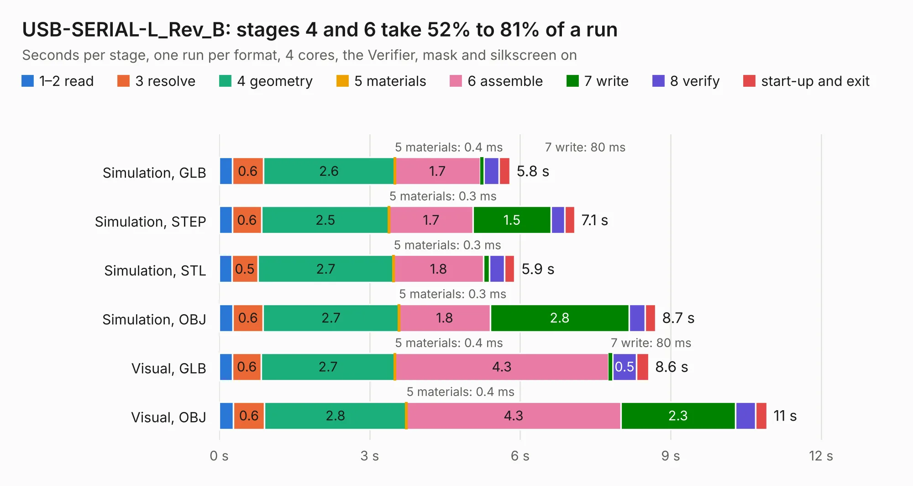

# 2005. USB-SERIAL-L_Rev_B

Board 2,005 of the 3,128 of [Corpus Testing](../Corpus-Testing.md), on [Corpus Page 19](../CorpusTestingPages/Corpus-Testing-19.md#2005-usb-serial-l_rev_b).

| Mode and format | 1–2 read | 3 resolve | 4 geometry | 5 materials | 6 assemble | 7 write | 8 verify | start-up and exit | Total |
|---|---:|---:|---:|---:|---:|---:|---:|---:|---:|
| Simulation, GLB | 0.3 | 0.6 | 2.6 | 0.4&nbsp;ms | 1.7 | 80&nbsp;ms | 0.3 | 0.2 | 5.8 |
| Simulation, STEP | 0.3 | 0.6 | 2.5 | 0.3&nbsp;ms | 1.7 | 1.5 | 0.3 | 0.2 | 7.1 |
| Simulation, STL | 0.3 | 0.5 | 2.7 | 0.3&nbsp;ms | 1.8 | 0.1 | 0.3 | 0.2 | 5.9 |
| Simulation, OBJ | 0.3 | 0.6 | 2.7 | 0.3&nbsp;ms | 1.8 | 2.8 | 0.3 | 0.2 | 8.7 |
| Visual, GLB | 0.3 | 0.6 | 2.7 | 0.4&nbsp;ms | 4.3 | 80&nbsp;ms | 0.5 | 0.2 | 8.6 |
| Visual, OBJ | 0.3 | 0.6 | 2.8 | 0.4&nbsp;ms | 4.3 | 2.3 | 0.4 | 0.2 | 10.9 |

<table align="center"><tr><td valign="top">

| Board | Repo: [OLIMEX/USB-SERIAL-L](https://github.com/OLIMEX/USB-SERIAL-L) Board: `USB-SERIAL-L_Rev_B.kicad_pcb` |
|---|---|
| Folder | HARDWARE / USB-SERIAL-L_Rev_B |
| Complexity | 280&nbsp;/&nbsp;1000 (size&nbsp;205, features&nbsp;75) |
| KESE&nbsp;features | through vias, slotted holes, filled zones, stack-up, dielectric εr and tanδ |
| Tested | 9th November 2026 |
| Copper&nbsp;layers | 2 |
| File&nbsp;format | KiCad 7 (20221018) |
| Parts,&nbsp;tracks,&nbsp;vias | 42, 517, 63 |
| Triangles,&nbsp;simulation | 509,116 in 52 parts |
| Verifier | PASS in all six runs |

</td><td valign="top">

<table>
<tr><th>File type</th><th>File size</th><th>Peak memory used</th></tr>
<tr><th colspan="3" align="left">Simulation</th></tr>
<tr><td>GLB</td><td align="right">18&nbsp;MB</td><td align="right">315&nbsp;MB</td></tr>
<tr><td>STEP</td><td align="right">95&nbsp;MB</td><td align="right">349&nbsp;MB</td></tr>
<tr><td>STL</td><td align="right">25&nbsp;MB</td><td align="right">314&nbsp;MB</td></tr>
<tr><td>OBJ</td><td align="right">53&nbsp;MB</td><td align="right">400&nbsp;MB</td></tr>
<tr><th colspan="3" align="left">Visual</th></tr>
<tr><td>GLB</td><td align="right">14&nbsp;MB</td><td align="right">359&nbsp;MB</td></tr>
<tr><td>OBJ</td><td align="right">41&nbsp;MB</td><td align="right">356&nbsp;MB</td></tr>
</table>

</td></tr></table>

| Previous | Next |
|:---|---:|
| [2004. usb-sata_Rev.A](b2004b_USB-SATA_usb-sata-Rev-A.md) | [2006. VGA2HDMI_Rev_C](b2006b_VGA2HDMI_VGA2HDMI-Rev-C.md) |
