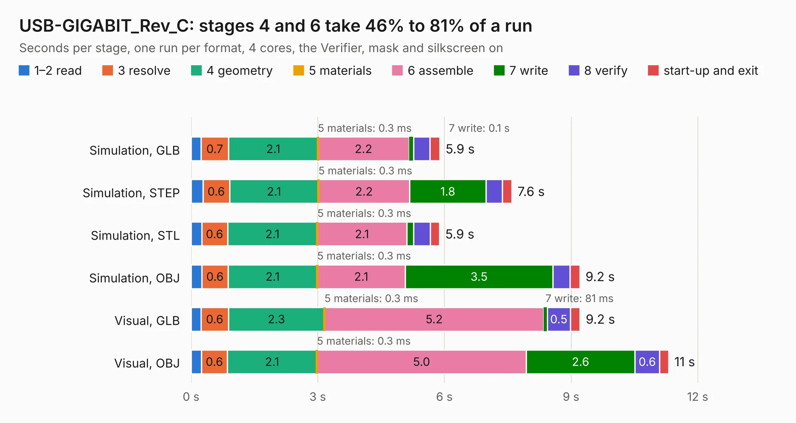

# 2006 USB-GIGABIT_Rev_C

Board 2,006 of the 3,138 of [Corpus Testing](../Corpus-Testing.md), on [Corpus Page 19](../CorpusTestingPages/Corpus-Testing-19.md#2006-usb-gigabit_rev_c).

| Mode and format | 1–2 read | 3 resolve | 4 geometry | 5 materials | 6 assemble | 7 write | 8 verify | start-up and exit | Total |
|---|---:|---:|---:|---:|---:|---:|---:|---:|---:|
| Simulation, GLB | 0.2 | 0.7 | 2.1 | 0.3&nbsp;ms | 2.2 | 0.1 | 0.4 | 0.2 | 5.9 |
| Simulation, STEP | 0.3 | 0.6 | 2.1 | 0.3&nbsp;ms | 2.2 | 1.8 | 0.4 | 0.2 | 7.6 |
| Simulation, STL | 0.3 | 0.6 | 2.1 | 0.3&nbsp;ms | 2.1 | 0.2 | 0.4 | 0.2 | 5.9 |
| Simulation, OBJ | 0.3 | 0.6 | 2.1 | 0.3&nbsp;ms | 2.1 | 3.5 | 0.4 | 0.2 | 9.2 |
| Visual, GLB | 0.2 | 0.6 | 2.3 | 0.3&nbsp;ms | 5.2 | 81&nbsp;ms | 0.5 | 0.2 | 9.2 |
| Visual, OBJ | 0.2 | 0.6 | 2.1 | 0.3&nbsp;ms | 5.0 | 2.6 | 0.6 | 0.2 | 11.3 |

<table align="center"><tr><td valign="top">

| Board | Repo: [OLIMEX/USB-GIGABIT](https://github.com/OLIMEX/USB-GIGABIT) Board: `USB-GIGABIT_Rev_C.kicad_pcb` |
|---|---|
| Folder | HARDWARE / USB-GIGABIT-Rev.C |
| Complexity | 269&nbsp;/&nbsp;1000 (size&nbsp;224, features&nbsp;45) |
| KESE&nbsp;features | through vias, slotted holes, filled zones |
| Tested | 9th November 2026 |
| Copper&nbsp;layers | 4 |
| File&nbsp;format | KiCad 6 (20190905) |
| Parts,&nbsp;tracks,&nbsp;vias | 48, 582, 54 |
| Triangles,&nbsp;simulation | 637,954 in 61 parts |
| Verifier | PASS in all six runs |

</td><td valign="top">

<table>
<tr><th>File type</th><th>File size</th><th>Peak memory used</th></tr>
<tr><th colspan="3" align="left">Simulation</th></tr>
<tr><td>GLB</td><td align="right">22&nbsp;MB</td><td align="right">335&nbsp;MB</td></tr>
<tr><td>STEP</td><td align="right">98&nbsp;MB</td><td align="right">371&nbsp;MB</td></tr>
<tr><td>STL</td><td align="right">32&nbsp;MB</td><td align="right">343&nbsp;MB</td></tr>
<tr><td>OBJ</td><td align="right">66&nbsp;MB</td><td align="right">470&nbsp;MB</td></tr>
<tr><th colspan="3" align="left">Visual</th></tr>
<tr><td>GLB</td><td align="right">16&nbsp;MB</td><td align="right">394&nbsp;MB</td></tr>
<tr><td>OBJ</td><td align="right">47&nbsp;MB</td><td align="right">410&nbsp;MB</td></tr>
</table>

</td></tr></table>

| Previous | Next |
|:---|---:|
| [2005 USB-4SERIAL_Rev_B](b2005b_USB-4SERIAL_USB-4SERIAL-Rev-B.md) | [2007 USB-GIGABIT_Rev_D](b2007b_USB-GIGABIT_USB-GIGABIT-Rev-D.md) |
