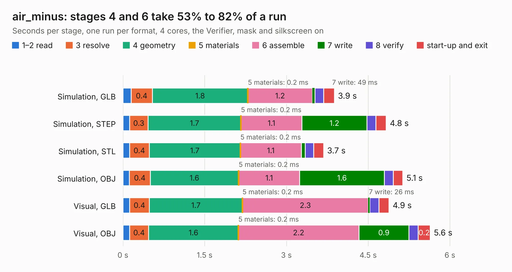

# 2006. air_minus

Board 2,006 of the 3,103 of [Corpus Testing](../Corpus-Testing.md), on [Corpus Page 19](../CorpusTestingPages/Corpus-Testing-19.md#2006-air_minus).

| Mode and format | 1–2 read | 3 resolve | 4 geometry | 5 materials | 6 assemble | 7 write | 8 verify | start-up and exit | Total |
|---|---:|---:|---:|---:|---:|---:|---:|---:|---:|
| Simulation, GLB | 0.1 | 0.4 | 1.8 | 0.2&nbsp;ms | 1.2 | 49&nbsp;ms | 0.2 | 0.2 | 3.9 |
| Simulation, STEP | 0.1 | 0.3 | 1.7 | 0.2&nbsp;ms | 1.1 | 1.2 | 0.2 | 0.2 | 4.8 |
| Simulation, STL | 0.1 | 0.4 | 1.7 | 0.2&nbsp;ms | 1.1 | 71&nbsp;ms | 0.2 | 0.2 | 3.7 |
| Simulation, OBJ | 0.1 | 0.4 | 1.6 | 0.2&nbsp;ms | 1.1 | 1.6 | 0.2 | 0.2 | 5.1 |
| Visual, GLB | 0.1 | 0.4 | 1.7 | 0.2&nbsp;ms | 2.3 | 26&nbsp;ms | 0.2 | 0.2 | 4.9 |
| Visual, OBJ | 0.1 | 0.4 | 1.6 | 0.2&nbsp;ms | 2.2 | 0.9 | 0.2 | 0.2 | 5.6 |

<table align="center"><tr><td valign="top">

| Board | Repo: [olin-electric-motorsports/olin-electric-motorsports](https://github.com/olin-electric-motorsports/olin-electric-motorsports) Board: `air_minus.kicad_pcb` |
|---|---|
| Folder | vehicle / mkv / hardware / service_section / airs / minus |
| Complexity | 135&nbsp;/&nbsp;1000 (size&nbsp;115, features&nbsp;20) |
| KESE&nbsp;features | rounded, trapezoid or chamfered pads, curved board outline |
| Tested | 9th November 2026 |
| Copper&nbsp;layers | 2 |
| File&nbsp;format | KiCad 6 (20211014) |
| Parts,&nbsp;tracks,&nbsp;vias | 12, 75, 0 |
| Triangles,&nbsp;simulation | 319,448 in 35 parts |
| Verifier | PASS in all six runs |

</td><td valign="top">

<table>
<tr><th>File type</th><th>File size</th><th>Peak memory used</th></tr>
<tr><th colspan="3" align="left">Simulation</th></tr>
<tr><td>GLB</td><td align="right">11&nbsp;MB</td><td align="right">238&nbsp;MB</td></tr>
<tr><td>STEP</td><td align="right">48&nbsp;MB</td><td align="right">261&nbsp;MB</td></tr>
<tr><td>STL</td><td align="right">16&nbsp;MB</td><td align="right">252&nbsp;MB</td></tr>
<tr><td>OBJ</td><td align="right">32&nbsp;MB</td><td align="right">249&nbsp;MB</td></tr>
<tr><th colspan="3" align="left">Visual</th></tr>
<tr><td>GLB</td><td align="right">5.7&nbsp;MB</td><td align="right">228&nbsp;MB</td></tr>
<tr><td>OBJ</td><td align="right">16&nbsp;MB</td><td align="right">222&nbsp;MB</td></tr>
</table>

</td></tr></table>

| Previous | Next |
|:---|---:|
| [2005. discharge](b2005b_olin-electric-motorsports_discharge.md) | [2007. air_plus](b2007b_olin-electric-motorsports_air-plus.md) |
