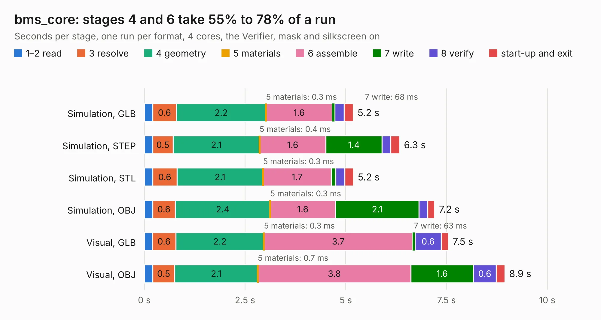

# 2007. bms_core

Board 2,007 of the 3,119 of [Corpus Testing](../Corpus-Testing.md), on [Corpus Page 19](../CorpusTestingPages/Corpus-Testing-19.md#2007-bms_core).

| Mode and format | 1–2 read | 3 resolve | 4 geometry | 5 materials | 6 assemble | 7 write | 8 verify | start-up and exit | Total |
|---|---:|---:|---:|---:|---:|---:|---:|---:|---:|
| Simulation, GLB | 0.2 | 0.6 | 2.2 | 0.3&nbsp;ms | 1.6 | 68&nbsp;ms | 0.2 | 0.2 | 5.2 |
| Simulation, STEP | 0.2 | 0.5 | 2.1 | 0.4&nbsp;ms | 1.6 | 1.4 | 0.2 | 0.2 | 6.3 |
| Simulation, STL | 0.2 | 0.6 | 2.1 | 0.3&nbsp;ms | 1.7 | 0.1 | 0.2 | 0.2 | 5.2 |
| Simulation, OBJ | 0.2 | 0.6 | 2.4 | 0.3&nbsp;ms | 1.6 | 2.1 | 0.2 | 0.2 | 7.2 |
| Visual, GLB | 0.2 | 0.6 | 2.2 | 0.3&nbsp;ms | 3.7 | 63&nbsp;ms | 0.6 | 0.2 | 7.5 |
| Visual, OBJ | 0.2 | 0.5 | 2.1 | 0.7&nbsp;ms | 3.8 | 1.6 | 0.6 | 0.2 | 8.9 |

<table align="center"><tr><td valign="top">

| Board | Repo: [olin-electric-motorsports/olin-electric-motorsports](https://github.com/olin-electric-motorsports/olin-electric-motorsports) Board: `bms_core.kicad_pcb` |
|---|---|
| Folder | vehicle / gokart / hardware / bms_core |
| Complexity | 258&nbsp;/&nbsp;1000 (size&nbsp;203, features&nbsp;55) |
| KESE&nbsp;features | through vias, rounded, trapezoid or chamfered pads, filled zones, curved board outline |
| Tested | 9th November 2026 |
| Copper&nbsp;layers | 2 |
| File&nbsp;format | KiCad 6 (20211014) |
| Parts,&nbsp;tracks,&nbsp;vias | 64, 375, 36 |
| Triangles,&nbsp;simulation | 483,212 in 77 parts |
| Verifier | PASS in all six runs |

</td><td valign="top">

<table>
<tr><th>File type</th><th>File size</th><th>Peak memory used</th></tr>
<tr><th colspan="3" align="left">Simulation</th></tr>
<tr><td>GLB</td><td align="right">18&nbsp;MB</td><td align="right">307&nbsp;MB</td></tr>
<tr><td>STEP</td><td align="right">83&nbsp;MB</td><td align="right">339&nbsp;MB</td></tr>
<tr><td>STL</td><td align="right">24&nbsp;MB</td><td align="right">301&nbsp;MB</td></tr>
<tr><td>OBJ</td><td align="right">51&nbsp;MB</td><td align="right">354&nbsp;MB</td></tr>
<tr><th colspan="3" align="left">Visual</th></tr>
<tr><td>GLB</td><td align="right">13&nbsp;MB</td><td align="right">332&nbsp;MB</td></tr>
<tr><td>OBJ</td><td align="right">37&nbsp;MB</td><td align="right">354&nbsp;MB</td></tr>
</table>

</td></tr></table>

| Previous | Next |
|:---|---:|
| [2006. telemetry_core](b2006b_olin-electric-motorsports_telemetry-core.md) | [2008. motor_ctrl_interface](b2008b_olin-electric-motorsports_motor-ctrl-interface.md) |
