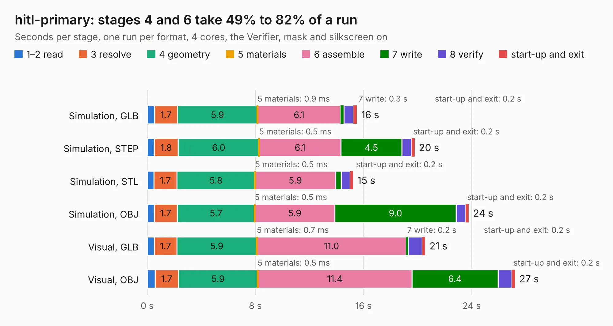

# 2008. hitl-primary

Board 2,008 of the 3,128 of [Corpus Testing](../Corpus-Testing.md), on [Corpus Page 19](../CorpusTestingPages/Corpus-Testing-19.md#2008-hitl-primary).

| Mode and format | 1–2 read | 3 resolve | 4 geometry | 5 materials | 6 assemble | 7 write | 8 verify | start-up and exit | Total |
|---|---:|---:|---:|---:|---:|---:|---:|---:|---:|
| Simulation, GLB | 0.5 | 1.7 | 5.9 | 0.9&nbsp;ms | 6.1 | 0.3 | 0.7 | 0.2 | 15.5 |
| Simulation, STEP | 0.5 | 1.8 | 6.0 | 0.5&nbsp;ms | 6.1 | 4.5 | 0.7 | 0.2 | 19.8 |
| Simulation, STL | 0.5 | 1.7 | 5.8 | 0.5&nbsp;ms | 5.9 | 0.4 | 0.7 | 0.2 | 15.2 |
| Simulation, OBJ | 0.5 | 1.7 | 5.7 | 0.5&nbsp;ms | 5.9 | 9.0 | 0.7 | 0.2 | 23.8 |
| Visual, GLB | 0.5 | 1.7 | 5.9 | 0.7&nbsp;ms | 11.0 | 0.2 | 1.0 | 0.2 | 20.6 |
| Visual, OBJ | 0.6 | 1.7 | 5.9 | 0.5&nbsp;ms | 11.4 | 6.4 | 1.0 | 0.2 | 27.2 |

<table align="center"><tr><td valign="top">

| Board | Repo: [olin-electric-motorsports/olin-electric-motorsports](https://github.com/olin-electric-motorsports/olin-electric-motorsports) Board: `hitl-primary.kicad_pcb` |
|---|---|
| Folder | projects / hitl / hitl / hardware / primary_board |
| Complexity | 388&nbsp;/&nbsp;1000 (size&nbsp;248, features&nbsp;140) |
| KESE&nbsp;features | through vias, slotted holes, custom pads, rounded, trapezoid or chamfered pads, arc tracks, filled zones, copper drawings, curved board outline, stack-up, dielectric εr and tanδ, mask and silkscreen colours |
| Tested | 9th November 2026 |
| Copper&nbsp;layers | 4 |
| File&nbsp;format | KiCad 6 (20211014) |
| Parts,&nbsp;tracks,&nbsp;vias | 121, 1,290, 177 |
| Triangles,&nbsp;simulation | 1,750,536 in 141 parts |
| Verifier | PASS in all six runs |

</td><td valign="top">

<table>
<tr><th>File type</th><th>File size</th><th>Peak memory used</th></tr>
<tr><th colspan="3" align="left">Simulation</th></tr>
<tr><td>GLB</td><td align="right">58&nbsp;MB</td><td align="right">649&nbsp;MB</td></tr>
<tr><td>STEP</td><td align="right">231&nbsp;MB</td><td align="right">779&nbsp;MB</td></tr>
<tr><td>STL</td><td align="right">88&nbsp;MB</td><td align="right">657&nbsp;MB</td></tr>
<tr><td>OBJ</td><td align="right">181&nbsp;MB</td><td align="right">1.2&nbsp;GB</td></tr>
<tr><th colspan="3" align="left">Visual</th></tr>
<tr><td>GLB</td><td align="right">40&nbsp;MB</td><td align="right">812&nbsp;MB</td></tr>
<tr><td>OBJ</td><td align="right">122&nbsp;MB</td><td align="right">856&nbsp;MB</td></tr>
</table>

</td></tr></table>

| Previous | Next |
|:---|---:|
| [2007. firmware_tester_board](b2007b_olin-electric-motorsports_firmware-tester-board.md) | [2009. breakout_pcie](b2009b_olin-electric-motorsports_breakout-pcie.md) |
