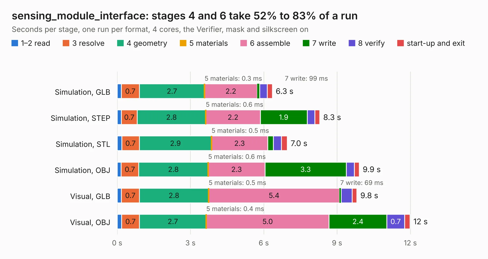

# 2009. sensing_module_interface

Board 2,009 of the 3,109 of [Corpus Testing](../Corpus-Testing.md), on [Corpus Page 19](../CorpusTestingPages/Corpus-Testing-19.md#2009-sensing_module_interface).

| Mode and format | 1–2 read | 3 resolve | 4 geometry | 5 materials | 6 assemble | 7 write | 8 verify | start-up and exit | Total |
|---|---:|---:|---:|---:|---:|---:|---:|---:|---:|
| Simulation, GLB | 0.2 | 0.7 | 2.7 | 0.3&nbsp;ms | 2.2 | 99&nbsp;ms | 0.3 | 0.2 | 6.3 |
| Simulation, STEP | 0.2 | 0.7 | 2.8 | 0.6&nbsp;ms | 2.2 | 1.9 | 0.3 | 0.2 | 8.3 |
| Simulation, STL | 0.2 | 0.7 | 2.9 | 0.5&nbsp;ms | 2.3 | 0.2 | 0.3 | 0.2 | 7.0 |
| Simulation, OBJ | 0.2 | 0.7 | 2.8 | 0.6&nbsp;ms | 2.3 | 3.3 | 0.3 | 0.2 | 9.9 |
| Visual, GLB | 0.2 | 0.7 | 2.8 | 0.5&nbsp;ms | 5.4 | 69&nbsp;ms | 0.5 | 0.2 | 9.8 |
| Visual, OBJ | 0.2 | 0.7 | 2.7 | 0.4&nbsp;ms | 5.0 | 2.4 | 0.7 | 0.2 | 12.0 |

<table align="center"><tr><td valign="top">

| Board | Repo: [olin-electric-motorsports/olin-electric-motorsports](https://github.com/olin-electric-motorsports/olin-electric-motorsports) Board: `sensing_module_interface.kicad_pcb` |
|---|---|
| Folder | vehicle / mkv / hardware / sensing / controller |
| Complexity | 200&nbsp;/&nbsp;1000 (size&nbsp;155, features&nbsp;45) |
| KESE&nbsp;features | through vias, filled zones, curved board outline |
| Tested | 9th November 2026 |
| Copper&nbsp;layers | 2 |
| File&nbsp;format | KiCad 6 (20211014) |
| Parts,&nbsp;tracks,&nbsp;vias | 17, 543, 42 |
| Triangles,&nbsp;simulation | 810,508 in 45 parts |
| Verifier | PASS in all six runs |

</td><td valign="top">

<table>
<tr><th>File type</th><th>File size</th><th>Peak memory used</th></tr>
<tr><th colspan="3" align="left">Simulation</th></tr>
<tr><td>GLB</td><td align="right">28&nbsp;MB</td><td align="right">397&nbsp;MB</td></tr>
<tr><td>STEP</td><td align="right">130&nbsp;MB</td><td align="right">437&nbsp;MB</td></tr>
<tr><td>STL</td><td align="right">41&nbsp;MB</td><td align="right">413&nbsp;MB</td></tr>
<tr><td>OBJ</td><td align="right">83&nbsp;MB</td><td align="right">579&nbsp;MB</td></tr>
<tr><th colspan="3" align="left">Visual</th></tr>
<tr><td>GLB</td><td align="right">18&nbsp;MB</td><td align="right">458&nbsp;MB</td></tr>
<tr><td>OBJ</td><td align="right">55&nbsp;MB</td><td align="right">460&nbsp;MB</td></tr>
</table>

</td></tr></table>

| Previous | Next |
|:---|---:|
| [2008. accelerometer](b2008b_olin-electric-motorsports_accelerometer.md) | [2010. sensing_controller1](b2010b_olin-electric-motorsports_sensing-controller1.md) |
