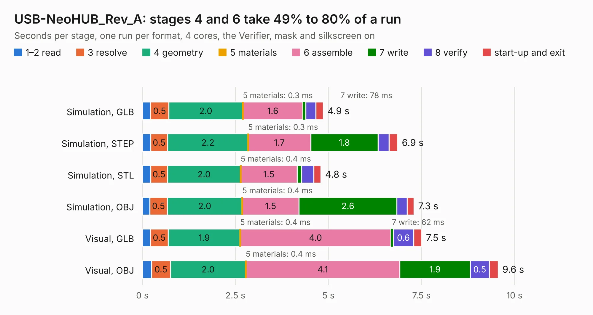

# 2011 USB-NeoHUB_Rev_A

Board 2,011 of the 3,138 of [Corpus Testing](../Corpus-Testing.md), on [Corpus Page 19](../CorpusTestingPages/Corpus-Testing-19.md#2011-usb-neohub_rev_a).

| Mode and format | 1–2 read | 3 resolve | 4 geometry | 5 materials | 6 assemble | 7 write | 8 verify | start-up and exit | Total |
|---|---:|---:|---:|---:|---:|---:|---:|---:|---:|
| Simulation, GLB | 0.2 | 0.5 | 2.0 | 0.3&nbsp;ms | 1.6 | 78&nbsp;ms | 0.3 | 0.2 | 4.9 |
| Simulation, STEP | 0.2 | 0.5 | 2.2 | 0.3&nbsp;ms | 1.7 | 1.8 | 0.3 | 0.2 | 6.9 |
| Simulation, STL | 0.2 | 0.5 | 2.0 | 0.4&nbsp;ms | 1.5 | 0.1 | 0.3 | 0.2 | 4.8 |
| Simulation, OBJ | 0.2 | 0.5 | 2.0 | 0.4&nbsp;ms | 1.5 | 2.6 | 0.3 | 0.2 | 7.3 |
| Visual, GLB | 0.2 | 0.5 | 1.9 | 0.4&nbsp;ms | 4.0 | 62&nbsp;ms | 0.6 | 0.2 | 7.5 |
| Visual, OBJ | 0.2 | 0.5 | 2.0 | 0.4&nbsp;ms | 4.1 | 1.9 | 0.5 | 0.2 | 9.6 |

<table align="center"><tr><td valign="top">

| Board | Repo: [OLIMEX/USB-NeoHub](https://github.com/OLIMEX/USB-NeoHub) Board: `USB-NeoHUB_Rev_A.kicad_pcb` |
|---|---|
| Folder | HARDWARE / USB-NeoHub-Rev.A |
| Complexity | 233&nbsp;/&nbsp;1000 (size&nbsp;158, features&nbsp;75) |
| KESE&nbsp;features | through vias, slotted holes, filled zones, stack-up, dielectric εr and tanδ |
| Tested | 9th November 2026 |
| Copper&nbsp;layers | 2 |
| File&nbsp;format | KiCad 7 (20221018) |
| Parts,&nbsp;tracks,&nbsp;vias | 23, 433, 75 |
| Triangles,&nbsp;simulation | 478,372 in 51 parts |
| Verifier | PASS in all six runs |

</td><td valign="top">

<table>
<tr><th>File type</th><th>File size</th><th>Peak memory used</th></tr>
<tr><th colspan="3" align="left">Simulation</th></tr>
<tr><td>GLB</td><td align="right">17&nbsp;MB</td><td align="right">300&nbsp;MB</td></tr>
<tr><td>STEP</td><td align="right">88&nbsp;MB</td><td align="right">324&nbsp;MB</td></tr>
<tr><td>STL</td><td align="right">24&nbsp;MB</td><td align="right">307&nbsp;MB</td></tr>
<tr><td>OBJ</td><td align="right">50&nbsp;MB</td><td align="right">376&nbsp;MB</td></tr>
<tr><th colspan="3" align="left">Visual</th></tr>
<tr><td>GLB</td><td align="right">13&nbsp;MB</td><td align="right">327&nbsp;MB</td></tr>
<tr><td>OBJ</td><td align="right">39&nbsp;MB</td><td align="right">342&nbsp;MB</td></tr>
</table>

</td></tr></table>

| Previous | Next |
|:---|---:|
| [2010 USB-gLINK_Rev_D](b2010b_USB-gLINK_USB-gLINK-Rev-D.md) | [2012 usb-sata_Rev.A](b2012b_USB-SATA_usb-sata-Rev-A.md) |
