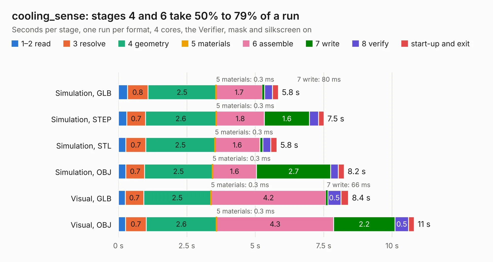

# 2012. cooling_sense

Board 2,012 of the 3,117 of [Corpus Testing](../Corpus-Testing.md), on [Corpus Page 19](../CorpusTestingPages/Corpus-Testing-19.md#2012-cooling_sense).

| Mode and format | 1–2 read | 3 resolve | 4 geometry | 5 materials | 6 assemble | 7 write | 8 verify | start-up and exit | Total |
|---|---:|---:|---:|---:|---:|---:|---:|---:|---:|
| Simulation, GLB | 0.3 | 0.8 | 2.5 | 0.3&nbsp;ms | 1.7 | 80&nbsp;ms | 0.3 | 0.2 | 5.8 |
| Simulation, STEP | 0.3 | 0.7 | 2.6 | 0.3&nbsp;ms | 1.8 | 1.6 | 0.3 | 0.2 | 7.5 |
| Simulation, STL | 0.3 | 0.7 | 2.5 | 0.3&nbsp;ms | 1.6 | 0.1 | 0.3 | 0.2 | 5.8 |
| Simulation, OBJ | 0.3 | 0.7 | 2.5 | 0.3&nbsp;ms | 1.6 | 2.7 | 0.3 | 0.2 | 8.2 |
| Visual, GLB | 0.2 | 0.7 | 2.5 | 0.3&nbsp;ms | 4.2 | 66&nbsp;ms | 0.5 | 0.3 | 8.4 |
| Visual, OBJ | 0.3 | 0.7 | 2.6 | 0.3&nbsp;ms | 4.3 | 2.2 | 0.5 | 0.2 | 10.8 |

<table align="center"><tr><td valign="top">

| Board | Repo: [olin-electric-motorsports/olin-electric-motorsports](https://github.com/olin-electric-motorsports/olin-electric-motorsports) Board: `cooling_sense.kicad_pcb` |
|---|---|
| Folder | vehicle / mkv / hardware / lvbox / cooling |
| Complexity | 242&nbsp;/&nbsp;1000 (size&nbsp;207, features&nbsp;35) |
| KESE&nbsp;features | through vias, rounded, trapezoid or chamfered pads, curved board outline |
| Tested | 9th November 2026 |
| Copper&nbsp;layers | 2 |
| File&nbsp;format | KiCad 6 (20211014) |
| Parts,&nbsp;tracks,&nbsp;vias | 51, 554, 55 |
| Triangles,&nbsp;simulation | 488,928 in 59 parts |
| Verifier | PASS in all six runs |

</td><td valign="top">

<table>
<tr><th>File type</th><th>File size</th><th>Peak memory used</th></tr>
<tr><th colspan="3" align="left">Simulation</th></tr>
<tr><td>GLB</td><td align="right">18&nbsp;MB</td><td align="right">311&nbsp;MB</td></tr>
<tr><td>STEP</td><td align="right">88&nbsp;MB</td><td align="right">338&nbsp;MB</td></tr>
<tr><td>STL</td><td align="right">24&nbsp;MB</td><td align="right">323&nbsp;MB</td></tr>
<tr><td>OBJ</td><td align="right">51&nbsp;MB</td><td align="right">384&nbsp;MB</td></tr>
<tr><th colspan="3" align="left">Visual</th></tr>
<tr><td>GLB</td><td align="right">14&nbsp;MB</td><td align="right">357&nbsp;MB</td></tr>
<tr><td>OBJ</td><td align="right">41&nbsp;MB</td><td align="right">363&nbsp;MB</td></tr>
</table>

</td></tr></table>

| Previous | Next |
|:---|---:|
| [2011. bspd_brakelight](b2011b_olin-electric-motorsports_bspd-brakelight.md) | [2013. lv_interface](b2013b_olin-electric-motorsports_lv-interface.md) |
