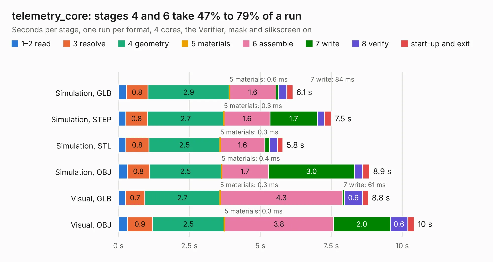

# 2012. telemetry_core

Board 2,012 of the 3,128 of [Corpus Testing](../Corpus-Testing.md), on [Corpus Page 19](../CorpusTestingPages/Corpus-Testing-19.md#2012-telemetry_core).

| Mode and format | 1–2 read | 3 resolve | 4 geometry | 5 materials | 6 assemble | 7 write | 8 verify | start-up and exit | Total |
|---|---:|---:|---:|---:|---:|---:|---:|---:|---:|
| Simulation, GLB | 0.3 | 0.8 | 2.9 | 0.6&nbsp;ms | 1.6 | 84&nbsp;ms | 0.3 | 0.2 | 6.1 |
| Simulation, STEP | 0.3 | 0.8 | 2.7 | 0.3&nbsp;ms | 1.6 | 1.7 | 0.2 | 0.2 | 7.5 |
| Simulation, STL | 0.3 | 0.8 | 2.5 | 0.3&nbsp;ms | 1.6 | 0.2 | 0.3 | 0.2 | 5.8 |
| Simulation, OBJ | 0.3 | 0.8 | 2.5 | 0.4&nbsp;ms | 1.7 | 3.0 | 0.3 | 0.3 | 8.9 |
| Visual, GLB | 0.3 | 0.7 | 2.7 | 0.3&nbsp;ms | 4.3 | 61&nbsp;ms | 0.6 | 0.2 | 8.8 |
| Visual, OBJ | 0.3 | 0.9 | 2.5 | 0.3&nbsp;ms | 3.8 | 2.0 | 0.6 | 0.2 | 10.4 |

<table align="center"><tr><td valign="top">

| Board | Repo: [olin-electric-motorsports/olin-electric-motorsports](https://github.com/olin-electric-motorsports/olin-electric-motorsports) Board: `telemetry_core.kicad_pcb` |
|---|---|
| Folder | projects / telemetry / telemetry_core |
| Complexity | 259&nbsp;/&nbsp;1000 (size&nbsp;204, features&nbsp;55) |
| KESE&nbsp;features | through vias, rounded, trapezoid or chamfered pads, filled zones, curved board outline |
| Tested | 9th November 2026 |
| Copper&nbsp;layers | 2 |
| File&nbsp;format | KiCad 6 (20211014) |
| Parts,&nbsp;tracks,&nbsp;vias | 51, 413, 54 |
| Triangles,&nbsp;simulation | 511,422 in 72 parts |
| Verifier | PASS in all six runs |

</td><td valign="top">

<table>
<tr><th>File type</th><th>File size</th><th>Peak memory used</th></tr>
<tr><th colspan="3" align="left">Simulation</th></tr>
<tr><td>GLB</td><td align="right">18&nbsp;MB</td><td align="right">329&nbsp;MB</td></tr>
<tr><td>STEP</td><td align="right">90&nbsp;MB</td><td align="right">335&nbsp;MB</td></tr>
<tr><td>STL</td><td align="right">26&nbsp;MB</td><td align="right">318&nbsp;MB</td></tr>
<tr><td>OBJ</td><td align="right">54&nbsp;MB</td><td align="right">399&nbsp;MB</td></tr>
<tr><th colspan="3" align="left">Visual</th></tr>
<tr><td>GLB</td><td align="right">13&nbsp;MB</td><td align="right">346&nbsp;MB</td></tr>
<tr><td>OBJ</td><td align="right">40&nbsp;MB</td><td align="right">356&nbsp;MB</td></tr>
</table>

</td></tr></table>

| Previous | Next |
|:---|---:|
| [2011. imu](b2011b_olin-electric-motorsports_projects-telemetry-imu_imu.md) | [2013. bms_core](b2013b_olin-electric-motorsports_vehicle-gokart-hardware-bms-core_bms-core.md) |
