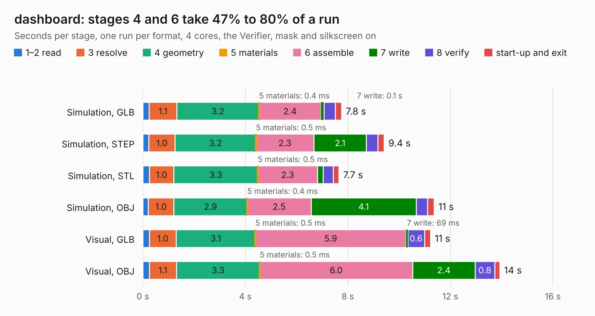

# 2012. dashboard

Board 2,012 of the 3,121 of [Corpus Testing](../Corpus-Testing.md), on [Corpus Page 19](../CorpusTestingPages/Corpus-Testing-19.md#2012-dashboard).

| Mode and format | 1–2 read | 3 resolve | 4 geometry | 5 materials | 6 assemble | 7 write | 8 verify | start-up and exit | Total |
|---|---:|---:|---:|---:|---:|---:|---:|---:|---:|
| Simulation, GLB | 0.2 | 1.1 | 3.2 | 0.4&nbsp;ms | 2.4 | 0.1 | 0.4 | 0.2 | 7.8 |
| Simulation, STEP | 0.2 | 1.0 | 3.2 | 0.5&nbsp;ms | 2.3 | 2.1 | 0.5 | 0.2 | 9.4 |
| Simulation, STL | 0.3 | 1.0 | 3.3 | 0.5&nbsp;ms | 2.3 | 0.2 | 0.4 | 0.2 | 7.7 |
| Simulation, OBJ | 0.2 | 1.0 | 2.9 | 0.4&nbsp;ms | 2.5 | 4.1 | 0.4 | 0.3 | 11.4 |
| Visual, GLB | 0.3 | 1.0 | 3.1 | 0.5&nbsp;ms | 5.9 | 69&nbsp;ms | 0.6 | 0.2 | 11.2 |
| Visual, OBJ | 0.3 | 1.1 | 3.3 | 0.5&nbsp;ms | 6.0 | 2.4 | 0.8 | 0.2 | 13.9 |

<table align="center"><tr><td valign="top">

| Board | Repo: [olin-electric-motorsports/olin-electric-motorsports](https://github.com/olin-electric-motorsports/olin-electric-motorsports) Board: `dashboard.kicad_pcb` |
|---|---|
| Folder | vehicle / mkv / hardware / dashboard / dux |
| Complexity | 282&nbsp;/&nbsp;1000 (size&nbsp;237, features&nbsp;45) |
| KESE&nbsp;features | through vias, rounded, trapezoid or chamfered pads, filled zones |
| Tested | 9th November 2026 |
| Copper&nbsp;layers | 4 |
| File&nbsp;format | KiCad 6 (20211014) |
| Parts,&nbsp;tracks,&nbsp;vias | 65, 683, 69 |
| Triangles,&nbsp;simulation | 856,406 in 101 parts |
| Verifier | PASS in all six runs |

</td><td valign="top">

<table>
<tr><th>File type</th><th>File size</th><th>Peak memory used</th></tr>
<tr><th colspan="3" align="left">Simulation</th></tr>
<tr><td>GLB</td><td align="right">30&nbsp;MB</td><td align="right">366&nbsp;MB</td></tr>
<tr><td>STEP</td><td align="right">124&nbsp;MB</td><td align="right">413&nbsp;MB</td></tr>
<tr><td>STL</td><td align="right">43&nbsp;MB</td><td align="right">352&nbsp;MB</td></tr>
<tr><td>OBJ</td><td align="right">89&nbsp;MB</td><td align="right">611&nbsp;MB</td></tr>
<tr><th colspan="3" align="left">Visual</th></tr>
<tr><td>GLB</td><td align="right">18&nbsp;MB</td><td align="right">432&nbsp;MB</td></tr>
<tr><td>OBJ</td><td align="right">54&nbsp;MB</td><td align="right">463&nbsp;MB</td></tr>
</table>

</td></tr></table>

| Previous | Next |
|:---|---:|
| [2011. throttle](b2011b_olin-electric-motorsports_vehicle-gokart-hardware-throttle_throttle.md) | [2013. interface](b2013b_olin-electric-motorsports_interface.md) |
