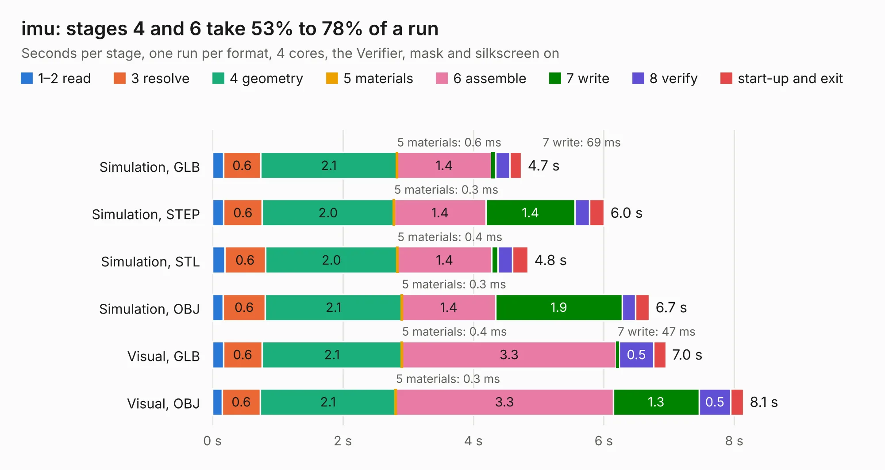

# 2013. imu

Board 2,013 of the 3,130 of [Corpus Testing](../Corpus-Testing.md), on [Corpus Page 19](../CorpusTestingPages/Corpus-Testing-19.md#2013-imu).

| Mode and format | 1–2 read | 3 resolve | 4 geometry | 5 materials | 6 assemble | 7 write | 8 verify | start-up and exit | Total |
|---|---:|---:|---:|---:|---:|---:|---:|---:|---:|
| Simulation, GLB | 0.2 | 0.6 | 2.1 | 0.6&nbsp;ms | 1.4 | 69&nbsp;ms | 0.2 | 0.2 | 4.7 |
| Simulation, STEP | 0.2 | 0.6 | 2.0 | 0.3&nbsp;ms | 1.4 | 1.4 | 0.2 | 0.2 | 6.0 |
| Simulation, STL | 0.2 | 0.6 | 2.0 | 0.4&nbsp;ms | 1.4 | 95&nbsp;ms | 0.2 | 0.2 | 4.8 |
| Simulation, OBJ | 0.2 | 0.6 | 2.1 | 0.3&nbsp;ms | 1.4 | 1.9 | 0.2 | 0.2 | 6.7 |
| Visual, GLB | 0.2 | 0.6 | 2.1 | 0.4&nbsp;ms | 3.3 | 47&nbsp;ms | 0.5 | 0.2 | 7.0 |
| Visual, OBJ | 0.1 | 0.6 | 2.1 | 0.3&nbsp;ms | 3.3 | 1.3 | 0.5 | 0.2 | 8.1 |

<table align="center"><tr><td valign="top">

| Board | Repo: [olin-electric-motorsports/olin-electric-motorsports](https://github.com/olin-electric-motorsports/olin-electric-motorsports) Board: `imu.kicad_pcb` |
|---|---|
| Folder | projects / telemetry / imu |
| Complexity | 282&nbsp;/&nbsp;1000 (size&nbsp;202, features&nbsp;80) |
| KESE&nbsp;features | through vias, custom pads, rounded, trapezoid or chamfered pads, filled zones, copper drawings, curved board outline |
| Tested | 9th November 2026 |
| Copper&nbsp;layers | 2 |
| File&nbsp;format | KiCad 6 (20211014) |
| Parts,&nbsp;tracks,&nbsp;vias | 46, 411, 45 |
| Triangles,&nbsp;simulation | 480,786 in 73 parts |
| Verifier | PASS in all six runs |

</td><td valign="top">

<table>
<tr><th>File type</th><th>File size</th><th>Peak memory used</th></tr>
<tr><th colspan="3" align="left">Simulation</th></tr>
<tr><td>GLB</td><td align="right">17&nbsp;MB</td><td align="right">302&nbsp;MB</td></tr>
<tr><td>STEP</td><td align="right">83&nbsp;MB</td><td align="right">326&nbsp;MB</td></tr>
<tr><td>STL</td><td align="right">24&nbsp;MB</td><td align="right">293&nbsp;MB</td></tr>
<tr><td>OBJ</td><td align="right">50&nbsp;MB</td><td align="right">378&nbsp;MB</td></tr>
<tr><th colspan="3" align="left">Visual</th></tr>
<tr><td>GLB</td><td align="right">12&nbsp;MB</td><td align="right">316&nbsp;MB</td></tr>
<tr><td>OBJ</td><td align="right">34&nbsp;MB</td><td align="right">312&nbsp;MB</td></tr>
</table>

</td></tr></table>

| Previous | Next |
|:---|---:|
| [2012. pcie_x1_passthrough](b2012b_olin-electric-motorsports_pcie-x1-passthrough.md) | [2014. telemetry_core](b2014b_olin-electric-motorsports_telemetry-core.md) |
