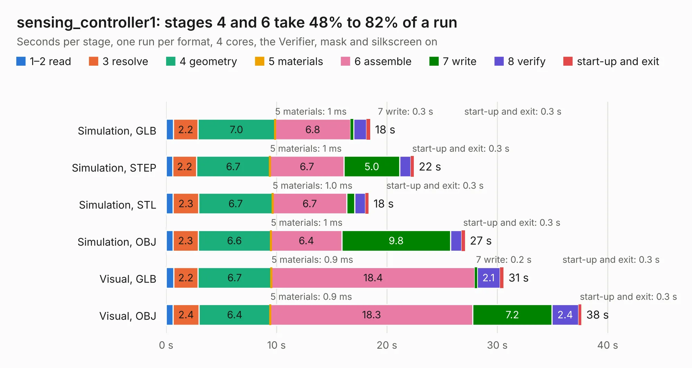

# 2013. sensing_controller1

Board 2,013 of the 3,112 of [Corpus Testing](../Corpus-Testing.md), on [Corpus Page 19](../CorpusTestingPages/Corpus-Testing-19.md#2013-sensing_controller1).

| Mode and format | 1–2 read | 3 resolve | 4 geometry | 5 materials | 6 assemble | 7 write | 8 verify | start-up and exit | Total |
|---|---:|---:|---:|---:|---:|---:|---:|---:|---:|
| Simulation, GLB | 0.7 | 2.2 | 7.0 | 1&nbsp;ms | 6.8 | 0.3 | 1.2 | 0.3 | 18.5 |
| Simulation, STEP | 0.6 | 2.2 | 6.7 | 1&nbsp;ms | 6.7 | 5.0 | 1.0 | 0.3 | 22.4 |
| Simulation, STL | 0.6 | 2.3 | 6.7 | 1.0&nbsp;ms | 6.7 | 0.7 | 1.0 | 0.3 | 18.3 |
| Simulation, OBJ | 0.6 | 2.3 | 6.6 | 1&nbsp;ms | 6.4 | 9.8 | 1.0 | 0.3 | 27.1 |
| Visual, GLB | 0.7 | 2.2 | 6.7 | 0.9&nbsp;ms | 18.4 | 0.2 | 2.1 | 0.3 | 30.6 |
| Visual, OBJ | 0.6 | 2.4 | 6.4 | 0.9&nbsp;ms | 18.3 | 7.2 | 2.4 | 0.3 | 37.6 |

<table align="center"><tr><td valign="top">

| Board | Repo: [olin-electric-motorsports/olin-electric-motorsports](https://github.com/olin-electric-motorsports/olin-electric-motorsports) Board: `sensing_controller1.kicad_pcb` |
|---|---|
| Folder | vehicle / mkv / hardware / sensing_controller |
| Complexity | 348&nbsp;/&nbsp;1000 (size&nbsp;263, features&nbsp;85) |
| KESE&nbsp;features | through vias, rounded, trapezoid or chamfered pads, filled zones, curved board outline, stack-up, dielectric εr and tanδ |
| Tested | 9th November 2026 |
| Copper&nbsp;layers | 4 |
| File&nbsp;format | KiCad 6 (20211014) |
| Parts,&nbsp;tracks,&nbsp;vias | 183, 1,732, 190 |
| Triangles,&nbsp;simulation | 1,872,730 in 204 parts |
| Verifier | PASS in all six runs |

</td><td valign="top">

<table>
<tr><th>File type</th><th>File size</th><th>Peak memory used</th></tr>
<tr><th colspan="3" align="left">Simulation</th></tr>
<tr><td>GLB</td><td align="right">64&nbsp;MB</td><td align="right">672&nbsp;MB</td></tr>
<tr><td>STEP</td><td align="right">292&nbsp;MB</td><td align="right">840&nbsp;MB</td></tr>
<tr><td>STL</td><td align="right">94&nbsp;MB</td><td align="right">715&nbsp;MB</td></tr>
<tr><td>OBJ</td><td align="right">197&nbsp;MB</td><td align="right">1.3&nbsp;GB</td></tr>
<tr><th colspan="3" align="left">Visual</th></tr>
<tr><td>GLB</td><td align="right">44&nbsp;MB</td><td align="right">826&nbsp;MB</td></tr>
<tr><td>OBJ</td><td align="right">136&nbsp;MB</td><td align="right">988&nbsp;MB</td></tr>
</table>

</td></tr></table>

| Previous | Next |
|:---|---:|
| [2012. sensing_module_interface](b2012b_olin-electric-motorsports_sensing-module-interface.md) | [2014. discharge](b2014b_olin-electric-motorsports_discharge.md) |
