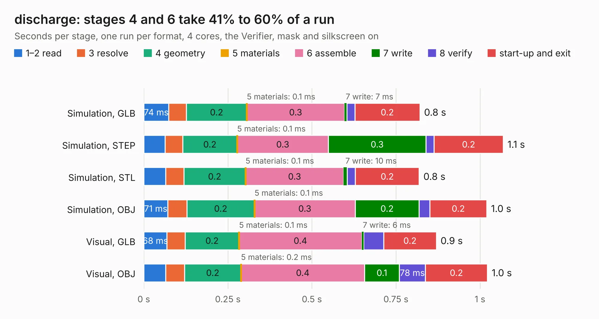

# 2014. discharge

Board 2,014 of the 3,112 of [Corpus Testing](../Corpus-Testing.md), on [Corpus Page 19](../CorpusTestingPages/Corpus-Testing-19.md#2014-discharge).

| Mode and format | 1–2 read | 3 resolve | 4 geometry | 5 materials | 6 assemble | 7 write | 8 verify | start-up and exit | Total |
|---|---:|---:|---:|---:|---:|---:|---:|---:|---:|
| Simulation, GLB | 74&nbsp;ms | 53&nbsp;ms | 0.2 | 0.1&nbsp;ms | 0.3 | 7&nbsp;ms | 24&nbsp;ms | 0.2 | 0.8 |
| Simulation, STEP | 63&nbsp;ms | 53&nbsp;ms | 0.2 | 0.1&nbsp;ms | 0.3 | 0.3 | 24&nbsp;ms | 0.2 | 1.1 |
| Simulation, STL | 65&nbsp;ms | 54&nbsp;ms | 0.2 | 0.1&nbsp;ms | 0.3 | 10&nbsp;ms | 24&nbsp;ms | 0.2 | 0.8 |
| Simulation, OBJ | 71&nbsp;ms | 57&nbsp;ms | 0.2 | 0.1&nbsp;ms | 0.3 | 0.2 | 32&nbsp;ms | 0.2 | 1.0 |
| Visual, GLB | 68&nbsp;ms | 54&nbsp;ms | 0.2 | 0.1&nbsp;ms | 0.4 | 6&nbsp;ms | 59&nbsp;ms | 0.2 | 0.9 |
| Visual, OBJ | 65&nbsp;ms | 56&nbsp;ms | 0.2 | 0.2&nbsp;ms | 0.4 | 0.1 | 78&nbsp;ms | 0.2 | 1.0 |

<table align="center"><tr><td valign="top">

| Board | Repo: [olin-electric-motorsports/olin-electric-motorsports](https://github.com/olin-electric-motorsports/olin-electric-motorsports) Board: `discharge.kicad_pcb` |
|---|---|
| Folder | vehicle / mkv / hardware / service_section / airs / discharge |
| Complexity | 47&nbsp;/&nbsp;1000 (size&nbsp;47, features&nbsp;0) |
| Tested | 9th November 2026 |
| Copper&nbsp;layers | 2 |
| File&nbsp;format | KiCad 6 (20211014) |
| Parts,&nbsp;tracks,&nbsp;vias | 1, 3, 0 |
| Triangles,&nbsp;simulation | 41,376 in 13 parts |
| Verifier | PASS in all six runs |

</td><td valign="top">

<table>
<tr><th>File type</th><th>File size</th><th>Peak memory used</th></tr>
<tr><th colspan="3" align="left">Simulation</th></tr>
<tr><td>GLB</td><td align="right">1.4&nbsp;MB</td><td align="right">66&nbsp;MB</td></tr>
<tr><td>STEP</td><td align="right">6.2&nbsp;MB</td><td align="right">69&nbsp;MB</td></tr>
<tr><td>STL</td><td align="right">2.1&nbsp;MB</td><td align="right">68&nbsp;MB</td></tr>
<tr><td>OBJ</td><td align="right">3.9&nbsp;MB</td><td align="right">84&nbsp;MB</td></tr>
<tr><th colspan="3" align="left">Visual</th></tr>
<tr><td>GLB</td><td align="right">756&nbsp;kB</td><td align="right">115&nbsp;MB</td></tr>
<tr><td>OBJ</td><td align="right">2.0&nbsp;MB</td><td align="right">103&nbsp;MB</td></tr>
</table>

</td></tr></table>

| Previous | Next |
|:---|---:|
| [2013. sensing_controller1](b2013b_olin-electric-motorsports_sensing-controller1.md) | [2015. air_minus](b2015b_olin-electric-motorsports_air-minus.md) |
