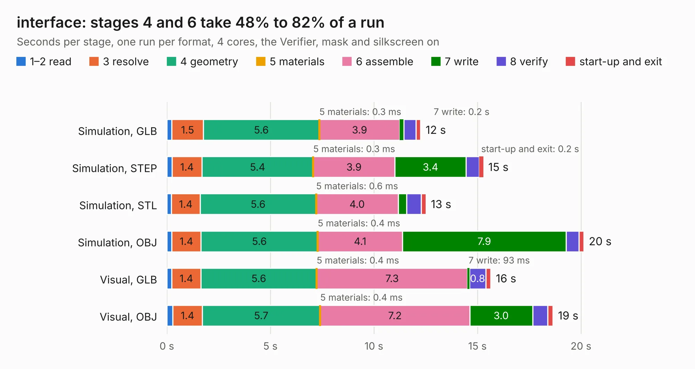

# 2014. interface

Board 2,014 of the 3,122 of [Corpus Testing](../Corpus-Testing.md), on [Corpus Page 19](../CorpusTestingPages/Corpus-Testing-19.md#2014-interface).

| Mode and format | 1–2 read | 3 resolve | 4 geometry | 5 materials | 6 assemble | 7 write | 8 verify | start-up and exit | Total |
|---|---:|---:|---:|---:|---:|---:|---:|---:|---:|
| Simulation, GLB | 0.2 | 1.5 | 5.6 | 0.3&nbsp;ms | 3.9 | 0.2 | 0.6 | 0.2 | 12.3 |
| Simulation, STEP | 0.3 | 1.4 | 5.4 | 0.3&nbsp;ms | 3.9 | 3.4 | 0.6 | 0.2 | 15.3 |
| Simulation, STL | 0.2 | 1.4 | 5.6 | 0.6&nbsp;ms | 4.0 | 0.4 | 0.7 | 0.2 | 12.5 |
| Simulation, OBJ | 0.2 | 1.4 | 5.6 | 0.4&nbsp;ms | 4.1 | 7.9 | 0.6 | 0.2 | 20.1 |
| Visual, GLB | 0.2 | 1.4 | 5.6 | 0.4&nbsp;ms | 7.3 | 93&nbsp;ms | 0.8 | 0.2 | 15.6 |
| Visual, OBJ | 0.3 | 1.4 | 5.7 | 0.4&nbsp;ms | 7.2 | 3.0 | 0.7 | 0.3 | 18.6 |

<table align="center"><tr><td valign="top">

| Board | Repo: [olin-electric-motorsports/olin-electric-motorsports](https://github.com/olin-electric-motorsports/olin-electric-motorsports) Board: `interface.kicad_pcb` |
|---|---|
| Folder | vehicle / mkv / hardware / dashboard / dux_interface |
| Complexity | 237&nbsp;/&nbsp;1000 (size&nbsp;167, features&nbsp;70) |
| KESE&nbsp;features | through vias, custom pads, rounded, trapezoid or chamfered pads, filled zones, copper drawings |
| Tested | 9th November 2026 |
| Copper&nbsp;layers | 4 |
| File&nbsp;format | KiCad 6 (20211014) |
| Parts,&nbsp;tracks,&nbsp;vias | 15, 515, 10 |
| Triangles,&nbsp;simulation | 1,329,794 in 61 parts |
| Verifier | PASS in all six runs |

</td><td valign="top">

<table>
<tr><th>File type</th><th>File size</th><th>Peak memory used</th></tr>
<tr><th colspan="3" align="left">Simulation</th></tr>
<tr><td>GLB</td><td align="right">46&nbsp;MB</td><td align="right">489&nbsp;MB</td></tr>
<tr><td>STEP</td><td align="right">181&nbsp;MB</td><td align="right">545&nbsp;MB</td></tr>
<tr><td>STL</td><td align="right">66&nbsp;MB</td><td align="right">486&nbsp;MB</td></tr>
<tr><td>OBJ</td><td align="right">138&nbsp;MB</td><td align="right">923&nbsp;MB</td></tr>
<tr><th colspan="3" align="left">Visual</th></tr>
<tr><td>GLB</td><td align="right">20&nbsp;MB</td><td align="right">531&nbsp;MB</td></tr>
<tr><td>OBJ</td><td align="right">59&nbsp;MB</td><td align="right">514&nbsp;MB</td></tr>
</table>

</td></tr></table>

| Previous | Next |
|:---|---:|
| [2013. dashboard](b2013b_olin-electric-motorsports_vehicle-mkv-hardware-dashboard-dux_dashboard.md) | [2015. throttle](b2015b_olin-electric-motorsports_vehicle-mkv-hardware-dashboard-throttle_throttle.md) |
