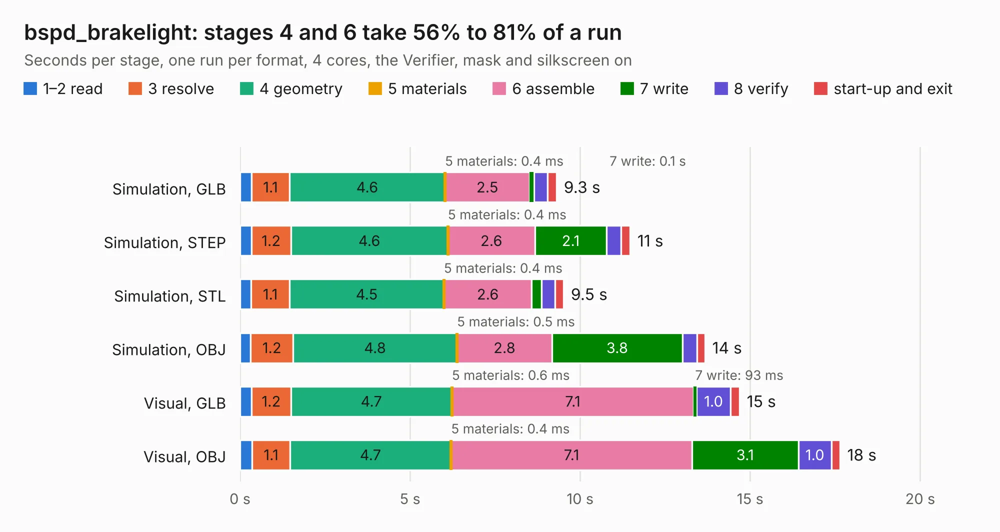

# 2015. bspd_brakelight

Board 2,015 of the 3,121 of [Corpus Testing](../Corpus-Testing.md), on [Corpus Page 19](../CorpusTestingPages/Corpus-Testing-19.md#2015-bspd_brakelight).

| Mode and format | 1–2 read | 3 resolve | 4 geometry | 5 materials | 6 assemble | 7 write | 8 verify | start-up and exit | Total |
|---|---:|---:|---:|---:|---:|---:|---:|---:|---:|
| Simulation, GLB | 0.3 | 1.1 | 4.6 | 0.4&nbsp;ms | 2.5 | 0.1 | 0.4 | 0.3 | 9.3 |
| Simulation, STEP | 0.3 | 1.2 | 4.6 | 0.4&nbsp;ms | 2.6 | 2.1 | 0.4 | 0.3 | 11.5 |
| Simulation, STL | 0.3 | 1.1 | 4.5 | 0.4&nbsp;ms | 2.6 | 0.3 | 0.4 | 0.3 | 9.5 |
| Simulation, OBJ | 0.3 | 1.2 | 4.8 | 0.5&nbsp;ms | 2.8 | 3.8 | 0.4 | 0.2 | 13.7 |
| Visual, GLB | 0.3 | 1.2 | 4.7 | 0.6&nbsp;ms | 7.1 | 93&nbsp;ms | 1.0 | 0.3 | 14.7 |
| Visual, OBJ | 0.4 | 1.1 | 4.7 | 0.4&nbsp;ms | 7.1 | 3.1 | 1.0 | 0.3 | 17.6 |

<table align="center"><tr><td valign="top">

| Board | Repo: [olin-electric-motorsports/olin-electric-motorsports](https://github.com/olin-electric-motorsports/olin-electric-motorsports) Board: `bspd_brakelight.kicad_pcb` |
|---|---|
| Folder | vehicle / mkv / hardware / lvbox / bspd |
| Complexity | 277&nbsp;/&nbsp;1000 (size&nbsp;222, features&nbsp;55) |
| KESE&nbsp;features | through vias, rounded, trapezoid or chamfered pads, filled zones, curved board outline |
| Tested | 9th November 2026 |
| Copper&nbsp;layers | 2 |
| File&nbsp;format | KiCad 6 (20211014) |
| Parts,&nbsp;tracks,&nbsp;vias | 86, 1,018, 71 |
| Triangles,&nbsp;simulation | 626,612 in 79 parts |
| Verifier | PASS in all six runs |

</td><td valign="top">

<table>
<tr><th>File type</th><th>File size</th><th>Peak memory used</th></tr>
<tr><th colspan="3" align="left">Simulation</th></tr>
<tr><td>GLB</td><td align="right">23&nbsp;MB</td><td align="right">379&nbsp;MB</td></tr>
<tr><td>STEP</td><td align="right">106&nbsp;MB</td><td align="right">437&nbsp;MB</td></tr>
<tr><td>STL</td><td align="right">31&nbsp;MB</td><td align="right">377&nbsp;MB</td></tr>
<tr><td>OBJ</td><td align="right">67&nbsp;MB</td><td align="right">495&nbsp;MB</td></tr>
<tr><th colspan="3" align="left">Visual</th></tr>
<tr><td>GLB</td><td align="right">19&nbsp;MB</td><td align="right">437&nbsp;MB</td></tr>
<tr><td>OBJ</td><td align="right">55&nbsp;MB</td><td align="right">473&nbsp;MB</td></tr>
</table>

</td></tr></table>

| Previous | Next |
|:---|---:|
| [2014. throttle](b2014b_olin-electric-motorsports_vehicle-mkv-hardware-dashboard-throttle_throttle.md) | [2016. cooling_sense](b2016b_olin-electric-motorsports_cooling-sense.md) |
