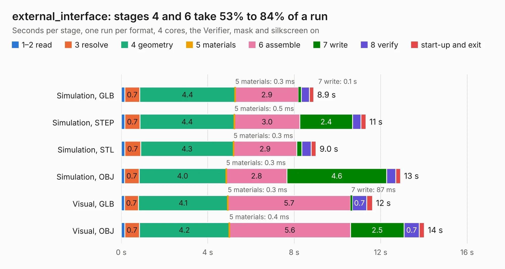

# 2015. external_interface

Board 2,015 of the 3,106 of [Corpus Testing](../Corpus-Testing.md), on [Corpus Page 19](../CorpusTestingPages/Corpus-Testing-19.md#2015-external_interface).

| Mode and format | 1–2 read | 3 resolve | 4 geometry | 5 materials | 6 assemble | 7 write | 8 verify | start-up and exit | Total |
|---|---:|---:|---:|---:|---:|---:|---:|---:|---:|
| Simulation, GLB | 0.2 | 0.7 | 4.4 | 0.3&nbsp;ms | 2.9 | 0.1 | 0.4 | 0.2 | 8.9 |
| Simulation, STEP | 0.2 | 0.7 | 4.4 | 0.5&nbsp;ms | 3.0 | 2.4 | 0.4 | 0.2 | 11.3 |
| Simulation, STL | 0.2 | 0.7 | 4.3 | 0.3&nbsp;ms | 2.9 | 0.2 | 0.4 | 0.2 | 9.0 |
| Simulation, OBJ | 0.2 | 0.7 | 4.0 | 0.3&nbsp;ms | 2.8 | 4.6 | 0.4 | 0.2 | 12.9 |
| Visual, GLB | 0.1 | 0.7 | 4.1 | 0.3&nbsp;ms | 5.7 | 87&nbsp;ms | 0.7 | 0.3 | 11.6 |
| Visual, OBJ | 0.2 | 0.7 | 4.2 | 0.4&nbsp;ms | 5.6 | 2.5 | 0.7 | 0.2 | 14.0 |

<table align="center"><tr><td valign="top">

| Board | Repo: [olin-electric-motorsports/olin-electric-motorsports](https://github.com/olin-electric-motorsports/olin-electric-motorsports) Board: `external_interface.kicad_pcb` |
|---|---|
| Folder | vehicle / mkv / hardware / service_section / interface / external |
| Complexity | 157&nbsp;/&nbsp;1000 (size&nbsp;127, features&nbsp;30) |
| KESE&nbsp;features | filled zones, curved board outline |
| Tested | 9th November 2026 |
| Copper&nbsp;layers | 2 |
| File&nbsp;format | KiCad 6 (20211014) |
| Parts,&nbsp;tracks,&nbsp;vias | 6, 227, 0 |
| Triangles,&nbsp;simulation | 797,256 in 52 parts |
| Verifier | PASS in all six runs |

</td><td valign="top">

<table>
<tr><th>File type</th><th>File size</th><th>Peak memory used</th></tr>
<tr><th colspan="3" align="left">Simulation</th></tr>
<tr><td>GLB</td><td align="right">27&nbsp;MB</td><td align="right">368&nbsp;MB</td></tr>
<tr><td>STEP</td><td align="right">134&nbsp;MB</td><td align="right">439&nbsp;MB</td></tr>
<tr><td>STL</td><td align="right">40&nbsp;MB</td><td align="right">376&nbsp;MB</td></tr>
<tr><td>OBJ</td><td align="right">82&nbsp;MB</td><td align="right">589&nbsp;MB</td></tr>
<tr><th colspan="3" align="left">Visual</th></tr>
<tr><td>GLB</td><td align="right">15&nbsp;MB</td><td align="right">417&nbsp;MB</td></tr>
<tr><td>OBJ</td><td align="right">44&nbsp;MB</td><td align="right">422&nbsp;MB</td></tr>
</table>

</td></tr></table>

| Previous | Next |
|:---|---:|
| [2014. bms_core](b2014b_olin-electric-motorsports_vehicle-mkv-hardware-service-section-controller_bms-core.md) | [2016. internal_interface](b2016b_olin-electric-motorsports_internal-interface.md) |
