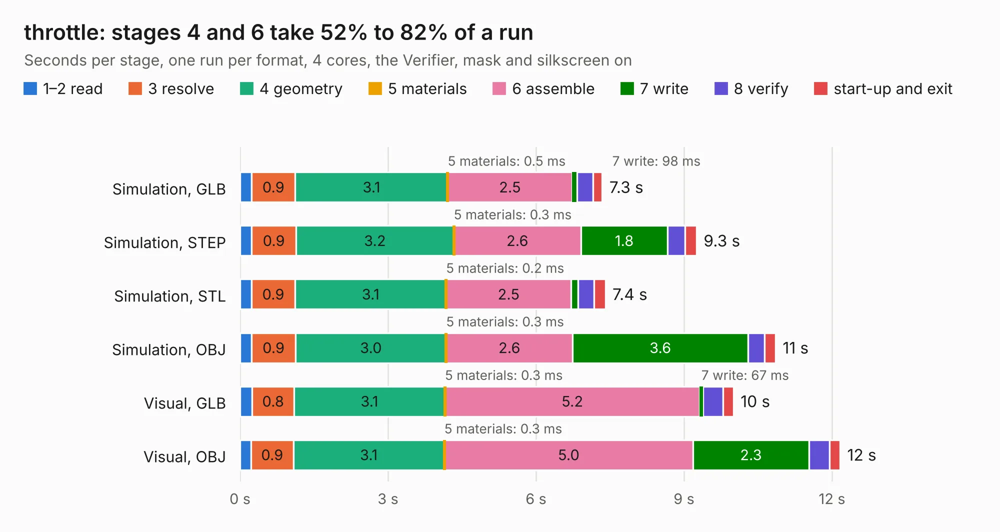

# 2015. throttle

Board 2,015 of the 3,122 of [Corpus Testing](../Corpus-Testing.md), on [Corpus Page 19](../CorpusTestingPages/Corpus-Testing-19.md#2015-throttle).

| Mode and format | 1–2 read | 3 resolve | 4 geometry | 5 materials | 6 assemble | 7 write | 8 verify | start-up and exit | Total |
|---|---:|---:|---:|---:|---:|---:|---:|---:|---:|
| Simulation, GLB | 0.2 | 0.9 | 3.1 | 0.5&nbsp;ms | 2.5 | 98&nbsp;ms | 0.3 | 0.2 | 7.3 |
| Simulation, STEP | 0.2 | 0.9 | 3.2 | 0.3&nbsp;ms | 2.6 | 1.8 | 0.4 | 0.2 | 9.3 |
| Simulation, STL | 0.2 | 0.9 | 3.1 | 0.2&nbsp;ms | 2.5 | 0.1 | 0.3 | 0.2 | 7.4 |
| Simulation, OBJ | 0.2 | 0.9 | 3.0 | 0.3&nbsp;ms | 2.6 | 3.6 | 0.3 | 0.2 | 10.9 |
| Visual, GLB | 0.2 | 0.8 | 3.1 | 0.3&nbsp;ms | 5.2 | 67&nbsp;ms | 0.4 | 0.2 | 10.0 |
| Visual, OBJ | 0.2 | 0.9 | 3.1 | 0.3&nbsp;ms | 5.0 | 2.3 | 0.4 | 0.2 | 12.2 |

<table align="center"><tr><td valign="top">

| Board | Repo: [olin-electric-motorsports/olin-electric-motorsports](https://github.com/olin-electric-motorsports/olin-electric-motorsports) Board: `throttle.kicad_pcb` |
|---|---|
| Folder | vehicle / mkv / hardware / dashboard / throttle |
| Complexity | 277&nbsp;/&nbsp;1000 (size&nbsp;232, features&nbsp;45) |
| KESE&nbsp;features | through vias, rounded, trapezoid or chamfered pads, filled zones |
| Tested | 9th November 2026 |
| Copper&nbsp;layers | 4 |
| File&nbsp;format | KiCad 6 (20211014) |
| Parts,&nbsp;tracks,&nbsp;vias | 68, 810, 47 |
| Triangles,&nbsp;simulation | 647,824 in 76 parts |
| Verifier | PASS in all six runs |

</td><td valign="top">

<table>
<tr><th>File type</th><th>File size</th><th>Peak memory used</th></tr>
<tr><th colspan="3" align="left">Simulation</th></tr>
<tr><td>GLB</td><td align="right">23&nbsp;MB</td><td align="right">329&nbsp;MB</td></tr>
<tr><td>STEP</td><td align="right">98&nbsp;MB</td><td align="right">390&nbsp;MB</td></tr>
<tr><td>STL</td><td align="right">32&nbsp;MB</td><td align="right">324&nbsp;MB</td></tr>
<tr><td>OBJ</td><td align="right">68&nbsp;MB</td><td align="right">449&nbsp;MB</td></tr>
<tr><th colspan="3" align="left">Visual</th></tr>
<tr><td>GLB</td><td align="right">15&nbsp;MB</td><td align="right">392&nbsp;MB</td></tr>
<tr><td>OBJ</td><td align="right">45&nbsp;MB</td><td align="right">395&nbsp;MB</td></tr>
</table>

</td></tr></table>

| Previous | Next |
|:---|---:|
| [2014. interface](b2014b_olin-electric-motorsports_interface.md) | [2016. bspd_brakelight](b2016b_olin-electric-motorsports_bspd-brakelight.md) |
