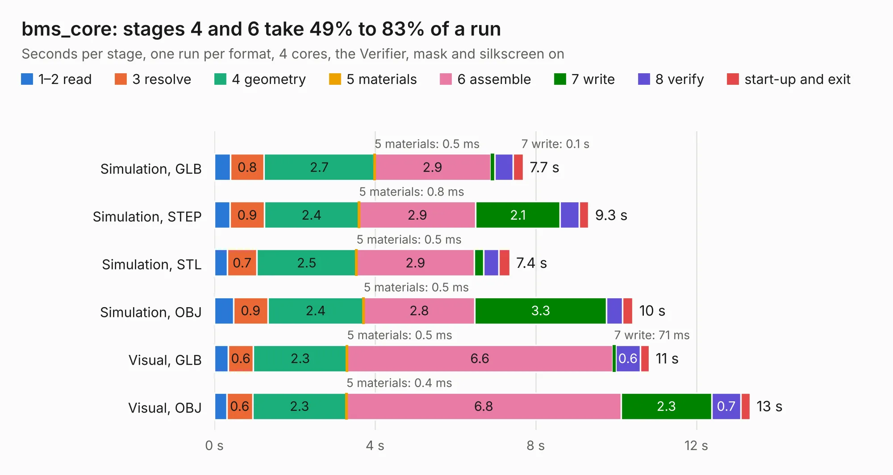

# 2015. bms_core

Board 2,015 of the 3,101 of [Corpus Testing](../Corpus-Testing.md), on [Corpus Page 19](../CorpusTestingPages/Corpus-Testing-19.md#2015-bms_core).

| Mode and format | 1–2 read | 3 resolve | 4 geometry | 5 materials | 6 assemble | 7 write | 8 verify | start-up and exit | Total |
|---|---:|---:|---:|---:|---:|---:|---:|---:|---:|
| Simulation, GLB | 0.4 | 0.8 | 2.7 | 0.5&nbsp;ms | 2.9 | 0.1 | 0.5 | 0.3 | 7.7 |
| Simulation, STEP | 0.4 | 0.9 | 2.4 | 0.8&nbsp;ms | 2.9 | 2.1 | 0.5 | 0.2 | 9.3 |
| Simulation, STL | 0.3 | 0.7 | 2.5 | 0.5&nbsp;ms | 2.9 | 0.2 | 0.4 | 0.3 | 7.4 |
| Simulation, OBJ | 0.5 | 0.9 | 2.4 | 0.5&nbsp;ms | 2.8 | 3.3 | 0.4 | 0.3 | 10.4 |
| Visual, GLB | 0.3 | 0.6 | 2.3 | 0.5&nbsp;ms | 6.6 | 71&nbsp;ms | 0.6 | 0.2 | 10.8 |
| Visual, OBJ | 0.3 | 0.6 | 2.3 | 0.4&nbsp;ms | 6.8 | 2.3 | 0.7 | 0.2 | 13.3 |

<table align="center"><tr><td valign="top">

| Board | Repo: [olin-electric-motorsports/olin-electric-motorsports](https://github.com/olin-electric-motorsports/olin-electric-motorsports) Board: `bms_core.kicad_pcb` |
|---|---|
| Folder | vehicle / mkvi / hardware / bms / bms_core |
| Complexity | 315&nbsp;/&nbsp;1000 (size&nbsp;225, features&nbsp;90) |
| KESE&nbsp;features | through vias, rounded, trapezoid or chamfered pads, filled zones, curved board outline, stack-up, dielectric εr and tanδ, mask and silkscreen colours |
| Tested | 9th November 2026 |
| Copper&nbsp;layers | 4 |
| File&nbsp;format | KiCad 7 (20221018) |
| Parts,&nbsp;tracks,&nbsp;vias | 50, 542, 75 |
| Triangles,&nbsp;simulation | 621,672 in 125 parts |
| Verifier | PASS in all six runs |

</td><td valign="top">

<table>
<tr><th>File type</th><th>File size</th><th>Peak memory used</th></tr>
<tr><th colspan="3" align="left">Simulation</th></tr>
<tr><td>GLB</td><td align="right">21&nbsp;MB</td><td align="right">326&nbsp;MB</td></tr>
<tr><td>STEP</td><td align="right">91&nbsp;MB</td><td align="right">397&nbsp;MB</td></tr>
<tr><td>STL</td><td align="right">31&nbsp;MB</td><td align="right">323&nbsp;MB</td></tr>
<tr><td>OBJ</td><td align="right">64&nbsp;MB</td><td align="right">467&nbsp;MB</td></tr>
<tr><th colspan="3" align="left">Visual</th></tr>
<tr><td>GLB</td><td align="right">15&nbsp;MB</td><td align="right">426&nbsp;MB</td></tr>
<tr><td>OBJ</td><td align="right">44&nbsp;MB</td><td align="right">427&nbsp;MB</td></tr>
</table>

</td></tr></table>

| Previous | Next |
|:---|---:|
| [2014. service_section_controller](b2014b_olin-electric-motorsports_service-section-controller.md) | [2016. bms_csc](b2016b_olin-electric-motorsports_vehicle-mkvi-hardware-bms-bms-csc_bms-csc.md) |
