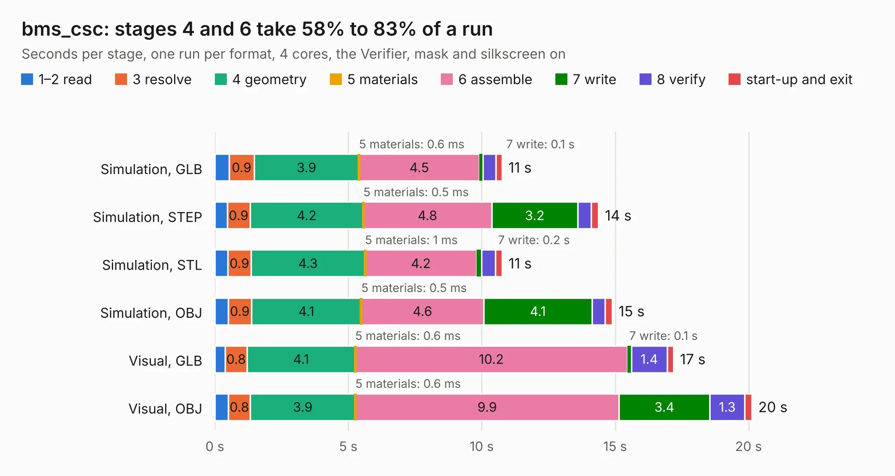

# 2017. bms_csc

Board 2,017 of the 3,102 of [Corpus Testing](../Corpus-Testing.md), on [Corpus Page 19](../CorpusTestingPages/Corpus-Testing-19.md#2017-bms_csc).

| Mode and format | 1–2 read | 3 resolve | 4 geometry | 5 materials | 6 assemble | 7 write | 8 verify | start-up and exit | Total |
|---|---:|---:|---:|---:|---:|---:|---:|---:|---:|
| Simulation, GLB | 0.5 | 0.9 | 3.9 | 0.6&nbsp;ms | 4.5 | 0.1 | 0.5 | 0.2 | 10.8 |
| Simulation, STEP | 0.5 | 0.9 | 4.2 | 0.5&nbsp;ms | 4.8 | 3.2 | 0.5 | 0.3 | 14.4 |
| Simulation, STL | 0.5 | 0.9 | 4.3 | 1&nbsp;ms | 4.2 | 0.2 | 0.5 | 0.3 | 10.8 |
| Simulation, OBJ | 0.5 | 0.9 | 4.1 | 0.5&nbsp;ms | 4.6 | 4.1 | 0.5 | 0.3 | 14.9 |
| Visual, GLB | 0.4 | 0.8 | 4.1 | 0.6&nbsp;ms | 10.2 | 0.1 | 1.4 | 0.2 | 17.2 |
| Visual, OBJ | 0.5 | 0.8 | 3.9 | 0.6&nbsp;ms | 9.9 | 3.4 | 1.3 | 0.3 | 20.1 |

<table align="center"><tr><td valign="top">

| Board | Repo: [olin-electric-motorsports/olin-electric-motorsports](https://github.com/olin-electric-motorsports/olin-electric-motorsports) Board: `bms_csc.kicad_pcb` |
|---|---|
| Folder | vehicle / mkvi / hardware / bms / bms_csc |
| Complexity | 349&nbsp;/&nbsp;1000 (size&nbsp;234, features&nbsp;115) |
| KESE&nbsp;features | through vias, custom pads, rounded, trapezoid or chamfered pads, filled zones, copper drawings, curved board outline, stack-up, dielectric εr and tanδ, mask and silkscreen colours |
| Tested | 9th November 2026 |
| Copper&nbsp;layers | 2 |
| File&nbsp;format | KiCad 7 (20221018) |
| Parts,&nbsp;tracks,&nbsp;vias | 133, 1,535, 128 |
| Triangles,&nbsp;simulation | 863,206 in 168 parts |
| Verifier | PASS in all six runs |

</td><td valign="top">

<table>
<tr><th>File type</th><th>File size</th><th>Peak memory used</th></tr>
<tr><th colspan="3" align="left">Simulation</th></tr>
<tr><td>GLB</td><td align="right">31&nbsp;MB</td><td align="right">485&nbsp;MB</td></tr>
<tr><td>STEP</td><td align="right">172&nbsp;MB</td><td align="right">529&nbsp;MB</td></tr>
<tr><td>STL</td><td align="right">43&nbsp;MB</td><td align="right">475&nbsp;MB</td></tr>
<tr><td>OBJ</td><td align="right">90&nbsp;MB</td><td align="right">632&nbsp;MB</td></tr>
<tr><th colspan="3" align="left">Visual</th></tr>
<tr><td>GLB</td><td align="right">28&nbsp;MB</td><td align="right">566&nbsp;MB</td></tr>
<tr><td>OBJ</td><td align="right">84&nbsp;MB</td><td align="right">697&nbsp;MB</td></tr>
</table>

</td></tr></table>

| Previous | Next |
|:---|---:|
| [2016. bms_core](b2016b_olin-electric-motorsports_vehicle-mkvi-hardware-bms-bms-core_bms-core.md) | [2018. bms_csc](b2018b_olin-electric-motorsports_vehicle-mkvi-hardware-bms-bms-csc-rev-1_bms-csc.md) |
