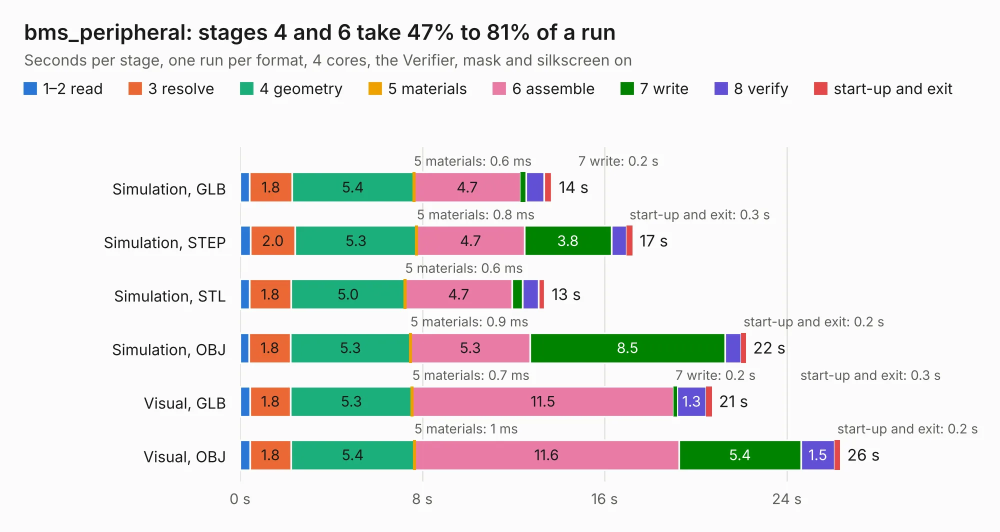

# 2018. bms_peripheral

Board 2,018 of the 3,107 of [Corpus Testing](../Corpus-Testing.md), on [Corpus Page 19](../CorpusTestingPages/Corpus-Testing-19.md#2018-bms_peripheral).

| Mode and format | 1–2 read | 3 resolve | 4 geometry | 5 materials | 6 assemble | 7 write | 8 verify | start-up and exit | Total |
|---|---:|---:|---:|---:|---:|---:|---:|---:|---:|
| Simulation, GLB | 0.4 | 1.8 | 5.4 | 0.6&nbsp;ms | 4.7 | 0.2 | 0.8 | 0.3 | 13.7 |
| Simulation, STEP | 0.5 | 2.0 | 5.3 | 0.8&nbsp;ms | 4.7 | 3.8 | 0.7 | 0.3 | 17.2 |
| Simulation, STL | 0.4 | 1.8 | 5.0 | 0.6&nbsp;ms | 4.7 | 0.4 | 0.7 | 0.3 | 13.4 |
| Simulation, OBJ | 0.4 | 1.8 | 5.3 | 0.9&nbsp;ms | 5.3 | 8.5 | 0.7 | 0.2 | 22.2 |
| Visual, GLB | 0.4 | 1.8 | 5.3 | 0.7&nbsp;ms | 11.5 | 0.2 | 1.3 | 0.3 | 20.7 |
| Visual, OBJ | 0.4 | 1.8 | 5.4 | 1&nbsp;ms | 11.6 | 5.4 | 1.5 | 0.2 | 26.3 |

<table align="center"><tr><td valign="top">

| Board | Repo: [olin-electric-motorsports/olin-electric-motorsports](https://github.com/olin-electric-motorsports/olin-electric-motorsports) Board: `bms_peripheral.kicad_pcb` |
|---|---|
| Folder | vehicle / mkv / hardware / service_section / peripheral |
| Complexity | 302&nbsp;/&nbsp;1000 (size&nbsp;257, features&nbsp;45) |
| KESE&nbsp;features | through vias, filled zones, curved board outline |
| Tested | 9th November 2026 |
| Copper&nbsp;layers | 4 |
| File&nbsp;format | KiCad 6 (20211014) |
| Parts,&nbsp;tracks,&nbsp;vias | 133, 1,467, 152 |
| Triangles,&nbsp;simulation | 1,351,570 in 178 parts |
| Verifier | PASS in all six runs |

</td><td valign="top">

<table>
<tr><th>File type</th><th>File size</th><th>Peak memory used</th></tr>
<tr><th colspan="3" align="left">Simulation</th></tr>
<tr><td>GLB</td><td align="right">47&nbsp;MB</td><td align="right">510&nbsp;MB</td></tr>
<tr><td>STEP</td><td align="right">175&nbsp;MB</td><td align="right">662&nbsp;MB</td></tr>
<tr><td>STL</td><td align="right">68&nbsp;MB</td><td align="right">534&nbsp;MB</td></tr>
<tr><td>OBJ</td><td align="right">140&nbsp;MB</td><td align="right">959&nbsp;MB</td></tr>
<tr><th colspan="3" align="left">Visual</th></tr>
<tr><td>GLB</td><td align="right">31&nbsp;MB</td><td align="right">662&nbsp;MB</td></tr>
<tr><td>OBJ</td><td align="right">97&nbsp;MB</td><td align="right">746&nbsp;MB</td></tr>
</table>

</td></tr></table>

| Previous | Next |
|:---|---:|
| [2017. internal_interface](b2017b_olin-electric-motorsports_internal-interface.md) | [2019. bms_peripheral_v2](b2019b_olin-electric-motorsports_bms-peripheral-v2.md) |
