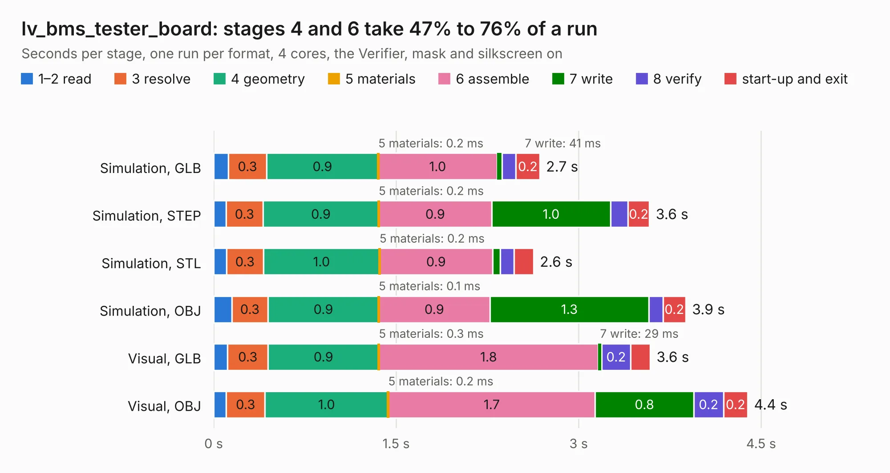

# 2022. lv_bms_tester_board

Board 2,022 of the 3,125 of [Corpus Testing](../Corpus-Testing.md), on [Corpus Page 19](../CorpusTestingPages/Corpus-Testing-19.md#2022-lv_bms_tester_board).

| Mode and format | 1–2 read | 3 resolve | 4 geometry | 5 materials | 6 assemble | 7 write | 8 verify | start-up and exit | Total |
|---|---:|---:|---:|---:|---:|---:|---:|---:|---:|
| Simulation, GLB | 0.1 | 0.3 | 0.9 | 0.2&nbsp;ms | 1.0 | 41&nbsp;ms | 0.1 | 0.2 | 2.7 |
| Simulation, STEP | 0.1 | 0.3 | 0.9 | 0.2&nbsp;ms | 0.9 | 1.0 | 0.1 | 0.2 | 3.6 |
| Simulation, STL | 0.1 | 0.3 | 1.0 | 0.2&nbsp;ms | 0.9 | 64&nbsp;ms | 0.1 | 0.2 | 2.6 |
| Simulation, OBJ | 0.1 | 0.3 | 0.9 | 0.1&nbsp;ms | 0.9 | 1.3 | 0.1 | 0.2 | 3.9 |
| Visual, GLB | 0.1 | 0.3 | 0.9 | 0.3&nbsp;ms | 1.8 | 29&nbsp;ms | 0.2 | 0.2 | 3.6 |
| Visual, OBJ | 0.1 | 0.3 | 1.0 | 0.2&nbsp;ms | 1.7 | 0.8 | 0.2 | 0.2 | 4.4 |

<table align="center"><tr><td valign="top">

| Board | Repo: [olin-electric-motorsports/olin-electric-motorsports](https://github.com/olin-electric-motorsports/olin-electric-motorsports) Board: `lv_bms_tester_board.kicad_pcb` |
|---|---|
| Folder | vehicle / mkv / hardware / lvbox / lvbms / tester_board |
| Complexity | 202&nbsp;/&nbsp;1000 (size&nbsp;147, features&nbsp;55) |
| KESE&nbsp;features | through vias, rounded, trapezoid or chamfered pads, filled zones, curved board outline |
| Tested | 9th November 2026 |
| Copper&nbsp;layers | 4 |
| File&nbsp;format | KiCad 6 (20211014) |
| Parts,&nbsp;tracks,&nbsp;vias | 8, 69, 58 |
| Triangles,&nbsp;simulation | 329,298 in 19 parts |
| Verifier | PASS in all six runs |

</td><td valign="top">

<table>
<tr><th>File type</th><th>File size</th><th>Peak memory used</th></tr>
<tr><th colspan="3" align="left">Simulation</th></tr>
<tr><td>GLB</td><td align="right">11&nbsp;MB</td><td align="right">235&nbsp;MB</td></tr>
<tr><td>STEP</td><td align="right">45&nbsp;MB</td><td align="right">260&nbsp;MB</td></tr>
<tr><td>STL</td><td align="right">16&nbsp;MB</td><td align="right">234&nbsp;MB</td></tr>
<tr><td>OBJ</td><td align="right">33&nbsp;MB</td><td align="right">268&nbsp;MB</td></tr>
<tr><th colspan="3" align="left">Visual</th></tr>
<tr><td>GLB</td><td align="right">7.2&nbsp;MB</td><td align="right">221&nbsp;MB</td></tr>
<tr><td>OBJ</td><td align="right">21&nbsp;MB</td><td align="right">224&nbsp;MB</td></tr>
</table>

</td></tr></table>

| Previous | Next |
|:---|---:|
| [2021. lvbms](b2021b_olin-electric-motorsports_lvbms.md) | [2023. accelerometer](b2023b_olin-electric-motorsports_accelerometer.md) |
