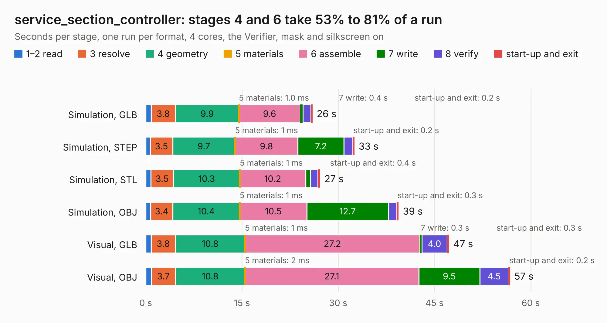

# 2024. service_section_controller

Board 2,024 of the 3,111 of [Corpus Testing](../Corpus-Testing.md), on [Corpus Page 19](../CorpusTestingPages/Corpus-Testing-19.md#2024-service_section_controller).

| Mode and format | 1–2 read | 3 resolve | 4 geometry | 5 materials | 6 assemble | 7 write | 8 verify | start-up and exit | Total |
|---|---:|---:|---:|---:|---:|---:|---:|---:|---:|
| Simulation, GLB | 0.8 | 3.8 | 9.9 | 1.0&nbsp;ms | 9.6 | 0.4 | 1.2 | 0.2 | 26.0 |
| Simulation, STEP | 0.7 | 3.5 | 9.7 | 1&nbsp;ms | 9.8 | 7.2 | 1.4 | 0.2 | 32.5 |
| Simulation, STL | 0.8 | 3.5 | 10.3 | 1&nbsp;ms | 10.2 | 0.8 | 1.1 | 0.4 | 27.2 |
| Simulation, OBJ | 0.8 | 3.4 | 10.4 | 1&nbsp;ms | 10.5 | 12.7 | 1.3 | 0.3 | 39.4 |
| Visual, GLB | 0.9 | 3.8 | 10.8 | 1&nbsp;ms | 27.2 | 0.3 | 4.0 | 0.3 | 47.3 |
| Visual, OBJ | 0.9 | 3.7 | 10.8 | 2&nbsp;ms | 27.1 | 9.5 | 4.5 | 0.2 | 56.8 |

<table align="center"><tr><td valign="top">

| Board | Repo: [olin-electric-motorsports/olin-electric-motorsports](https://github.com/olin-electric-motorsports/olin-electric-motorsports) Board: `service_section_controller.kicad_pcb` |
|---|---|
| Folder | vehicle / mkv / hardware / service_section_controller |
| Complexity | 335&nbsp;/&nbsp;1000 (size&nbsp;270, features&nbsp;65) |
| KESE&nbsp;features | through vias, slotted holes, rounded, trapezoid or chamfered pads, filled zones, curved board outline |
| Tested | 9th November 2026 |
| Copper&nbsp;layers | 4 |
| File&nbsp;format | KiCad 6 (20211014) |
| Parts,&nbsp;tracks,&nbsp;vias | 223, 2,061, 312 |
| Triangles,&nbsp;simulation | 2,994,678 in 189 parts |
| Verifier | PASS in all six runs |

</td><td valign="top">

<table>
<tr><th>File type</th><th>File size</th><th>Peak memory used</th></tr>
<tr><th colspan="3" align="left">Simulation</th></tr>
<tr><td>GLB</td><td align="right">105&nbsp;MB</td><td align="right">1.0&nbsp;GB</td></tr>
<tr><td>STEP</td><td align="right">424&nbsp;MB</td><td align="right">1.3&nbsp;GB</td></tr>
<tr><td>STL</td><td align="right">150&nbsp;MB</td><td align="right">987&nbsp;MB</td></tr>
<tr><td>OBJ</td><td align="right">322&nbsp;MB</td><td align="right">2.0&nbsp;GB</td></tr>
<tr><th colspan="3" align="left">Visual</th></tr>
<tr><td>GLB</td><td align="right">78&nbsp;MB</td><td align="right">1.3&nbsp;GB</td></tr>
<tr><td>OBJ</td><td align="right">242&nbsp;MB</td><td align="right">1.5&nbsp;GB</td></tr>
</table>

</td></tr></table>

| Previous | Next |
|:---|---:|
| [2023. bms_peripheral_v2](b2023b_olin-electric-motorsports_bms-peripheral-v2.md) | [2025. bms_core](b2025b_olin-electric-motorsports_vehicle-mkvi-hardware-bms-bms-core_bms-core.md) |
