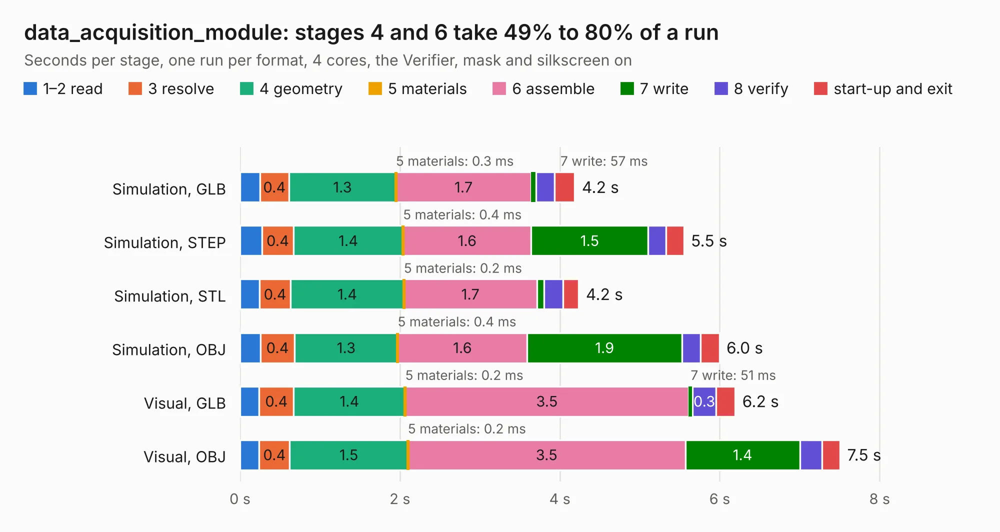

# 2025. data_acquisition_module

Board 2,025 of the 3,108 of [Corpus Testing](../Corpus-Testing.md), on [Corpus Page 19](../CorpusTestingPages/Corpus-Testing-19.md#2025-data_acquisition_module).

| Mode and format | 1–2 read | 3 resolve | 4 geometry | 5 materials | 6 assemble | 7 write | 8 verify | start-up and exit | Total |
|---|---:|---:|---:|---:|---:|---:|---:|---:|---:|
| Simulation, GLB | 0.2 | 0.4 | 1.3 | 0.3&nbsp;ms | 1.7 | 57&nbsp;ms | 0.2 | 0.3 | 4.2 |
| Simulation, STEP | 0.3 | 0.4 | 1.4 | 0.4&nbsp;ms | 1.6 | 1.5 | 0.2 | 0.2 | 5.5 |
| Simulation, STL | 0.2 | 0.4 | 1.4 | 0.2&nbsp;ms | 1.7 | 90&nbsp;ms | 0.2 | 0.2 | 4.2 |
| Simulation, OBJ | 0.3 | 0.4 | 1.3 | 0.4&nbsp;ms | 1.6 | 1.9 | 0.2 | 0.2 | 6.0 |
| Visual, GLB | 0.2 | 0.4 | 1.4 | 0.2&nbsp;ms | 3.5 | 51&nbsp;ms | 0.3 | 0.2 | 6.2 |
| Visual, OBJ | 0.2 | 0.4 | 1.5 | 0.2&nbsp;ms | 3.5 | 1.4 | 0.3 | 0.2 | 7.5 |

<table align="center"><tr><td valign="top">

| Board | Repo: [olin-electric-motorsports/olin-electric-motorsports](https://github.com/olin-electric-motorsports/olin-electric-motorsports) Board: `data_acquisition_module.kicad_pcb` |
|---|---|
| Folder | vehicle / mkvi / hardware / bms / data_acquisition_module |
| Complexity | 256&nbsp;/&nbsp;1000 (size&nbsp;166, features&nbsp;90) |
| KESE&nbsp;features | through vias, rounded, trapezoid or chamfered pads, filled zones, curved board outline, stack-up, dielectric εr and tanδ, mask and silkscreen colours |
| Tested | 9th November 2026 |
| Copper&nbsp;layers | 2 |
| File&nbsp;format | KiCad 7 (20221018) |
| Parts,&nbsp;tracks,&nbsp;vias | 38, 654, 47 |
| Triangles,&nbsp;simulation | 292,426 in 68 parts |
| Verifier | PASS in all six runs |

</td><td valign="top">

<table>
<tr><th>File type</th><th>File size</th><th>Peak memory used</th></tr>
<tr><th colspan="3" align="left">Simulation</th></tr>
<tr><td>GLB</td><td align="right">11&nbsp;MB</td><td align="right">257&nbsp;MB</td></tr>
<tr><td>STEP</td><td align="right">56&nbsp;MB</td><td align="right">285&nbsp;MB</td></tr>
<tr><td>STL</td><td align="right">15&nbsp;MB</td><td align="right">256&nbsp;MB</td></tr>
<tr><td>OBJ</td><td align="right">30&nbsp;MB</td><td align="right">258&nbsp;MB</td></tr>
<tr><th colspan="3" align="left">Visual</th></tr>
<tr><td>GLB</td><td align="right">9.4&nbsp;MB</td><td align="right">291&nbsp;MB</td></tr>
<tr><td>OBJ</td><td align="right">27&nbsp;MB</td><td align="right">292&nbsp;MB</td></tr>
</table>

</td></tr></table>

| Previous | Next |
|:---|---:|
| [2024. bms_csc](b2024b_olin-electric-motorsports_vehicle-mkvi-hardware-bms-bms-csc-rev-1_bms-csc.md) | [2026. J1772](b2026b_olin-electric-motorsports_J1772.md) |
