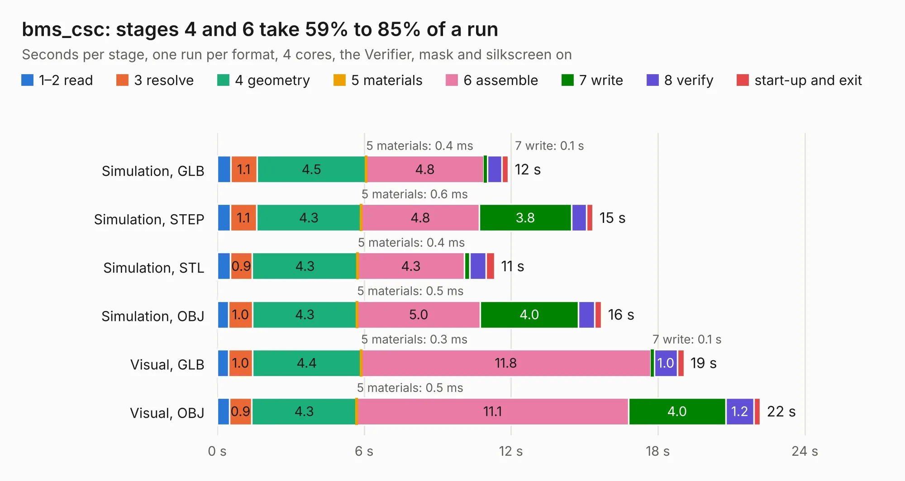

# 2027. bms_csc

Board 2,027 of the 3,111 of [Corpus Testing](../Corpus-Testing.md), on [Corpus Page 19](../CorpusTestingPages/Corpus-Testing-19.md#2027-bms_csc).

| Mode and format | 1–2 read | 3 resolve | 4 geometry | 5 materials | 6 assemble | 7 write | 8 verify | start-up and exit | Total |
|---|---:|---:|---:|---:|---:|---:|---:|---:|---:|
| Simulation, GLB | 0.5 | 1.1 | 4.5 | 0.4&nbsp;ms | 4.8 | 0.1 | 0.6 | 0.3 | 11.9 |
| Simulation, STEP | 0.5 | 1.1 | 4.3 | 0.6&nbsp;ms | 4.8 | 3.8 | 0.6 | 0.3 | 15.3 |
| Simulation, STL | 0.5 | 0.9 | 4.3 | 0.4&nbsp;ms | 4.3 | 0.2 | 0.7 | 0.4 | 11.3 |
| Simulation, OBJ | 0.5 | 1.0 | 4.3 | 0.5&nbsp;ms | 5.0 | 4.0 | 0.7 | 0.3 | 15.7 |
| Visual, GLB | 0.5 | 1.0 | 4.4 | 0.3&nbsp;ms | 11.8 | 0.1 | 1.0 | 0.3 | 19.1 |
| Visual, OBJ | 0.5 | 0.9 | 4.3 | 0.5&nbsp;ms | 11.1 | 4.0 | 1.2 | 0.3 | 22.2 |

<table align="center"><tr><td valign="top">

| Board | Repo: [olin-electric-motorsports/olin-electric-motorsports](https://github.com/olin-electric-motorsports/olin-electric-motorsports) Board: `bms_csc.kicad_pcb` |
|---|---|
| Folder | vehicle / mkvi / hardware / bms / bms_csc / rev_1 |
| Complexity | 349&nbsp;/&nbsp;1000 (size&nbsp;234, features&nbsp;115) |
| KESE&nbsp;features | through vias, custom pads, rounded, trapezoid or chamfered pads, filled zones, copper drawings, curved board outline, stack-up, dielectric εr and tanδ, mask and silkscreen colours |
| Tested | 9th November 2026 |
| Copper&nbsp;layers | 2 |
| File&nbsp;format | KiCad 7 (20221018) |
| Parts,&nbsp;tracks,&nbsp;vias | 133, 1,573, 120 |
| Triangles,&nbsp;simulation | 843,322 in 168 parts |
| Verifier | PASS in all six runs |

</td><td valign="top">

<table>
<tr><th>File type</th><th>File size</th><th>Peak memory used</th></tr>
<tr><th colspan="3" align="left">Simulation</th></tr>
<tr><td>GLB</td><td align="right">30&nbsp;MB</td><td align="right">479&nbsp;MB</td></tr>
<tr><td>STEP</td><td align="right">170&nbsp;MB</td><td align="right">535&nbsp;MB</td></tr>
<tr><td>STL</td><td align="right">42&nbsp;MB</td><td align="right">482&nbsp;MB</td></tr>
<tr><td>OBJ</td><td align="right">88&nbsp;MB</td><td align="right">621&nbsp;MB</td></tr>
<tr><th colspan="3" align="left">Visual</th></tr>
<tr><td>GLB</td><td align="right">27&nbsp;MB</td><td align="right">673&nbsp;MB</td></tr>
<tr><td>OBJ</td><td align="right">81&nbsp;MB</td><td align="right">662&nbsp;MB</td></tr>
</table>

</td></tr></table>

| Previous | Next |
|:---|---:|
| [2026. bms_csc](b2026b_olin-electric-motorsports_vehicle-mkvi-hardware-bms-bms-csc_bms-csc.md) | [2028. data_acquisition_module](b2028b_olin-electric-motorsports_data-acquisition-module.md) |
