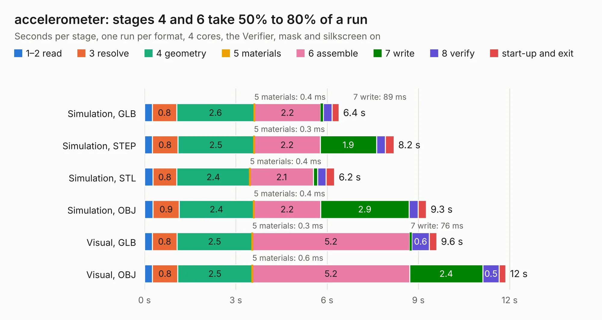

# 2028. accelerometer

Board 2,028 of the 3,132 of [Corpus Testing](../Corpus-Testing.md), on [Corpus Page 19](../CorpusTestingPages/Corpus-Testing-19.md#2028-accelerometer).

| Mode and format | 1–2 read | 3 resolve | 4 geometry | 5 materials | 6 assemble | 7 write | 8 verify | start-up and exit | Total |
|---|---:|---:|---:|---:|---:|---:|---:|---:|---:|
| Simulation, GLB | 0.3 | 0.8 | 2.6 | 0.4&nbsp;ms | 2.2 | 89&nbsp;ms | 0.3 | 0.2 | 6.4 |
| Simulation, STEP | 0.3 | 0.8 | 2.5 | 0.3&nbsp;ms | 2.2 | 1.9 | 0.3 | 0.3 | 8.2 |
| Simulation, STL | 0.3 | 0.8 | 2.4 | 0.4&nbsp;ms | 2.1 | 0.1 | 0.3 | 0.3 | 6.2 |
| Simulation, OBJ | 0.3 | 0.9 | 2.4 | 0.4&nbsp;ms | 2.2 | 2.9 | 0.3 | 0.3 | 9.3 |
| Visual, GLB | 0.3 | 0.8 | 2.5 | 0.3&nbsp;ms | 5.2 | 76&nbsp;ms | 0.6 | 0.2 | 9.6 |
| Visual, OBJ | 0.3 | 0.8 | 2.5 | 0.6&nbsp;ms | 5.2 | 2.4 | 0.5 | 0.2 | 11.9 |

<table align="center"><tr><td valign="top">

| Board | Repo: [olin-electric-motorsports/olin-electric-motorsports](https://github.com/olin-electric-motorsports/olin-electric-motorsports) Board: `accelerometer.kicad_pcb` |
|---|---|
| Folder | vehicle / mkv / hardware / sensing / accelerometer |
| Complexity | 263&nbsp;/&nbsp;1000 (size&nbsp;208, features&nbsp;55) |
| KESE&nbsp;features | through vias, rounded, trapezoid or chamfered pads, filled zones, curved board outline |
| Tested | 9th November 2026 |
| Copper&nbsp;layers | 2 |
| File&nbsp;format | KiCad 6 (20211014) |
| Parts,&nbsp;tracks,&nbsp;vias | 54, 512, 73 |
| Triangles,&nbsp;simulation | 493,092 in 66 parts |
| Verifier | PASS in all six runs |

</td><td valign="top">

<table>
<tr><th>File type</th><th>File size</th><th>Peak memory used</th></tr>
<tr><th colspan="3" align="left">Simulation</th></tr>
<tr><td>GLB</td><td align="right">18&nbsp;MB</td><td align="right">314&nbsp;MB</td></tr>
<tr><td>STEP</td><td align="right">85&nbsp;MB</td><td align="right">358&nbsp;MB</td></tr>
<tr><td>STL</td><td align="right">25&nbsp;MB</td><td align="right">334&nbsp;MB</td></tr>
<tr><td>OBJ</td><td align="right">52&nbsp;MB</td><td align="right">395&nbsp;MB</td></tr>
<tr><th colspan="3" align="left">Visual</th></tr>
<tr><td>GLB</td><td align="right">15&nbsp;MB</td><td align="right">373&nbsp;MB</td></tr>
<tr><td>OBJ</td><td align="right">45&nbsp;MB</td><td align="right">397&nbsp;MB</td></tr>
</table>

</td></tr></table>

| Previous | Next |
|:---|---:|
| [2027. lv_bms_tester_board](b2027b_olin-electric-motorsports_lv-bms-tester-board.md) | [2029. sensing_module_interface](b2029b_olin-electric-motorsports_sensing-module-interface.md) |
