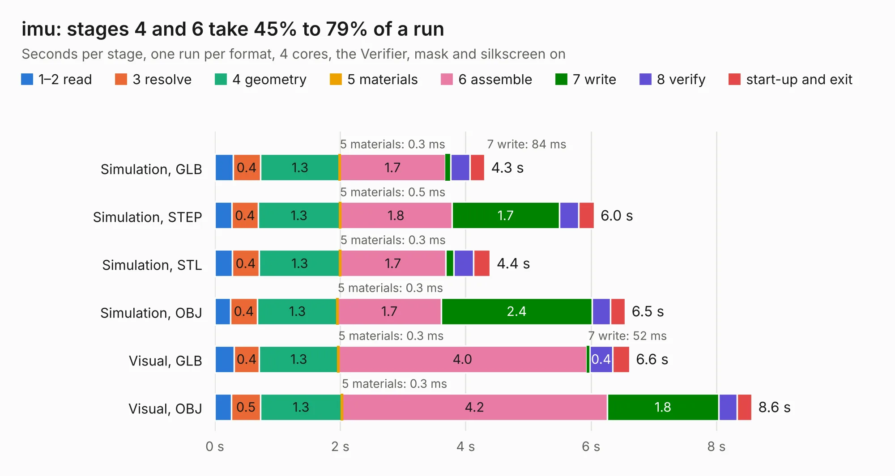

# 2028. imu

Board 2,028 of the 3,107 of [Corpus Testing](../Corpus-Testing.md), on [Corpus Page 19](../CorpusTestingPages/Corpus-Testing-19.md#2028-imu).

| Mode and format | 1–2 read | 3 resolve | 4 geometry | 5 materials | 6 assemble | 7 write | 8 verify | start-up and exit | Total |
|---|---:|---:|---:|---:|---:|---:|---:|---:|---:|
| Simulation, GLB | 0.3 | 0.4 | 1.3 | 0.3&nbsp;ms | 1.7 | 84&nbsp;ms | 0.3 | 0.2 | 4.3 |
| Simulation, STEP | 0.3 | 0.4 | 1.3 | 0.5&nbsp;ms | 1.8 | 1.7 | 0.3 | 0.2 | 6.0 |
| Simulation, STL | 0.3 | 0.4 | 1.3 | 0.3&nbsp;ms | 1.7 | 0.1 | 0.3 | 0.3 | 4.4 |
| Simulation, OBJ | 0.3 | 0.4 | 1.3 | 0.3&nbsp;ms | 1.7 | 2.4 | 0.3 | 0.2 | 6.5 |
| Visual, GLB | 0.3 | 0.4 | 1.3 | 0.3&nbsp;ms | 4.0 | 52&nbsp;ms | 0.4 | 0.3 | 6.6 |
| Visual, OBJ | 0.3 | 0.5 | 1.3 | 0.3&nbsp;ms | 4.2 | 1.8 | 0.3 | 0.2 | 8.6 |

<table align="center"><tr><td valign="top">

| Board | Repo: [olin-electric-motorsports/olin-electric-motorsports](https://github.com/olin-electric-motorsports/olin-electric-motorsports) Board: `imu.kicad_pcb` |
|---|---|
| Folder | vehicle / mkvi / hardware / imu |
| Complexity | 345&nbsp;/&nbsp;1000 (size&nbsp;215, features&nbsp;130) |
| KESE&nbsp;features | through vias, custom pads, rounded, trapezoid or chamfered pads, arc tracks, filled zones, copper drawings, stack-up, dielectric εr and tanδ, copper finish |
| Tested | 9th November 2026 |
| Copper&nbsp;layers | 4 |
| File&nbsp;format | KiCad 7 (20221018) |
| Parts,&nbsp;tracks,&nbsp;vias | 34, 383, 51 |
| Triangles,&nbsp;simulation | 421,836 in 72 parts |
| Verifier | PASS in all six runs |

</td><td valign="top">

<table>
<tr><th>File type</th><th>File size</th><th>Peak memory used</th></tr>
<tr><th colspan="3" align="left">Simulation</th></tr>
<tr><td>GLB</td><td align="right">15&nbsp;MB</td><td align="right">302&nbsp;MB</td></tr>
<tr><td>STEP</td><td align="right">67&nbsp;MB</td><td align="right">312&nbsp;MB</td></tr>
<tr><td>STL</td><td align="right">21&nbsp;MB</td><td align="right">307&nbsp;MB</td></tr>
<tr><td>OBJ</td><td align="right">44&nbsp;MB</td><td align="right">342&nbsp;MB</td></tr>
<tr><th colspan="3" align="left">Visual</th></tr>
<tr><td>GLB</td><td align="right">9.8&nbsp;MB</td><td align="right">306&nbsp;MB</td></tr>
<tr><td>OBJ</td><td align="right">30&nbsp;MB</td><td align="right">314&nbsp;MB</td></tr>
</table>

</td></tr></table>

| Previous | Next |
|:---|---:|
| [2027. cooling-board](b2027b_olin-electric-motorsports_cooling-board.md) | [2029. imu_panelized](b2029b_olin-electric-motorsports_imu-panelized.md) |
