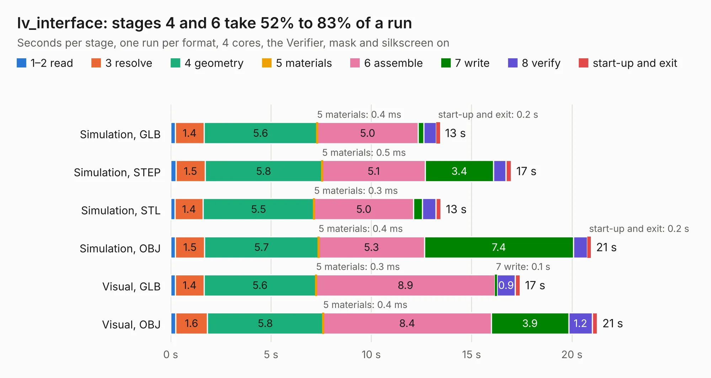

# 2029. lv_interface

Board 2,029 of the 3,139 of [Corpus Testing](../Corpus-Testing.md), on [Corpus Page 19](../CorpusTestingPages/Corpus-Testing-19.md#2029-lv_interface).

| Mode and format | 1–2 read | 3 resolve | 4 geometry | 5 materials | 6 assemble | 7 write | 8 verify | start-up and exit | Total |
|---|---:|---:|---:|---:|---:|---:|---:|---:|---:|
| Simulation, GLB | 0.2 | 1.4 | 5.6 | 0.4&nbsp;ms | 5.0 | 0.3 | 0.6 | 0.2 | 13.4 |
| Simulation, STEP | 0.3 | 1.5 | 5.8 | 0.5&nbsp;ms | 5.1 | 3.4 | 0.6 | 0.3 | 17.0 |
| Simulation, STL | 0.2 | 1.4 | 5.5 | 0.3&nbsp;ms | 5.0 | 0.4 | 0.7 | 0.2 | 13.5 |
| Simulation, OBJ | 0.2 | 1.5 | 5.7 | 0.4&nbsp;ms | 5.3 | 7.4 | 0.7 | 0.2 | 21.0 |
| Visual, GLB | 0.2 | 1.4 | 5.6 | 0.3&nbsp;ms | 8.9 | 0.1 | 0.9 | 0.2 | 17.4 |
| Visual, OBJ | 0.2 | 1.6 | 5.8 | 0.4&nbsp;ms | 8.4 | 3.9 | 1.2 | 0.3 | 21.3 |

<table align="center"><tr><td valign="top">

| Board | Repo: [olin-electric-motorsports/olin-electric-motorsports](https://github.com/olin-electric-motorsports/olin-electric-motorsports) Board: `lv_interface.kicad_pcb` |
|---|---|
| Folder | vehicle / mkv / hardware / lvbox / interface |
| Complexity | 238&nbsp;/&nbsp;1000 (size&nbsp;183, features&nbsp;55) |
| KESE&nbsp;features | through vias, rounded, trapezoid or chamfered pads, filled zones, curved board outline |
| Tested | 9th November 2026 |
| Copper&nbsp;layers | 4 |
| File&nbsp;format | KiCad 6 (20211014) |
| Parts,&nbsp;tracks,&nbsp;vias | 22, 1,054, 31 |
| Triangles,&nbsp;simulation | 1,827,706 in 63 parts |
| Verifier | PASS in all six runs |

</td><td valign="top">

<table>
<tr><th>File type</th><th>File size</th><th>Peak memory used</th></tr>
<tr><th colspan="3" align="left">Simulation</th></tr>
<tr><td>GLB</td><td align="right">62&nbsp;MB</td><td align="right">594&nbsp;MB</td></tr>
<tr><td>STEP</td><td align="right">234&nbsp;MB</td><td align="right">739&nbsp;MB</td></tr>
<tr><td>STL</td><td align="right">91&nbsp;MB</td><td align="right">630&nbsp;MB</td></tr>
<tr><td>OBJ</td><td align="right">189&nbsp;MB</td><td align="right">1.2&nbsp;GB</td></tr>
<tr><th colspan="3" align="left">Visual</th></tr>
<tr><td>GLB</td><td align="right">29&nbsp;MB</td><td align="right">746&nbsp;MB</td></tr>
<tr><td>OBJ</td><td align="right">87&nbsp;MB</td><td align="right">689&nbsp;MB</td></tr>
</table>

</td></tr></table>

| Previous | Next |
|:---|---:|
| [2028. cooling_sense](b2028b_olin-electric-motorsports_cooling-sense.md) | [2030. lvbms](b2030b_olin-electric-motorsports_lvbms.md) |
