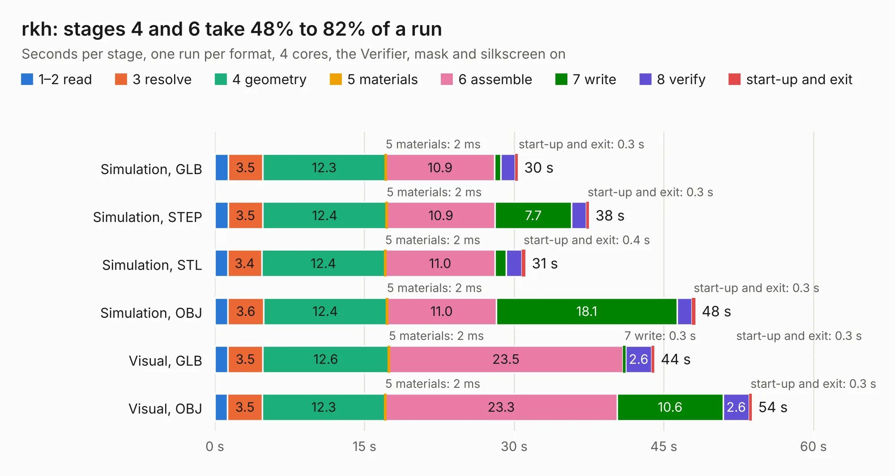

# 2029. rkh

Board 2,029 of the 3,101 of [Corpus Testing](../Corpus-Testing.md), on [Corpus Page 19](../CorpusTestingPages/Corpus-Testing-19.md#2029-rkh).

| Mode and format | 1–2 read | 3 resolve | 4 geometry | 5 materials | 6 assemble | 7 write | 8 verify | start-up and exit | Total |
|---|---:|---:|---:|---:|---:|---:|---:|---:|---:|
| Simulation, GLB | 1.3 | 3.5 | 12.3 | 2&nbsp;ms | 10.9 | 0.6 | 1.4 | 0.3 | 30.4 |
| Simulation, STEP | 1.3 | 3.5 | 12.4 | 2&nbsp;ms | 10.9 | 7.7 | 1.5 | 0.3 | 37.5 |
| Simulation, STL | 1.3 | 3.4 | 12.4 | 2&nbsp;ms | 11.0 | 1.1 | 1.6 | 0.4 | 31.1 |
| Simulation, OBJ | 1.3 | 3.6 | 12.4 | 2&nbsp;ms | 11.0 | 18.1 | 1.5 | 0.3 | 48.2 |
| Visual, GLB | 1.3 | 3.5 | 12.6 | 2&nbsp;ms | 23.5 | 0.3 | 2.6 | 0.3 | 44.1 |
| Visual, OBJ | 1.3 | 3.5 | 12.3 | 2&nbsp;ms | 23.3 | 10.6 | 2.6 | 0.3 | 53.8 |

<table align="center"><tr><td valign="top">

| Board | Repo: [olin-electric-motorsports/olin-electric-motorsports](https://github.com/olin-electric-motorsports/olin-electric-motorsports) Board: `rkh.kicad_pcb` |
|---|---|
| Folder | vehicle / mkvi / hardware / rkh |
| Complexity | 351&nbsp;/&nbsp;1000 (size&nbsp;211, features&nbsp;140) |
| KESE&nbsp;features | through vias, slotted holes, custom pads, rounded, trapezoid or chamfered pads, filled zones, copper drawings, curved board outline, stack-up, dielectric εr and tanδ, copper finish, mask and silkscreen colours |
| Tested | 9th November 2026 |
| Copper&nbsp;layers | 4 |
| File&nbsp;format | KiCad 7 (20221018) |
| Parts,&nbsp;tracks,&nbsp;vias | 104, 1,199, 360 |
| Triangles,&nbsp;simulation | 3,088,646 in 478 parts |
| Verifier | PASS in all six runs |

</td><td valign="top">

<table>
<tr><th>File type</th><th>File size</th><th>Peak memory used</th></tr>
<tr><th colspan="3" align="left">Simulation</th></tr>
<tr><td>GLB</td><td align="right">102&nbsp;MB</td><td align="right">993&nbsp;MB</td></tr>
<tr><td>STEP</td><td align="right">382&nbsp;MB</td><td align="right">1.2&nbsp;GB</td></tr>
<tr><td>STL</td><td align="right">154&nbsp;MB</td><td align="right">1.0&nbsp;GB</td></tr>
<tr><td>OBJ</td><td align="right">327&nbsp;MB</td><td align="right">2.0&nbsp;GB</td></tr>
<tr><th colspan="3" align="left">Visual</th></tr>
<tr><td>GLB</td><td align="right">60&nbsp;MB</td><td align="right">1.2&nbsp;GB</td></tr>
<tr><td>OBJ</td><td align="right">187&nbsp;MB</td><td align="right">1.4&nbsp;GB</td></tr>
</table>

</td></tr></table>

| Previous | Next |
|:---|---:|
| [2028. throttle](b2028b_olin-electric-motorsports_vehicle-mkvi-hardware-nostril-throttle_throttle.md) | [2030. carrier-fix](b2030b_olin-electric-motorsports_carrier-fix.md) |
