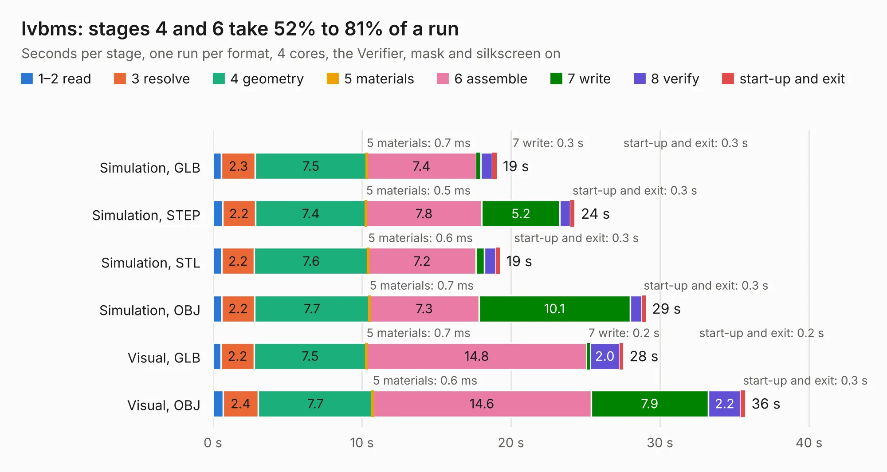

# 2030. lvbms

Board 2,030 of the 3,138 of [Corpus Testing](../Corpus-Testing.md), on [Corpus Page 19](../CorpusTestingPages/Corpus-Testing-19.md#2030-lvbms).

| Mode and format | 1–2 read | 3 resolve | 4 geometry | 5 materials | 6 assemble | 7 write | 8 verify | start-up and exit | Total |
|---|---:|---:|---:|---:|---:|---:|---:|---:|---:|
| Simulation, GLB | 0.6 | 2.3 | 7.5 | 0.7&nbsp;ms | 7.4 | 0.3 | 0.8 | 0.3 | 19.0 |
| Simulation, STEP | 0.6 | 2.2 | 7.4 | 0.5&nbsp;ms | 7.8 | 5.2 | 0.7 | 0.3 | 24.3 |
| Simulation, STL | 0.6 | 2.2 | 7.6 | 0.6&nbsp;ms | 7.2 | 0.6 | 0.8 | 0.3 | 19.3 |
| Simulation, OBJ | 0.6 | 2.2 | 7.7 | 0.7&nbsp;ms | 7.3 | 10.1 | 0.8 | 0.3 | 29.0 |
| Visual, GLB | 0.5 | 2.2 | 7.5 | 0.7&nbsp;ms | 14.8 | 0.2 | 2.0 | 0.2 | 27.5 |
| Visual, OBJ | 0.7 | 2.4 | 7.7 | 0.6&nbsp;ms | 14.6 | 7.9 | 2.2 | 0.3 | 35.7 |

<table align="center"><tr><td valign="top">

| Board | Repo: [olin-electric-motorsports/olin-electric-motorsports](https://github.com/olin-electric-motorsports/olin-electric-motorsports) Board: `lvbms.kicad_pcb` |
|---|---|
| Folder | vehicle / mkv / hardware / lvbox / lvbms |
| Complexity | 295&nbsp;/&nbsp;1000 (size&nbsp;240, features&nbsp;55) |
| KESE&nbsp;features | through vias, rounded, trapezoid or chamfered pads, filled zones, curved board outline |
| Tested | 9th November 2026 |
| Copper&nbsp;layers | 4 |
| File&nbsp;format | KiCad 6 (20211014) |
| Parts,&nbsp;tracks,&nbsp;vias | 107, 763, 148 |
| Triangles,&nbsp;simulation | 1,795,438 in 106 parts |
| Verifier | PASS in all six runs |

</td><td valign="top">

<table>
<tr><th>File type</th><th>File size</th><th>Peak memory used</th></tr>
<tr><th colspan="3" align="left">Simulation</th></tr>
<tr><td>GLB</td><td align="right">63&nbsp;MB</td><td align="right">664&nbsp;MB</td></tr>
<tr><td>STEP</td><td align="right">257&nbsp;MB</td><td align="right">850&nbsp;MB</td></tr>
<tr><td>STL</td><td align="right">90&nbsp;MB</td><td align="right">660&nbsp;MB</td></tr>
<tr><td>OBJ</td><td align="right">190&nbsp;MB</td><td align="right">1.2&nbsp;GB</td></tr>
<tr><th colspan="3" align="left">Visual</th></tr>
<tr><td>GLB</td><td align="right">45&nbsp;MB</td><td align="right">864&nbsp;MB</td></tr>
<tr><td>OBJ</td><td align="right">138&nbsp;MB</td><td align="right">980&nbsp;MB</td></tr>
</table>

</td></tr></table>

| Previous | Next |
|:---|---:|
| [2029. lv_interface](b2029b_olin-electric-motorsports_lv-interface.md) | [2031. lv_bms_tester_board](b2031b_olin-electric-motorsports_lv-bms-tester-board.md) |
