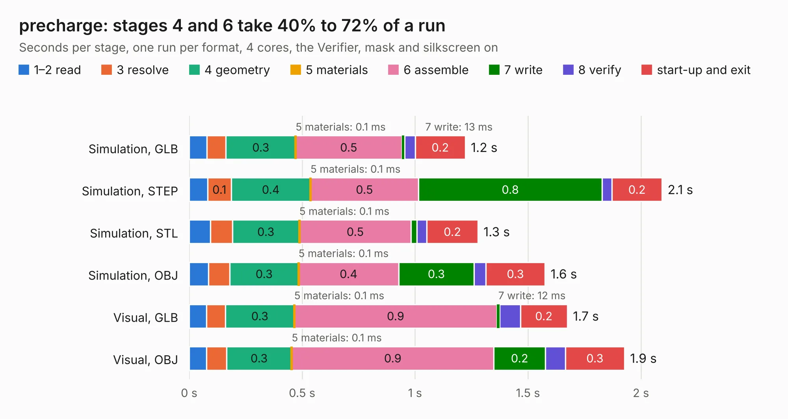

# 2030. precharge

Board 2,030 of the 3,126 of [Corpus Testing](../Corpus-Testing.md), on [Corpus Page 19](../CorpusTestingPages/Corpus-Testing-19.md#2030-precharge).

| Mode and format | 1–2 read | 3 resolve | 4 geometry | 5 materials | 6 assemble | 7 write | 8 verify | start-up and exit | Total |
|---|---:|---:|---:|---:|---:|---:|---:|---:|---:|
| Simulation, GLB | 78&nbsp;ms | 85&nbsp;ms | 0.3 | 0.1&nbsp;ms | 0.5 | 13&nbsp;ms | 47&nbsp;ms | 0.2 | 1.2 |
| Simulation, STEP | 82&nbsp;ms | 0.1 | 0.4 | 0.1&nbsp;ms | 0.5 | 0.8 | 44&nbsp;ms | 0.2 | 2.1 |
| Simulation, STL | 94&nbsp;ms | 98&nbsp;ms | 0.3 | 0.1&nbsp;ms | 0.5 | 25&nbsp;ms | 45&nbsp;ms | 0.2 | 1.3 |
| Simulation, OBJ | 85&nbsp;ms | 94&nbsp;ms | 0.3 | 0.1&nbsp;ms | 0.4 | 0.3 | 52&nbsp;ms | 0.3 | 1.6 |
| Visual, GLB | 76&nbsp;ms | 85&nbsp;ms | 0.3 | 0.1&nbsp;ms | 0.9 | 12&nbsp;ms | 92&nbsp;ms | 0.2 | 1.7 |
| Visual, OBJ | 77&nbsp;ms | 88&nbsp;ms | 0.3 | 0.1&nbsp;ms | 0.9 | 0.2 | 89&nbsp;ms | 0.3 | 1.9 |

<table align="center"><tr><td valign="top">

| Board | Repo: [olin-electric-motorsports/olin-electric-motorsports](https://github.com/olin-electric-motorsports/olin-electric-motorsports) Board: `precharge.kicad_pcb` |
|---|---|
| Folder | vehicle / mkv / hardware / service_section / airs / precharge |
| Complexity | 60&nbsp;/&nbsp;1000 (size&nbsp;60, features&nbsp;0) |
| Tested | 9th November 2026 |
| Copper&nbsp;layers | 2 |
| File&nbsp;format | KiCad 6 (20211014) |
| Parts,&nbsp;tracks,&nbsp;vias | 2, 6, 0 |
| Triangles,&nbsp;simulation | 65,448 in 14 parts |
| Verifier | PASS in all six runs |

</td><td valign="top">

<table>
<tr><th>File type</th><th>File size</th><th>Peak memory used</th></tr>
<tr><th colspan="3" align="left">Simulation</th></tr>
<tr><td>GLB</td><td align="right">2.2&nbsp;MB</td><td align="right">169&nbsp;MB</td></tr>
<tr><td>STEP</td><td align="right">9.9&nbsp;MB</td><td align="right">173&nbsp;MB</td></tr>
<tr><td>STL</td><td align="right">3.3&nbsp;MB</td><td align="right">167&nbsp;MB</td></tr>
<tr><td>OBJ</td><td align="right">6.2&nbsp;MB</td><td align="right">169&nbsp;MB</td></tr>
<tr><th colspan="3" align="left">Visual</th></tr>
<tr><td>GLB</td><td align="right">1.1&nbsp;MB</td><td align="right">152&nbsp;MB</td></tr>
<tr><td>OBJ</td><td align="right">3.2&nbsp;MB</td><td align="right">153&nbsp;MB</td></tr>
</table>

</td></tr></table>

| Previous | Next |
|:---|---:|
| [2029. air_plus](b2029b_olin-electric-motorsports_air-plus.md) | [2031. data_acquisition_1](b2031b_olin-electric-motorsports_data-acquisition-1.md) |
