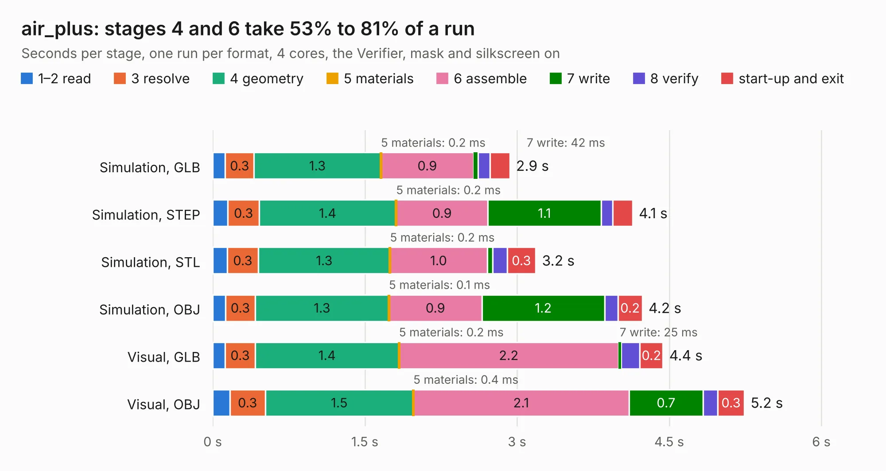

# 2031. air_plus

Board 2,031 of the 3,130 of [Corpus Testing](../Corpus-Testing.md), on [Corpus Page 19](../CorpusTestingPages/Corpus-Testing-19.md#2031-air_plus).

| Mode and format | 1–2 read | 3 resolve | 4 geometry | 5 materials | 6 assemble | 7 write | 8 verify | start-up and exit | Total |
|---|---:|---:|---:|---:|---:|---:|---:|---:|---:|
| Simulation, GLB | 0.1 | 0.3 | 1.3 | 0.2&nbsp;ms | 0.9 | 42&nbsp;ms | 0.1 | 0.2 | 2.9 |
| Simulation, STEP | 0.2 | 0.3 | 1.4 | 0.2&nbsp;ms | 0.9 | 1.1 | 0.1 | 0.2 | 4.1 |
| Simulation, STL | 0.1 | 0.3 | 1.3 | 0.2&nbsp;ms | 1.0 | 56&nbsp;ms | 0.1 | 0.3 | 3.2 |
| Simulation, OBJ | 0.1 | 0.3 | 1.3 | 0.1&nbsp;ms | 0.9 | 1.2 | 0.1 | 0.2 | 4.2 |
| Visual, GLB | 0.1 | 0.3 | 1.4 | 0.2&nbsp;ms | 2.2 | 25&nbsp;ms | 0.2 | 0.2 | 4.4 |
| Visual, OBJ | 0.2 | 0.3 | 1.5 | 0.4&nbsp;ms | 2.1 | 0.7 | 0.1 | 0.3 | 5.2 |

<table align="center"><tr><td valign="top">

| Board | Repo: [olin-electric-motorsports/olin-electric-motorsports](https://github.com/olin-electric-motorsports/olin-electric-motorsports) Board: `air_plus.kicad_pcb` |
|---|---|
| Folder | vehicle / mkv / hardware / service_section / airs / plus |
| Complexity | 126&nbsp;/&nbsp;1000 (size&nbsp;106, features&nbsp;20) |
| KESE&nbsp;features | rounded, trapezoid or chamfered pads, curved board outline |
| Tested | 9th November 2026 |
| Copper&nbsp;layers | 2 |
| File&nbsp;format | KiCad 6 (20211014) |
| Parts,&nbsp;tracks,&nbsp;vias | 10, 48, 0 |
| Triangles,&nbsp;simulation | 225,108 in 23 parts |
| Verifier | PASS in all six runs |

</td><td valign="top">

<table>
<tr><th>File type</th><th>File size</th><th>Peak memory used</th></tr>
<tr><th colspan="3" align="left">Simulation</th></tr>
<tr><td>GLB</td><td align="right">7.8&nbsp;MB</td><td align="right">216&nbsp;MB</td></tr>
<tr><td>STEP</td><td align="right">34&nbsp;MB</td><td align="right">227&nbsp;MB</td></tr>
<tr><td>STL</td><td align="right">11&nbsp;MB</td><td align="right">217&nbsp;MB</td></tr>
<tr><td>OBJ</td><td align="right">23&nbsp;MB</td><td align="right">211&nbsp;MB</td></tr>
<tr><th colspan="3" align="left">Visual</th></tr>
<tr><td>GLB</td><td align="right">4.3&nbsp;MB</td><td align="right">184&nbsp;MB</td></tr>
<tr><td>OBJ</td><td align="right">12&nbsp;MB</td><td align="right">180&nbsp;MB</td></tr>
</table>

</td></tr></table>

| Previous | Next |
|:---|---:|
| [2030. air_minus](b2030b_olin-electric-motorsports_air-minus.md) | [2032. precharge](b2032b_olin-electric-motorsports_precharge.md) |
