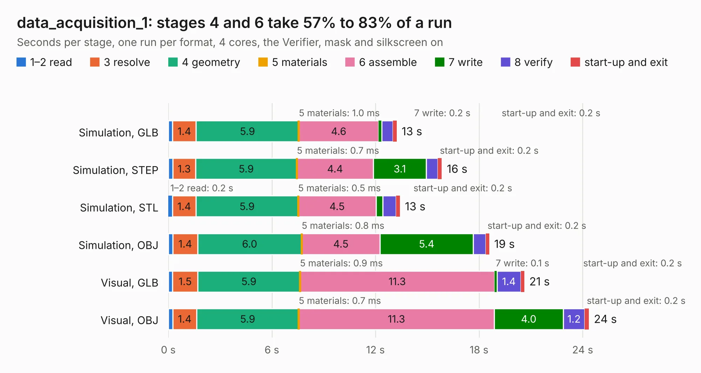

# 2032. data_acquisition_1

Board 2,032 of the 3,129 of [Corpus Testing](../Corpus-Testing.md), on [Corpus Page 19](../CorpusTestingPages/Corpus-Testing-19.md#2032-data_acquisition_1).

| Mode and format | 1–2 read | 3 resolve | 4 geometry | 5 materials | 6 assemble | 7 write | 8 verify | start-up and exit | Total |
|---|---:|---:|---:|---:|---:|---:|---:|---:|---:|
| Simulation, GLB | 0.3 | 1.4 | 5.9 | 1.0&nbsp;ms | 4.6 | 0.2 | 0.7 | 0.2 | 13.2 |
| Simulation, STEP | 0.3 | 1.3 | 5.9 | 0.7&nbsp;ms | 4.4 | 3.1 | 0.7 | 0.2 | 15.8 |
| Simulation, STL | 0.2 | 1.4 | 5.9 | 0.5&nbsp;ms | 4.5 | 0.4 | 0.8 | 0.2 | 13.4 |
| Simulation, OBJ | 0.3 | 1.4 | 6.0 | 0.8&nbsp;ms | 4.5 | 5.4 | 0.7 | 0.2 | 18.6 |
| Visual, GLB | 0.2 | 1.5 | 5.9 | 0.9&nbsp;ms | 11.3 | 0.1 | 1.4 | 0.2 | 20.6 |
| Visual, OBJ | 0.3 | 1.4 | 5.9 | 0.7&nbsp;ms | 11.3 | 4.0 | 1.2 | 0.2 | 24.4 |

<table align="center"><tr><td valign="top">

| Board | Repo: [olin-electric-motorsports/olin-electric-motorsports](https://github.com/olin-electric-motorsports/olin-electric-motorsports) Board: `data_acquisition_1.kicad_pcb` |
|---|---|
| Folder | vehicle / mkv / hardware / service_section / bms / da1 |
| Complexity | 242&nbsp;/&nbsp;1000 (size&nbsp;187, features&nbsp;55) |
| KESE&nbsp;features | through vias, rounded, trapezoid or chamfered pads, filled zones, curved board outline |
| Tested | 9th November 2026 |
| Copper&nbsp;layers | 2 |
| File&nbsp;format | KiCad 6 (20211014) |
| Parts,&nbsp;tracks,&nbsp;vias | 76, 1,548, 110 |
| Triangles,&nbsp;simulation | 1,333,082 in 128 parts |
| Verifier | PASS in all six runs |

</td><td valign="top">

<table>
<tr><th>File type</th><th>File size</th><th>Peak memory used</th></tr>
<tr><th colspan="3" align="left">Simulation</th></tr>
<tr><td>GLB</td><td align="right">47&nbsp;MB</td><td align="right">541&nbsp;MB</td></tr>
<tr><td>STEP</td><td align="right">242&nbsp;MB</td><td align="right">619&nbsp;MB</td></tr>
<tr><td>STL</td><td align="right">67&nbsp;MB</td><td align="right">518&nbsp;MB</td></tr>
<tr><td>OBJ</td><td align="right">139&nbsp;MB</td><td align="right">935&nbsp;MB</td></tr>
<tr><th colspan="3" align="left">Visual</th></tr>
<tr><td>GLB</td><td align="right">33&nbsp;MB</td><td align="right">658&nbsp;MB</td></tr>
<tr><td>OBJ</td><td align="right">100&nbsp;MB</td><td align="right">725&nbsp;MB</td></tr>
</table>

</td></tr></table>

| Previous | Next |
|:---|---:|
| [2031. precharge](b2031b_olin-electric-motorsports_precharge.md) | [2033. data_acquisition_2](b2033b_olin-electric-motorsports_data-acquisition-2.md) |
