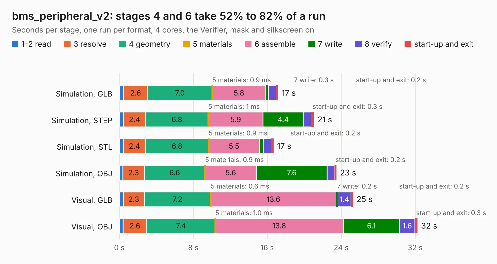

# 2036. bms_peripheral_v2

Board 2,036 of the 3,124 of [Corpus Testing](../Corpus-Testing.md), on [Corpus Page 19](../CorpusTestingPages/Corpus-Testing-19.md#2036-bms_peripheral_v2).

| Mode and format | 1–2 read | 3 resolve | 4 geometry | 5 materials | 6 assemble | 7 write | 8 verify | start-up and exit | Total |
|---|---:|---:|---:|---:|---:|---:|---:|---:|---:|
| Simulation, GLB | 0.5 | 2.6 | 7.0 | 0.9&nbsp;ms | 5.8 | 0.3 | 0.9 | 0.2 | 17.2 |
| Simulation, STEP | 0.5 | 2.4 | 6.8 | 1&nbsp;ms | 5.9 | 4.4 | 0.8 | 0.3 | 21.1 |
| Simulation, STL | 0.5 | 2.4 | 6.8 | 0.9&nbsp;ms | 5.5 | 0.4 | 0.9 | 0.2 | 16.7 |
| Simulation, OBJ | 0.4 | 2.3 | 6.6 | 0.9&nbsp;ms | 5.6 | 7.6 | 0.8 | 0.2 | 23.5 |
| Visual, GLB | 0.4 | 2.3 | 7.2 | 0.6&nbsp;ms | 13.6 | 0.2 | 1.4 | 0.2 | 25.3 |
| Visual, OBJ | 0.4 | 2.6 | 7.4 | 1.0&nbsp;ms | 13.8 | 6.1 | 1.6 | 0.3 | 32.3 |

<table align="center"><tr><td valign="top">

| Board | Repo: [olin-electric-motorsports/olin-electric-motorsports](https://github.com/olin-electric-motorsports/olin-electric-motorsports) Board: `bms_peripheral_v2.kicad_pcb` |
|---|---|
| Folder | vehicle / mkv / hardware / service_section / peripheral |
| Complexity | 304&nbsp;/&nbsp;1000 (size&nbsp;259, features&nbsp;45) |
| KESE&nbsp;features | through vias, filled zones, curved board outline |
| Tested | 9th November 2026 |
| Copper&nbsp;layers | 4 |
| File&nbsp;format | KiCad 6 (20211014) |
| Parts,&nbsp;tracks,&nbsp;vias | 134, 1,595, 199 |
| Triangles,&nbsp;simulation | 1,760,720 in 182 parts |
| Verifier | PASS in all six runs |

</td><td valign="top">

<table>
<tr><th>File type</th><th>File size</th><th>Peak memory used</th></tr>
<tr><th colspan="3" align="left">Simulation</th></tr>
<tr><td>GLB</td><td align="right">61&nbsp;MB</td><td align="right">635&nbsp;MB</td></tr>
<tr><td>STEP</td><td align="right">230&nbsp;MB</td><td align="right">747&nbsp;MB</td></tr>
<tr><td>STL</td><td align="right">88&nbsp;MB</td><td align="right">631&nbsp;MB</td></tr>
<tr><td>OBJ</td><td align="right">186&nbsp;MB</td><td align="right">1.2&nbsp;GB</td></tr>
<tr><th colspan="3" align="left">Visual</th></tr>
<tr><td>GLB</td><td align="right">40&nbsp;MB</td><td align="right">731&nbsp;MB</td></tr>
<tr><td>OBJ</td><td align="right">123&nbsp;MB</td><td align="right">884&nbsp;MB</td></tr>
</table>

</td></tr></table>

| Previous | Next |
|:---|---:|
| [2035. bms_peripheral](b2035b_olin-electric-motorsports_bms-peripheral.md) | [2037. service_section_controller](b2037b_olin-electric-motorsports_service-section-controller.md) |
