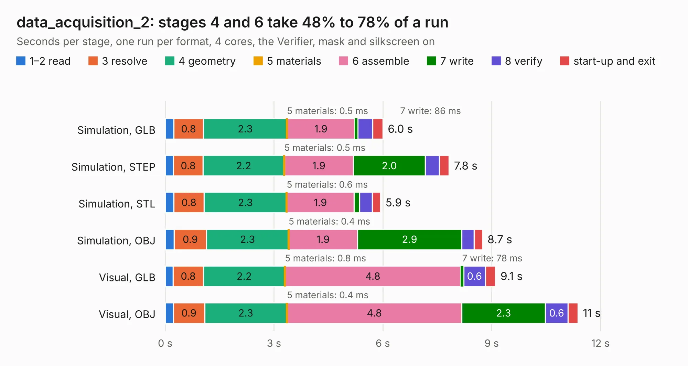

# 2036. data_acquisition_2

Board 2,036 of the 3,132 of [Corpus Testing](../Corpus-Testing.md), on [Corpus Page 19](../CorpusTestingPages/Corpus-Testing-19.md#2036-data_acquisition_2).

| Mode and format | 1–2 read | 3 resolve | 4 geometry | 5 materials | 6 assemble | 7 write | 8 verify | start-up and exit | Total |
|---|---:|---:|---:|---:|---:|---:|---:|---:|---:|
| Simulation, GLB | 0.2 | 0.8 | 2.3 | 0.5&nbsp;ms | 1.9 | 86&nbsp;ms | 0.4 | 0.3 | 6.0 |
| Simulation, STEP | 0.2 | 0.8 | 2.2 | 0.5&nbsp;ms | 1.9 | 2.0 | 0.4 | 0.3 | 7.8 |
| Simulation, STL | 0.2 | 0.8 | 2.3 | 0.6&nbsp;ms | 1.9 | 0.1 | 0.4 | 0.2 | 5.9 |
| Simulation, OBJ | 0.2 | 0.9 | 2.3 | 0.4&nbsp;ms | 1.9 | 2.9 | 0.3 | 0.2 | 8.7 |
| Visual, GLB | 0.2 | 0.8 | 2.2 | 0.8&nbsp;ms | 4.8 | 78&nbsp;ms | 0.6 | 0.3 | 9.1 |
| Visual, OBJ | 0.2 | 0.9 | 2.3 | 0.4&nbsp;ms | 4.8 | 2.3 | 0.6 | 0.3 | 11.4 |

<table align="center"><tr><td valign="top">

| Board | Repo: [olin-electric-motorsports/olin-electric-motorsports](https://github.com/olin-electric-motorsports/olin-electric-motorsports) Board: `data_acquisition_2.kicad_pcb` |
|---|---|
| Folder | vehicle / mkv / hardware / service_section / bms / da2 |
| Complexity | 226&nbsp;/&nbsp;1000 (size&nbsp;171, features&nbsp;55) |
| KESE&nbsp;features | through vias, rounded, trapezoid or chamfered pads, filled zones, curved board outline |
| Tested | 9th November 2026 |
| Copper&nbsp;layers | 2 |
| File&nbsp;format | KiCad 6 (20211014) |
| Parts,&nbsp;tracks,&nbsp;vias | 64, 645, 51 |
| Triangles,&nbsp;simulation | 511,290 in 89 parts |
| Verifier | PASS in all six runs |

</td><td valign="top">

<table>
<tr><th>File type</th><th>File size</th><th>Peak memory used</th></tr>
<tr><th colspan="3" align="left">Simulation</th></tr>
<tr><td>GLB</td><td align="right">18&nbsp;MB</td><td align="right">312&nbsp;MB</td></tr>
<tr><td>STEP</td><td align="right">76&nbsp;MB</td><td align="right">355&nbsp;MB</td></tr>
<tr><td>STL</td><td align="right">26&nbsp;MB</td><td align="right">323&nbsp;MB</td></tr>
<tr><td>OBJ</td><td align="right">52&nbsp;MB</td><td align="right">395&nbsp;MB</td></tr>
<tr><th colspan="3" align="left">Visual</th></tr>
<tr><td>GLB</td><td align="right">13&nbsp;MB</td><td align="right">369&nbsp;MB</td></tr>
<tr><td>OBJ</td><td align="right">40&nbsp;MB</td><td align="right">370&nbsp;MB</td></tr>
</table>

</td></tr></table>

| Previous | Next |
|:---|---:|
| [2035. data_acquisition_1](b2035b_olin-electric-motorsports_data-acquisition-1.md) | [2037. bms_core](b2037b_olin-electric-motorsports_vehicle-mkv-hardware-service-section-controller_bms-core.md) |
