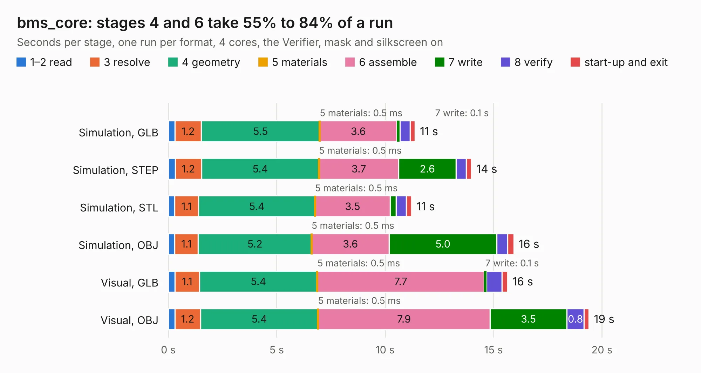

# 2036. bms_core

Board 2,036 of the 3,131 of [Corpus Testing](../Corpus-Testing.md), on [Corpus Page 19](../CorpusTestingPages/Corpus-Testing-19.md#2036-bms_core).

| Mode and format | 1–2 read | 3 resolve | 4 geometry | 5 materials | 6 assemble | 7 write | 8 verify | start-up and exit | Total |
|---|---:|---:|---:|---:|---:|---:|---:|---:|---:|
| Simulation, GLB | 0.3 | 1.2 | 5.5 | 0.5&nbsp;ms | 3.6 | 0.1 | 0.5 | 0.2 | 11.4 |
| Simulation, STEP | 0.3 | 1.2 | 5.4 | 0.5&nbsp;ms | 3.7 | 2.6 | 0.5 | 0.2 | 14.0 |
| Simulation, STL | 0.3 | 1.1 | 5.4 | 0.5&nbsp;ms | 3.5 | 0.3 | 0.5 | 0.2 | 11.2 |
| Simulation, OBJ | 0.3 | 1.1 | 5.2 | 0.5&nbsp;ms | 3.6 | 5.0 | 0.5 | 0.3 | 15.9 |
| Visual, GLB | 0.3 | 1.1 | 5.4 | 0.5&nbsp;ms | 7.7 | 0.1 | 0.7 | 0.3 | 15.6 |
| Visual, OBJ | 0.3 | 1.2 | 5.4 | 0.5&nbsp;ms | 7.9 | 3.5 | 0.8 | 0.2 | 19.4 |

<table align="center"><tr><td valign="top">

| Board | Repo: [olin-electric-motorsports/olin-electric-motorsports](https://github.com/olin-electric-motorsports/olin-electric-motorsports) Board: `bms_core.kicad_pcb` |
|---|---|
| Folder | vehicle / mkv / hardware / service_section / controller |
| Complexity | 283&nbsp;/&nbsp;1000 (size&nbsp;218, features&nbsp;65) |
| KESE&nbsp;features | through vias, slotted holes, rounded, trapezoid or chamfered pads, filled zones, curved board outline |
| Tested | 9th November 2026 |
| Copper&nbsp;layers | 2 |
| File&nbsp;format | KiCad 6 (20211014) |
| Parts,&nbsp;tracks,&nbsp;vias | 74, 799, 89 |
| Triangles,&nbsp;simulation | 820,468 in 86 parts |
| Verifier | PASS in all six runs |

</td><td valign="top">

<table>
<tr><th>File type</th><th>File size</th><th>Peak memory used</th></tr>
<tr><th colspan="3" align="left">Simulation</th></tr>
<tr><td>GLB</td><td align="right">29&nbsp;MB</td><td align="right">400&nbsp;MB</td></tr>
<tr><td>STEP</td><td align="right">146&nbsp;MB</td><td align="right">457&nbsp;MB</td></tr>
<tr><td>STL</td><td align="right">41&nbsp;MB</td><td align="right">388&nbsp;MB</td></tr>
<tr><td>OBJ</td><td align="right">86&nbsp;MB</td><td align="right">594&nbsp;MB</td></tr>
<tr><th colspan="3" align="left">Visual</th></tr>
<tr><td>GLB</td><td align="right">21&nbsp;MB</td><td align="right">472&nbsp;MB</td></tr>
<tr><td>OBJ</td><td align="right">62&nbsp;MB</td><td align="right">518&nbsp;MB</td></tr>
</table>

</td></tr></table>

| Previous | Next |
|:---|---:|
| [2035. data_acquisition_2](b2035b_olin-electric-motorsports_data-acquisition-2.md) | [2037. external_interface](b2037b_olin-electric-motorsports_external-interface.md) |
