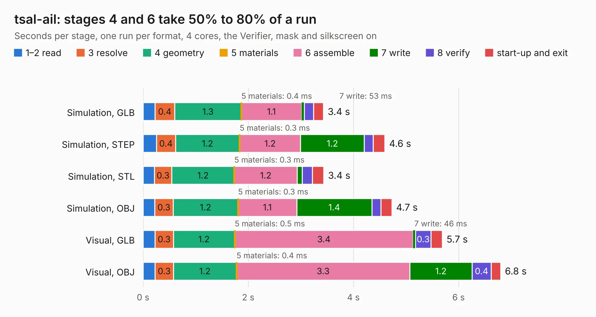

# 2038. tsal-ail

Board 2,038 of the 3,100 of [Corpus Testing](../Corpus-Testing.md), on [Corpus Page 19](../CorpusTestingPages/Corpus-Testing-19.md#2038-tsal-ail).

| Mode and format | 1–2 read | 3 resolve | 4 geometry | 5 materials | 6 assemble | 7 write | 8 verify | start-up and exit | Total |
|---|---:|---:|---:|---:|---:|---:|---:|---:|---:|
| Simulation, GLB | 0.2 | 0.4 | 1.3 | 0.4&nbsp;ms | 1.1 | 53&nbsp;ms | 0.2 | 0.2 | 3.4 |
| Simulation, STEP | 0.3 | 0.4 | 1.2 | 0.3&nbsp;ms | 1.2 | 1.2 | 0.2 | 0.2 | 4.6 |
| Simulation, STL | 0.2 | 0.3 | 1.2 | 0.3&nbsp;ms | 1.2 | 96&nbsp;ms | 0.2 | 0.2 | 3.4 |
| Simulation, OBJ | 0.2 | 0.3 | 1.2 | 0.3&nbsp;ms | 1.1 | 1.4 | 0.2 | 0.2 | 4.7 |
| Visual, GLB | 0.2 | 0.3 | 1.2 | 0.5&nbsp;ms | 3.4 | 46&nbsp;ms | 0.3 | 0.2 | 5.7 |
| Visual, OBJ | 0.2 | 0.3 | 1.2 | 0.4&nbsp;ms | 3.3 | 1.2 | 0.4 | 0.2 | 6.8 |

<table align="center"><tr><td valign="top">

| Board | Repo: [olin-electric-motorsports/olin-electric-motorsports](https://github.com/olin-electric-motorsports/olin-electric-motorsports) Board: `tsal-ail.kicad_pcb` |
|---|---|
| Folder | vehicle / mkvi / hardware / service-section / tsal-ail |
| Complexity | 240&nbsp;/&nbsp;1000 (size&nbsp;160, features&nbsp;80) |
| KESE&nbsp;features | through vias, rounded, trapezoid or chamfered pads, filled zones, stack-up, dielectric εr and tanδ, mask and silkscreen colours |
| Tested | 9th November 2026 |
| Copper&nbsp;layers | 2 |
| File&nbsp;format | KiCad 7 (20221018) |
| Parts,&nbsp;tracks,&nbsp;vias | 48, 289, 64 |
| Triangles,&nbsp;simulation | 363,968 in 112 parts |
| Verifier | PASS in all six runs |

</td><td valign="top">

<table>
<tr><th>File type</th><th>File size</th><th>Peak memory used</th></tr>
<tr><th colspan="3" align="left">Simulation</th></tr>
<tr><td>GLB</td><td align="right">13&nbsp;MB</td><td align="right">267&nbsp;MB</td></tr>
<tr><td>STEP</td><td align="right">62&nbsp;MB</td><td align="right">299&nbsp;MB</td></tr>
<tr><td>STL</td><td align="right">18&nbsp;MB</td><td align="right">267&nbsp;MB</td></tr>
<tr><td>OBJ</td><td align="right">37&nbsp;MB</td><td align="right">308&nbsp;MB</td></tr>
<tr><th colspan="3" align="left">Visual</th></tr>
<tr><td>GLB</td><td align="right">10&nbsp;MB</td><td align="right">305&nbsp;MB</td></tr>
<tr><td>OBJ</td><td align="right">30&nbsp;MB</td><td align="right">306&nbsp;MB</td></tr>
</table>

</td></tr></table>

| Previous | Next |
|:---|---:|
| [2037. precharge_discharge](b2037b_olin-electric-motorsports_precharge-discharge.md) | [2039. CM4_2](b2039b_CM4-NAS-MiniPCIE_CM4-2.md) |
