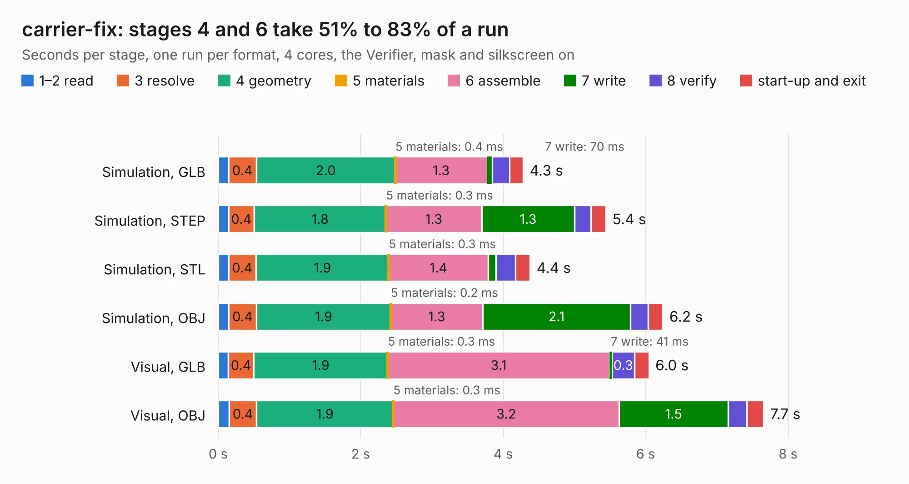

# 2039. carrier-fix

Board 2,039 of the 3,110 of [Corpus Testing](../Corpus-Testing.md), on [Corpus Page 19](../CorpusTestingPages/Corpus-Testing-19.md#2039-carrier-fix).

| Mode and format | 1–2 read | 3 resolve | 4 geometry | 5 materials | 6 assemble | 7 write | 8 verify | start-up and exit | Total |
|---|---:|---:|---:|---:|---:|---:|---:|---:|---:|
| Simulation, GLB | 0.1 | 0.4 | 2.0 | 0.4&nbsp;ms | 1.3 | 70&nbsp;ms | 0.2 | 0.2 | 4.3 |
| Simulation, STEP | 0.1 | 0.4 | 1.8 | 0.3&nbsp;ms | 1.3 | 1.3 | 0.2 | 0.2 | 5.4 |
| Simulation, STL | 0.1 | 0.4 | 1.9 | 0.3&nbsp;ms | 1.4 | 0.1 | 0.3 | 0.2 | 4.4 |
| Simulation, OBJ | 0.1 | 0.4 | 1.9 | 0.2&nbsp;ms | 1.3 | 2.1 | 0.2 | 0.2 | 6.2 |
| Visual, GLB | 0.1 | 0.4 | 1.9 | 0.3&nbsp;ms | 3.1 | 41&nbsp;ms | 0.3 | 0.2 | 6.0 |
| Visual, OBJ | 0.2 | 0.4 | 1.9 | 0.3&nbsp;ms | 3.2 | 1.5 | 0.3 | 0.2 | 7.7 |

<table align="center"><tr><td valign="top">

| Board | Repo: [olin-electric-motorsports/olin-electric-motorsports](https://github.com/olin-electric-motorsports/olin-electric-motorsports) Board: `carrier-fix.kicad_pcb` |
|---|---|
| Folder | vehicle / mkvi / hardware / segment / carrier-fix |
| Complexity | 255&nbsp;/&nbsp;1000 (size&nbsp;125, features&nbsp;130) |
| KESE&nbsp;features | through vias, slotted holes, rounded, trapezoid or chamfered pads, arc tracks, filled zones, curved board outline, stack-up, dielectric εr and tanδ, copper finish, mask and silkscreen colours |
| Tested | 9th November 2026 |
| Copper&nbsp;layers | 2 |
| File&nbsp;format | KiCad 7 (20221018) |
| Parts,&nbsp;tracks,&nbsp;vias | 4, 217, 11 |
| Triangles,&nbsp;simulation | 389,046 in 88 parts |
| Verifier | PASS in all six runs |

</td><td valign="top">

<table>
<tr><th>File type</th><th>File size</th><th>Peak memory used</th></tr>
<tr><th colspan="3" align="left">Simulation</th></tr>
<tr><td>GLB</td><td align="right">13&nbsp;MB</td><td align="right">260&nbsp;MB</td></tr>
<tr><td>STEP</td><td align="right">57&nbsp;MB</td><td align="right">291&nbsp;MB</td></tr>
<tr><td>STL</td><td align="right">19&nbsp;MB</td><td align="right">269&nbsp;MB</td></tr>
<tr><td>OBJ</td><td align="right">41&nbsp;MB</td><td align="right">297&nbsp;MB</td></tr>
<tr><th colspan="3" align="left">Visual</th></tr>
<tr><td>GLB</td><td align="right">9.3&nbsp;MB</td><td align="right">298&nbsp;MB</td></tr>
<tr><td>OBJ</td><td align="right">29&nbsp;MB</td><td align="right">299&nbsp;MB</td></tr>
</table>

</td></tr></table>

| Previous | Next |
|:---|---:|
| [2038. rkh](b2038b_olin-electric-motorsports_rkh.md) | [2040. power](b2040b_olin-electric-motorsports_power.md) |
