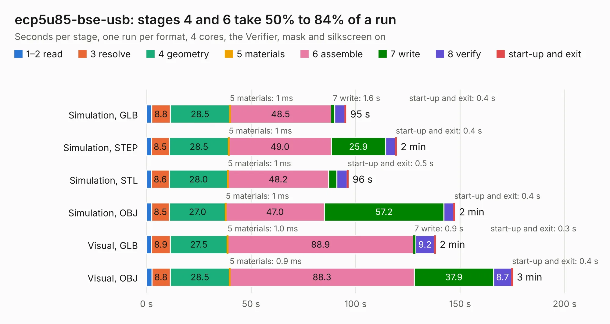

# 2043. ecp5u85-bse-usb

Board 2,043 of the 3,101 of [Corpus Testing](../Corpus-Testing.md), on [Corpus Page 19](../CorpusTestingPages/Corpus-Testing-19.md#2043-ecp5u85-bse-usb).

| Mode and format | 1–2 read | 3 resolve | 4 geometry | 5 materials | 6 assemble | 7 write | 8 verify | start-up and exit | Total |
|---|---:|---:|---:|---:|---:|---:|---:|---:|---:|
| Simulation, GLB | 2.5 | 8.8 | 28.5 | 1&nbsp;ms | 48.5 | 1.6 | 5.0 | 0.4 | 95.4 |
| Simulation, STEP | 2.3 | 8.5 | 28.5 | 1&nbsp;ms | 49.0 | 25.9 | 4.8 | 0.4 | 119.5 |
| Simulation, STL | 2.3 | 8.6 | 28.0 | 1&nbsp;ms | 48.2 | 3.9 | 5.0 | 0.5 | 96.5 |
| Simulation, OBJ | 2.4 | 8.5 | 27.0 | 1&nbsp;ms | 47.0 | 57.2 | 4.7 | 0.4 | 147.4 |
| Visual, GLB | 2.4 | 8.9 | 27.5 | 1.0&nbsp;ms | 88.9 | 0.9 | 9.2 | 0.3 | 138.2 |
| Visual, OBJ | 2.6 | 8.8 | 28.5 | 0.9&nbsp;ms | 88.3 | 37.9 | 8.7 | 0.4 | 175.0 |

<table align="center"><tr><td valign="top">

| Board | Repo: [open-ephys/ECP5U85-BSE-USB](https://github.com/open-ephys/ECP5U85-BSE-USB) Board: `ecp5u85-bse-usb.kicad_pcb` |
|---|---|
| Folder | pcb |
| Complexity | 482&nbsp;/&nbsp;1000 (size&nbsp;317, features&nbsp;165) |
| KESE&nbsp;features | through vias, slotted holes, custom pads, rounded, trapezoid or chamfered pads, drill offsets, arc tracks, filled zones, copper drawings, curved board outline, stack-up, dielectric εr and tanδ, copper finish, mask and silkscreen colours |
| Tested | 9th November 2026 |
| Copper&nbsp;layers | 6 |
| File&nbsp;format | KiCad 6 (20211014) |
| Parts,&nbsp;tracks,&nbsp;vias | 208, 10,088, 1,183 |
| Triangles,&nbsp;simulation | 9,132,082 in 347 parts |
| Verifier | PASS in all six runs |

</td><td valign="top">

<table>
<tr><th>File type</th><th>File size</th><th>Peak memory used</th></tr>
<tr><th colspan="3" align="left">Simulation</th></tr>
<tr><td>GLB</td><td align="right">307&nbsp;MB</td><td align="right">2.3&nbsp;GB</td></tr>
<tr><td>STEP</td><td align="right">1.4&nbsp;GB</td><td align="right">3.3&nbsp;GB</td></tr>
<tr><td>STL</td><td align="right">457&nbsp;MB</td><td align="right">2.3&nbsp;GB</td></tr>
<tr><td>OBJ</td><td align="right">982&nbsp;MB</td><td align="right">5.7&nbsp;GB</td></tr>
<tr><th colspan="3" align="left">Visual</th></tr>
<tr><td>GLB</td><td align="right">194&nbsp;MB</td><td align="right">3.0&nbsp;GB</td></tr>
<tr><td>OBJ</td><td align="right">637&nbsp;MB</td><td align="right">4.0&nbsp;GB</td></tr>
</table>

</td></tr></table>

| Previous | Next |
|:---|---:|
| [2042. oe-commutator-controller](b2042b_commutators_oe-commutator-controller.md) | [2044. ecp5u85-bse-usb_io-tester](b2044b_ECP5U85-BSE-USB-IO-Tester_ecp5u85-bse-usb-io-tester.md) |
