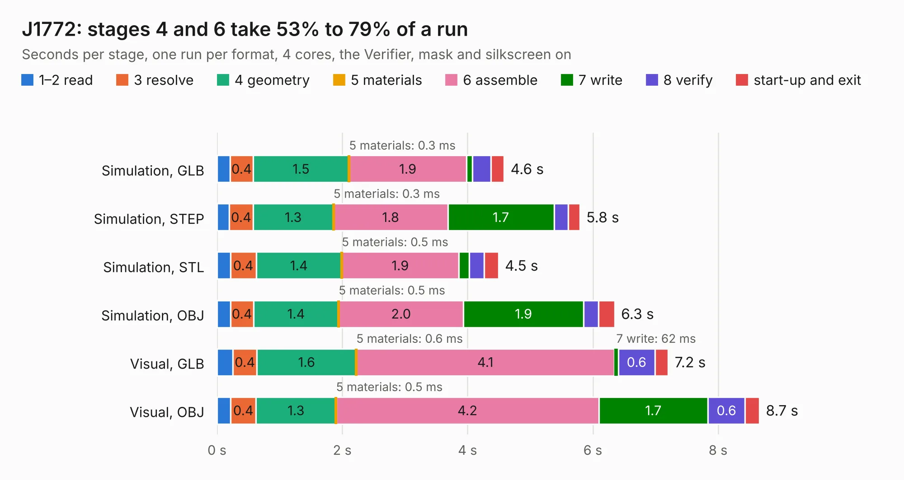

# 2043. J1772

Board 2,043 of the 3,126 of [Corpus Testing](../Corpus-Testing.md), on [Corpus Page 19](../CorpusTestingPages/Corpus-Testing-19.md#2043-j1772).

| Mode and format | 1–2 read | 3 resolve | 4 geometry | 5 materials | 6 assemble | 7 write | 8 verify | start-up and exit | Total |
|---|---:|---:|---:|---:|---:|---:|---:|---:|---:|
| Simulation, GLB | 0.2 | 0.4 | 1.5 | 0.3&nbsp;ms | 1.9 | 95&nbsp;ms | 0.3 | 0.2 | 4.6 |
| Simulation, STEP | 0.2 | 0.4 | 1.3 | 0.3&nbsp;ms | 1.8 | 1.7 | 0.2 | 0.2 | 5.8 |
| Simulation, STL | 0.2 | 0.4 | 1.4 | 0.5&nbsp;ms | 1.9 | 0.2 | 0.2 | 0.2 | 4.5 |
| Simulation, OBJ | 0.2 | 0.4 | 1.4 | 0.5&nbsp;ms | 2.0 | 1.9 | 0.2 | 0.3 | 6.3 |
| Visual, GLB | 0.3 | 0.4 | 1.6 | 0.6&nbsp;ms | 4.1 | 62&nbsp;ms | 0.6 | 0.2 | 7.2 |
| Visual, OBJ | 0.2 | 0.4 | 1.3 | 0.5&nbsp;ms | 4.2 | 1.7 | 0.6 | 0.2 | 8.7 |

<table align="center"><tr><td valign="top">

| Board | Repo: [olin-electric-motorsports/olin-electric-motorsports](https://github.com/olin-electric-motorsports/olin-electric-motorsports) Board: `J1772.kicad_pcb` |
|---|---|
| Folder | vehicle / mkvi / hardware / charging-cart / J1772 |
| Complexity | 287&nbsp;/&nbsp;1000 (size&nbsp;207, features&nbsp;80) |
| KESE&nbsp;features | through vias, rounded, trapezoid or chamfered pads, filled zones, stack-up, dielectric εr and tanδ, mask and silkscreen colours |
| Tested | 9th November 2026 |
| Copper&nbsp;layers | 2 |
| File&nbsp;format | KiCad 6 (20211014) |
| Parts,&nbsp;tracks,&nbsp;vias | 55, 440, 72 |
| Triangles,&nbsp;simulation | 429,352 in 89 parts |
| Verifier | PASS in all six runs |

</td><td valign="top">

<table>
<tr><th>File type</th><th>File size</th><th>Peak memory used</th></tr>
<tr><th colspan="3" align="left">Simulation</th></tr>
<tr><td>GLB</td><td align="right">15&nbsp;MB</td><td align="right">293&nbsp;MB</td></tr>
<tr><td>STEP</td><td align="right">66&nbsp;MB</td><td align="right">339&nbsp;MB</td></tr>
<tr><td>STL</td><td align="right">21&nbsp;MB</td><td align="right">295&nbsp;MB</td></tr>
<tr><td>OBJ</td><td align="right">43&nbsp;MB</td><td align="right">346&nbsp;MB</td></tr>
<tr><th colspan="3" align="left">Visual</th></tr>
<tr><td>GLB</td><td align="right">12&nbsp;MB</td><td align="right">348&nbsp;MB</td></tr>
<tr><td>OBJ</td><td align="right">36&nbsp;MB</td><td align="right">355&nbsp;MB</td></tr>
</table>

</td></tr></table>

| Previous | Next |
|:---|---:|
| [2042. data_acquisition_module](b2042b_olin-electric-motorsports_data-acquisition-module.md) | [2044. J1772_V2](b2044b_olin-electric-motorsports_J1772-V2.md) |
