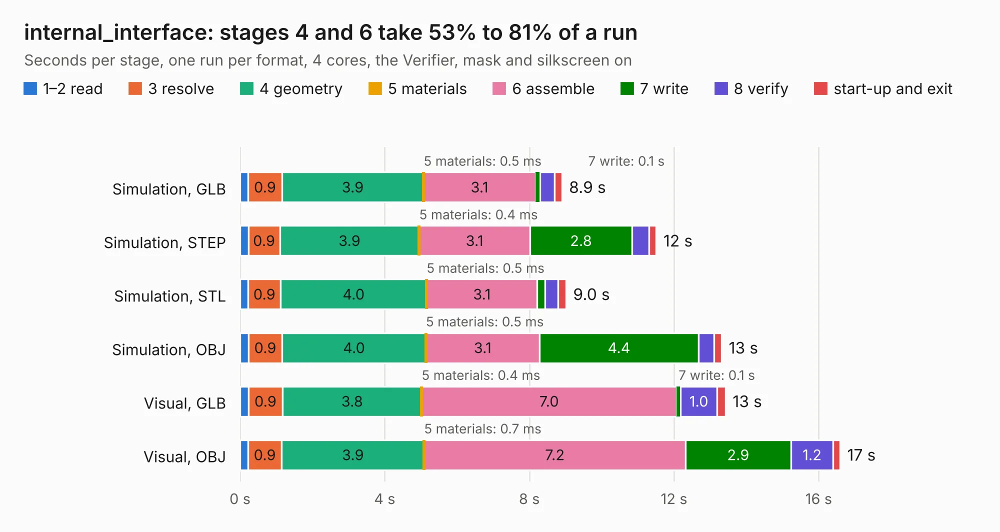

# 2043. internal_interface

Board 2,043 of the 3,139 of [Corpus Testing](../Corpus-Testing.md), on [Corpus Page 19](../CorpusTestingPages/Corpus-Testing-19.md#2043-internal_interface).

| Mode and format | 1–2 read | 3 resolve | 4 geometry | 5 materials | 6 assemble | 7 write | 8 verify | start-up and exit | Total |
|---|---:|---:|---:|---:|---:|---:|---:|---:|---:|
| Simulation, GLB | 0.2 | 0.9 | 3.9 | 0.5&nbsp;ms | 3.1 | 0.1 | 0.4 | 0.2 | 8.9 |
| Simulation, STEP | 0.2 | 0.9 | 3.9 | 0.4&nbsp;ms | 3.1 | 2.8 | 0.5 | 0.2 | 11.5 |
| Simulation, STL | 0.2 | 0.9 | 4.0 | 0.5&nbsp;ms | 3.1 | 0.2 | 0.4 | 0.2 | 9.0 |
| Simulation, OBJ | 0.2 | 0.9 | 4.0 | 0.5&nbsp;ms | 3.1 | 4.4 | 0.4 | 0.2 | 13.3 |
| Visual, GLB | 0.2 | 0.9 | 3.8 | 0.4&nbsp;ms | 7.0 | 0.1 | 1.0 | 0.2 | 13.4 |
| Visual, OBJ | 0.2 | 0.9 | 3.9 | 0.7&nbsp;ms | 7.2 | 2.9 | 1.2 | 0.2 | 16.6 |

<table align="center"><tr><td valign="top">

| Board | Repo: [olin-electric-motorsports/olin-electric-motorsports](https://github.com/olin-electric-motorsports/olin-electric-motorsports) Board: `internal_interface.kicad_pcb` |
|---|---|
| Folder | vehicle / mkv / hardware / service_section / interface / internal |
| Complexity | 227&nbsp;/&nbsp;1000 (size&nbsp;172, features&nbsp;55) |
| KESE&nbsp;features | through vias, rounded, trapezoid or chamfered pads, filled zones, curved board outline |
| Tested | 9th November 2026 |
| Copper&nbsp;layers | 2 |
| File&nbsp;format | KiCad 6 (20211014) |
| Parts,&nbsp;tracks,&nbsp;vias | 23, 1,610, 6 |
| Triangles,&nbsp;simulation | 1,076,704 in 74 parts |
| Verifier | PASS in all six runs |

</td><td valign="top">

<table>
<tr><th>File type</th><th>File size</th><th>Peak memory used</th></tr>
<tr><th colspan="3" align="left">Simulation</th></tr>
<tr><td>GLB</td><td align="right">37&nbsp;MB</td><td align="right">483&nbsp;MB</td></tr>
<tr><td>STEP</td><td align="right">200&nbsp;MB</td><td align="right">548&nbsp;MB</td></tr>
<tr><td>STL</td><td align="right">54&nbsp;MB</td><td align="right">495&nbsp;MB</td></tr>
<tr><td>OBJ</td><td align="right">110&nbsp;MB</td><td align="right">744&nbsp;MB</td></tr>
<tr><th colspan="3" align="left">Visual</th></tr>
<tr><td>GLB</td><td align="right">25&nbsp;MB</td><td align="right">563&nbsp;MB</td></tr>
<tr><td>OBJ</td><td align="right">75&nbsp;MB</td><td align="right">597&nbsp;MB</td></tr>
</table>

</td></tr></table>

| Previous | Next |
|:---|---:|
| [2042. external_interface](b2042b_olin-electric-motorsports_external-interface.md) | [2044. bms_peripheral](b2044b_olin-electric-motorsports_bms-peripheral.md) |
