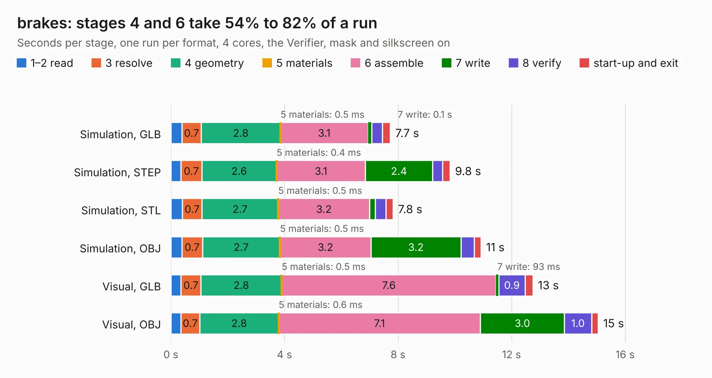

# 2044. brakes

Board 2,044 of the 3,120 of [Corpus Testing](../Corpus-Testing.md), on [Corpus Page 19](../CorpusTestingPages/Corpus-Testing-19.md#2044-brakes).

| Mode and format | 1–2 read | 3 resolve | 4 geometry | 5 materials | 6 assemble | 7 write | 8 verify | start-up and exit | Total |
|---|---:|---:|---:|---:|---:|---:|---:|---:|---:|
| Simulation, GLB | 0.4 | 0.7 | 2.8 | 0.5&nbsp;ms | 3.1 | 0.1 | 0.4 | 0.3 | 7.7 |
| Simulation, STEP | 0.4 | 0.7 | 2.6 | 0.4&nbsp;ms | 3.1 | 2.4 | 0.4 | 0.3 | 9.8 |
| Simulation, STL | 0.4 | 0.7 | 2.7 | 0.5&nbsp;ms | 3.2 | 0.2 | 0.4 | 0.2 | 7.8 |
| Simulation, OBJ | 0.4 | 0.7 | 2.7 | 0.5&nbsp;ms | 3.2 | 3.2 | 0.5 | 0.2 | 10.9 |
| Visual, GLB | 0.4 | 0.7 | 2.8 | 0.5&nbsp;ms | 7.6 | 93&nbsp;ms | 0.9 | 0.3 | 12.8 |
| Visual, OBJ | 0.4 | 0.7 | 2.8 | 0.6&nbsp;ms | 7.1 | 3.0 | 1.0 | 0.2 | 15.0 |

<table align="center"><tr><td valign="top">

| Board | Repo: [olin-electric-motorsports/olin-electric-motorsports](https://github.com/olin-electric-motorsports/olin-electric-motorsports) Board: `brakes.kicad_pcb` |
|---|---|
| Folder | vehicle / mkvi / hardware / nostril / brakes |
| Complexity | 299&nbsp;/&nbsp;1000 (size&nbsp;219, features&nbsp;80) |
| KESE&nbsp;features | through vias, rounded, trapezoid or chamfered pads, filled zones, stack-up, dielectric εr and tanδ, mask and silkscreen colours |
| Tested | 9th November 2026 |
| Copper&nbsp;layers | 2 |
| File&nbsp;format | KiCad 7 (20221018) |
| Parts,&nbsp;tracks,&nbsp;vias | 78, 759, 120 |
| Triangles,&nbsp;simulation | 614,202 in 122 parts |
| Verifier | PASS in all six runs |

</td><td valign="top">

<table>
<tr><th>File type</th><th>File size</th><th>Peak memory used</th></tr>
<tr><th colspan="3" align="left">Simulation</th></tr>
<tr><td>GLB</td><td align="right">22&nbsp;MB</td><td align="right">355&nbsp;MB</td></tr>
<tr><td>STEP</td><td align="right">107&nbsp;MB</td><td align="right">436&nbsp;MB</td></tr>
<tr><td>STL</td><td align="right">31&nbsp;MB</td><td align="right">359&nbsp;MB</td></tr>
<tr><td>OBJ</td><td align="right">63&nbsp;MB</td><td align="right">465&nbsp;MB</td></tr>
<tr><th colspan="3" align="left">Visual</th></tr>
<tr><td>GLB</td><td align="right">18&nbsp;MB</td><td align="right">449&nbsp;MB</td></tr>
<tr><td>OBJ</td><td align="right">55&nbsp;MB</td><td align="right">517&nbsp;MB</td></tr>
</table>

</td></tr></table>

| Previous | Next |
|:---|---:|
| [2043. mock-inverter](b2043b_olin-electric-motorsports_mock-inverter.md) | [2045. dashboard](b2045b_olin-electric-motorsports_vehicle-mkvi-hardware-nostril-dashboard_dashboard.md) |
