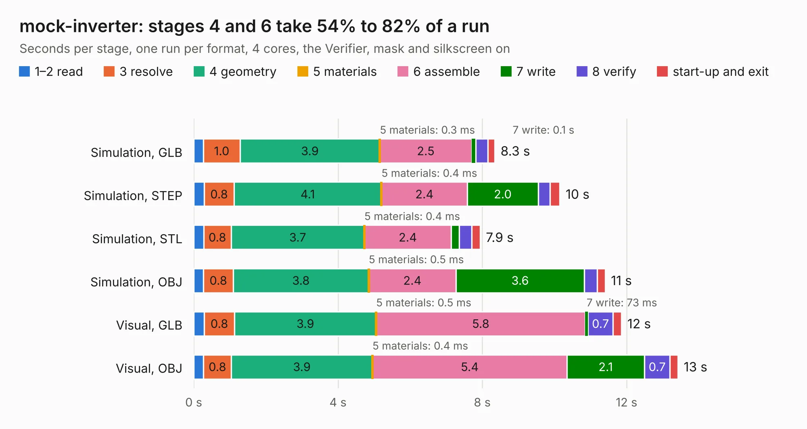

# 2045. mock-inverter

Board 2,045 of the 3,122 of [Corpus Testing](../Corpus-Testing.md), on [Corpus Page 19](../CorpusTestingPages/Corpus-Testing-19.md#2045-mock-inverter).

| Mode and format | 1–2 read | 3 resolve | 4 geometry | 5 materials | 6 assemble | 7 write | 8 verify | start-up and exit | Total |
|---|---:|---:|---:|---:|---:|---:|---:|---:|---:|
| Simulation, GLB | 0.3 | 1.0 | 3.9 | 0.3&nbsp;ms | 2.5 | 0.1 | 0.3 | 0.2 | 8.3 |
| Simulation, STEP | 0.3 | 0.8 | 4.1 | 0.4&nbsp;ms | 2.4 | 2.0 | 0.3 | 0.3 | 10.2 |
| Simulation, STL | 0.3 | 0.8 | 3.7 | 0.4&nbsp;ms | 2.4 | 0.2 | 0.3 | 0.2 | 7.9 |
| Simulation, OBJ | 0.3 | 0.8 | 3.8 | 0.5&nbsp;ms | 2.4 | 3.6 | 0.4 | 0.2 | 11.4 |
| Visual, GLB | 0.3 | 0.8 | 3.9 | 0.5&nbsp;ms | 5.8 | 73&nbsp;ms | 0.7 | 0.2 | 11.9 |
| Visual, OBJ | 0.3 | 0.8 | 3.9 | 0.4&nbsp;ms | 5.4 | 2.1 | 0.7 | 0.2 | 13.4 |

<table align="center"><tr><td valign="top">

| Board | Repo: [olin-electric-motorsports/olin-electric-motorsports](https://github.com/olin-electric-motorsports/olin-electric-motorsports) Board: `mock-inverter.kicad_pcb` |
|---|---|
| Folder | vehicle / mkvi / hardware / mock-inverter |
| Complexity | 311&nbsp;/&nbsp;1000 (size&nbsp;211, features&nbsp;100) |
| KESE&nbsp;features | through vias, rounded, trapezoid or chamfered pads, filled zones, curved board outline, stack-up, dielectric εr and tanδ, copper finish |
| Tested | 9th November 2026 |
| Copper&nbsp;layers | 2 |
| File&nbsp;format | KiCad 7 (20221018) |
| Parts,&nbsp;tracks,&nbsp;vias | 63, 614, 52 |
| Triangles,&nbsp;simulation | 840,918 in 97 parts |
| Verifier | PASS in all six runs |

</td><td valign="top">

<table>
<tr><th>File type</th><th>File size</th><th>Peak memory used</th></tr>
<tr><th colspan="3" align="left">Simulation</th></tr>
<tr><td>GLB</td><td align="right">30&nbsp;MB</td><td align="right">403&nbsp;MB</td></tr>
<tr><td>STEP</td><td align="right">146&nbsp;MB</td><td align="right">466&nbsp;MB</td></tr>
<tr><td>STL</td><td align="right">42&nbsp;MB</td><td align="right">393&nbsp;MB</td></tr>
<tr><td>OBJ</td><td align="right">87&nbsp;MB</td><td align="right">611&nbsp;MB</td></tr>
<tr><th colspan="3" align="left">Visual</th></tr>
<tr><td>GLB</td><td align="right">18&nbsp;MB</td><td align="right">461&nbsp;MB</td></tr>
<tr><td>OBJ</td><td align="right">54&nbsp;MB</td><td align="right">462&nbsp;MB</td></tr>
</table>

</td></tr></table>

| Previous | Next |
|:---|---:|
| [2044. imu_panelized](b2044b_olin-electric-motorsports_imu-panelized.md) | [2046. brakes](b2046b_olin-electric-motorsports_brakes.md) |
