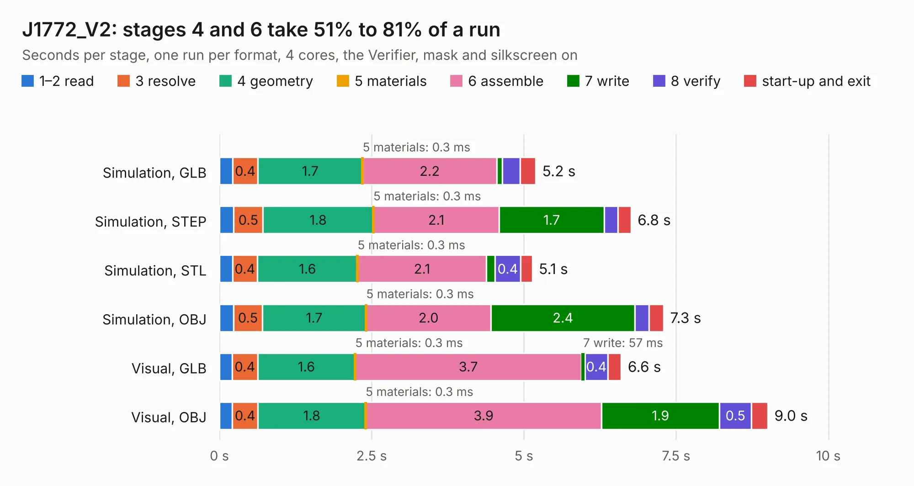

# 2047. J1772_V2

Board 2,047 of the 3,131 of [Corpus Testing](../Corpus-Testing.md), on [Corpus Page 19](../CorpusTestingPages/Corpus-Testing-19.md#2047-j1772_v2).

| Mode and format | 1–2 read | 3 resolve | 4 geometry | 5 materials | 6 assemble | 7 write | 8 verify | start-up and exit | Total |
|---|---:|---:|---:|---:|---:|---:|---:|---:|---:|
| Simulation, GLB | 0.2 | 0.4 | 1.7 | 0.3&nbsp;ms | 2.2 | 91&nbsp;ms | 0.3 | 0.3 | 5.2 |
| Simulation, STEP | 0.2 | 0.5 | 1.8 | 0.3&nbsp;ms | 2.1 | 1.7 | 0.2 | 0.2 | 6.8 |
| Simulation, STL | 0.2 | 0.4 | 1.6 | 0.3&nbsp;ms | 2.1 | 0.1 | 0.4 | 0.2 | 5.1 |
| Simulation, OBJ | 0.2 | 0.5 | 1.7 | 0.3&nbsp;ms | 2.0 | 2.4 | 0.2 | 0.2 | 7.3 |
| Visual, GLB | 0.2 | 0.4 | 1.6 | 0.3&nbsp;ms | 3.7 | 57&nbsp;ms | 0.4 | 0.2 | 6.6 |
| Visual, OBJ | 0.2 | 0.4 | 1.8 | 0.3&nbsp;ms | 3.9 | 1.9 | 0.5 | 0.3 | 9.0 |

<table align="center"><tr><td valign="top">

| Board | Repo: [olin-electric-motorsports/olin-electric-motorsports](https://github.com/olin-electric-motorsports/olin-electric-motorsports) Board: `J1772_V2.kicad_pcb` |
|---|---|
| Folder | vehicle / mkvi / hardware / charging-cart / J1772 |
| Complexity | 250&nbsp;/&nbsp;1000 (size&nbsp;205, features&nbsp;45) |
| KESE&nbsp;features | through vias, rounded, trapezoid or chamfered pads, filled zones |
| Tested | 9th November 2026 |
| Copper&nbsp;layers | 2 |
| File&nbsp;format | KiCad 7 (20221018) |
| Parts,&nbsp;tracks,&nbsp;vias | 53, 433, 54 |
| Triangles,&nbsp;simulation | 426,424 in 80 parts |
| Verifier | PASS in all six runs |

</td><td valign="top">

<table>
<tr><th>File type</th><th>File size</th><th>Peak memory used</th></tr>
<tr><th colspan="3" align="left">Simulation</th></tr>
<tr><td>GLB</td><td align="right">15&nbsp;MB</td><td align="right">289&nbsp;MB</td></tr>
<tr><td>STEP</td><td align="right">63&nbsp;MB</td><td align="right">328&nbsp;MB</td></tr>
<tr><td>STL</td><td align="right">21&nbsp;MB</td><td align="right">286&nbsp;MB</td></tr>
<tr><td>OBJ</td><td align="right">43&nbsp;MB</td><td align="right">349&nbsp;MB</td></tr>
<tr><th colspan="3" align="left">Visual</th></tr>
<tr><td>GLB</td><td align="right">12&nbsp;MB</td><td align="right">379&nbsp;MB</td></tr>
<tr><td>OBJ</td><td align="right">35&nbsp;MB</td><td align="right">337&nbsp;MB</td></tr>
</table>

</td></tr></table>

| Previous | Next |
|:---|---:|
| [2046. J1772](b2046b_olin-electric-motorsports_J1772.md) | [2048. cooling-board](b2048b_olin-electric-motorsports_cooling-board.md) |
