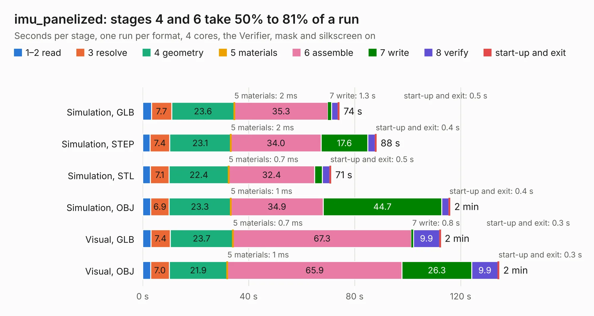

# 2049. imu_panelized

Board 2,049 of the 3,130 of [Corpus Testing](../Corpus-Testing.md), on [Corpus Page 19](../CorpusTestingPages/Corpus-Testing-19.md#2049-imu_panelized).

| Mode and format | 1–2 read | 3 resolve | 4 geometry | 5 materials | 6 assemble | 7 write | 8 verify | start-up and exit | Total |
|---|---:|---:|---:|---:|---:|---:|---:|---:|---:|
| Simulation, GLB | 3.3 | 7.7 | 23.6 | 2&nbsp;ms | 35.3 | 1.3 | 2.5 | 0.5 | 74.2 |
| Simulation, STEP | 2.8 | 7.4 | 23.1 | 2&nbsp;ms | 34.0 | 17.6 | 2.8 | 0.4 | 88.2 |
| Simulation, STL | 2.9 | 7.1 | 22.4 | 0.7&nbsp;ms | 32.4 | 2.9 | 2.8 | 0.5 | 71.1 |
| Simulation, OBJ | 3.1 | 6.9 | 23.3 | 1&nbsp;ms | 34.9 | 44.7 | 2.7 | 0.4 | 116.0 |
| Visual, GLB | 3.1 | 7.4 | 23.7 | 0.7&nbsp;ms | 67.3 | 0.8 | 9.9 | 0.3 | 112.4 |
| Visual, OBJ | 3.0 | 7.0 | 21.9 | 1&nbsp;ms | 65.9 | 26.3 | 9.9 | 0.3 | 134.5 |

<table align="center"><tr><td valign="top">

| Board | Repo: [olin-electric-motorsports/olin-electric-motorsports](https://github.com/olin-electric-motorsports/olin-electric-motorsports) Board: `imu_panelized.kicad_pcb` |
|---|---|
| Folder | vehicle / mkvi / hardware / imu |
| Complexity | 458&nbsp;/&nbsp;1000 (size&nbsp;318, features&nbsp;140) |
| KESE&nbsp;features | through vias, custom pads, rounded, trapezoid or chamfered pads, arc tracks, filled zones, copper drawings, curved board outline, stack-up, dielectric εr and tanδ, copper finish |
| Tested | 9th November 2026 |
| Copper&nbsp;layers | 4 |
| File&nbsp;format | KiCad 7 (20221018) |
| Parts,&nbsp;tracks,&nbsp;vias | 588, 6,144, 816 |
| Triangles,&nbsp;simulation | 7,414,440 in 72 parts |
| Note | panel |
| Verifier | PASS in all six runs |

</td><td valign="top">

<table>
<tr><th>File type</th><th>File size</th><th>Peak memory used</th></tr>
<tr><th colspan="3" align="left">Simulation</th></tr>
<tr><td>GLB</td><td align="right">255&nbsp;MB</td><td align="right">2.4&nbsp;GB</td></tr>
<tr><td>STEP</td><td align="right">1.2&nbsp;GB</td><td align="right">2.9&nbsp;GB</td></tr>
<tr><td>STL</td><td align="right">371&nbsp;MB</td><td align="right">2.4&nbsp;GB</td></tr>
<tr><td>OBJ</td><td align="right">819&nbsp;MB</td><td align="right">4.9&nbsp;GB</td></tr>
<tr><th colspan="3" align="left">Visual</th></tr>
<tr><td>GLB</td><td align="right">175&nbsp;MB</td><td align="right">2.8&nbsp;GB</td></tr>
<tr><td>OBJ</td><td align="right">566&nbsp;MB</td><td align="right">3.7&nbsp;GB</td></tr>
</table>

</td></tr></table>

| Previous | Next |
|:---|---:|
| [2048. imu](b2048b_olin-electric-motorsports_vehicle-mkvi-hardware-imu_imu.md) | [2050. mock-inverter](b2050b_olin-electric-motorsports_mock-inverter.md) |
