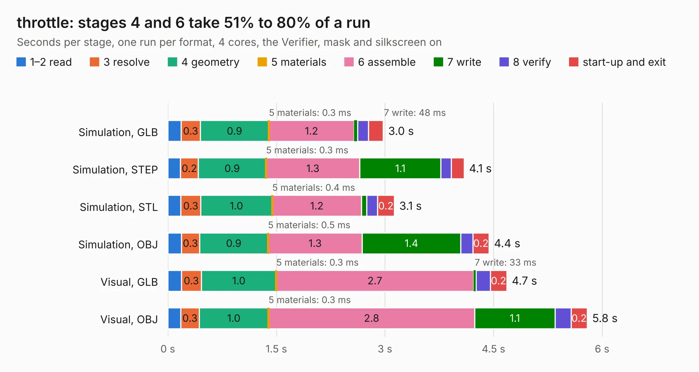

# 2049. throttle

Board 2,049 of the 3,122 of [Corpus Testing](../Corpus-Testing.md), on [Corpus Page 19](../CorpusTestingPages/Corpus-Testing-19.md#2049-throttle).

| Mode and format | 1–2 read | 3 resolve | 4 geometry | 5 materials | 6 assemble | 7 write | 8 verify | start-up and exit | Total |
|---|---:|---:|---:|---:|---:|---:|---:|---:|---:|
| Simulation, GLB | 0.2 | 0.3 | 0.9 | 0.3&nbsp;ms | 1.2 | 48&nbsp;ms | 0.1 | 0.2 | 3.0 |
| Simulation, STEP | 0.2 | 0.2 | 0.9 | 0.3&nbsp;ms | 1.3 | 1.1 | 0.1 | 0.2 | 4.1 |
| Simulation, STL | 0.2 | 0.3 | 1.0 | 0.4&nbsp;ms | 1.2 | 71&nbsp;ms | 0.2 | 0.2 | 3.1 |
| Simulation, OBJ | 0.2 | 0.3 | 0.9 | 0.5&nbsp;ms | 1.3 | 1.4 | 0.2 | 0.2 | 4.4 |
| Visual, GLB | 0.2 | 0.3 | 1.0 | 0.3&nbsp;ms | 2.7 | 33&nbsp;ms | 0.2 | 0.2 | 4.7 |
| Visual, OBJ | 0.2 | 0.3 | 1.0 | 0.3&nbsp;ms | 2.8 | 1.1 | 0.2 | 0.2 | 5.8 |

<table align="center"><tr><td valign="top">

| Board | Repo: [olin-electric-motorsports/olin-electric-motorsports](https://github.com/olin-electric-motorsports/olin-electric-motorsports) Board: `throttle.kicad_pcb` |
|---|---|
| Folder | vehicle / mkvi / hardware / nostril / throttle |
| Complexity | 323&nbsp;/&nbsp;1000 (size&nbsp;193, features&nbsp;130) |
| KESE&nbsp;features | through vias, rounded, trapezoid or chamfered pads, filled zones, curved board outline, stack-up, dielectric εr and tanδ, copper finish, mask and silkscreen colours, castellated pads |
| Tested | 9th November 2026 |
| Copper&nbsp;layers | 2 |
| File&nbsp;format | KiCad 7 (20221018) |
| Parts,&nbsp;tracks,&nbsp;vias | 31, 303, 39 |
| Triangles,&nbsp;simulation | 263,092 in 109 parts |
| Verifier | PASS in all six runs |

</td><td valign="top">

<table>
<tr><th>File type</th><th>File size</th><th>Peak memory used</th></tr>
<tr><th colspan="3" align="left">Simulation</th></tr>
<tr><td>GLB</td><td align="right">9.3&nbsp;MB</td><td align="right">237&nbsp;MB</td></tr>
<tr><td>STEP</td><td align="right">47&nbsp;MB</td><td align="right">267&nbsp;MB</td></tr>
<tr><td>STL</td><td align="right">13&nbsp;MB</td><td align="right">241&nbsp;MB</td></tr>
<tr><td>OBJ</td><td align="right">27&nbsp;MB</td><td align="right">238&nbsp;MB</td></tr>
<tr><th colspan="3" align="left">Visual</th></tr>
<tr><td>GLB</td><td align="right">7.4&nbsp;MB</td><td align="right">247&nbsp;MB</td></tr>
<tr><td>OBJ</td><td align="right">22&nbsp;MB</td><td align="right">248&nbsp;MB</td></tr>
</table>

</td></tr></table>

| Previous | Next |
|:---|---:|
| [2048. nostril](b2048b_olin-electric-motorsports_nostril.md) | [2050. rkh](b2050b_olin-electric-motorsports_rkh.md) |
