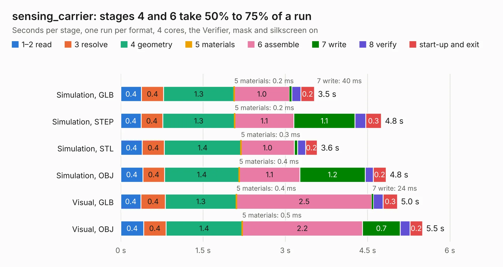

# 2051. sensing_carrier

Board 2,051 of the 3,119 of [Corpus Testing](../Corpus-Testing.md), on [Corpus Page 19](../CorpusTestingPages/Corpus-Testing-19.md#2051-sensing_carrier).

| Mode and format | 1–2 read | 3 resolve | 4 geometry | 5 materials | 6 assemble | 7 write | 8 verify | start-up and exit | Total |
|---|---:|---:|---:|---:|---:|---:|---:|---:|---:|
| Simulation, GLB | 0.4 | 0.4 | 1.3 | 0.2&nbsp;ms | 1.0 | 40&nbsp;ms | 0.2 | 0.2 | 3.5 |
| Simulation, STEP | 0.4 | 0.4 | 1.3 | 0.2&nbsp;ms | 1.1 | 1.1 | 0.2 | 0.3 | 4.8 |
| Simulation, STL | 0.4 | 0.4 | 1.4 | 0.3&nbsp;ms | 1.0 | 61&nbsp;ms | 0.1 | 0.2 | 3.6 |
| Simulation, OBJ | 0.4 | 0.4 | 1.4 | 0.4&nbsp;ms | 1.1 | 1.2 | 0.1 | 0.2 | 4.8 |
| Visual, GLB | 0.4 | 0.4 | 1.3 | 0.4&nbsp;ms | 2.5 | 24&nbsp;ms | 0.2 | 0.3 | 5.0 |
| Visual, OBJ | 0.4 | 0.4 | 1.4 | 0.5&nbsp;ms | 2.2 | 0.7 | 0.2 | 0.2 | 5.5 |

<table align="center"><tr><td valign="top">

| Board | Repo: [olin-electric-motorsports/olin-electric-motorsports](https://github.com/olin-electric-motorsports/olin-electric-motorsports) Board: `sensing_carrier.kicad_pcb` |
|---|---|
| Folder | vehicle / mkvi / hardware / sensing / sensing_carrier |
| Complexity | 242&nbsp;/&nbsp;1000 (size&nbsp;137, features&nbsp;105) |
| KESE&nbsp;features | through vias, slotted holes, rounded, trapezoid or chamfered pads, filled zones, copper text, curved board outline, stack-up, dielectric εr and tanδ |
| Tested | 9th November 2026 |
| Copper&nbsp;layers | 2 |
| File&nbsp;format | KiCad 6 (20211014) |
| Parts,&nbsp;tracks,&nbsp;vias | 19, 157, 20 |
| Triangles,&nbsp;simulation | 192,646 in 86 parts |
| Verifier | PASS in all six runs |

</td><td valign="top">

<table>
<tr><th>File type</th><th>File size</th><th>Peak memory used</th></tr>
<tr><th colspan="3" align="left">Simulation</th></tr>
<tr><td>GLB</td><td align="right">7.0&nbsp;MB</td><td align="right">226&nbsp;MB</td></tr>
<tr><td>STEP</td><td align="right">31&nbsp;MB</td><td align="right">229&nbsp;MB</td></tr>
<tr><td>STL</td><td align="right">9.6&nbsp;MB</td><td align="right">231&nbsp;MB</td></tr>
<tr><td>OBJ</td><td align="right">20&nbsp;MB</td><td align="right">232&nbsp;MB</td></tr>
<tr><th colspan="3" align="left">Visual</th></tr>
<tr><td>GLB</td><td align="right">4.4&nbsp;MB</td><td align="right">183&nbsp;MB</td></tr>
<tr><td>OBJ</td><td align="right">12&nbsp;MB</td><td align="right">188&nbsp;MB</td></tr>
</table>

</td></tr></table>

| Previous | Next |
|:---|---:|
| [2050. thermistors](b2050b_olin-electric-motorsports_thermistors.md) | [2052. sensing_controller](b2052b_olin-electric-motorsports_sensing-controller.md) |
