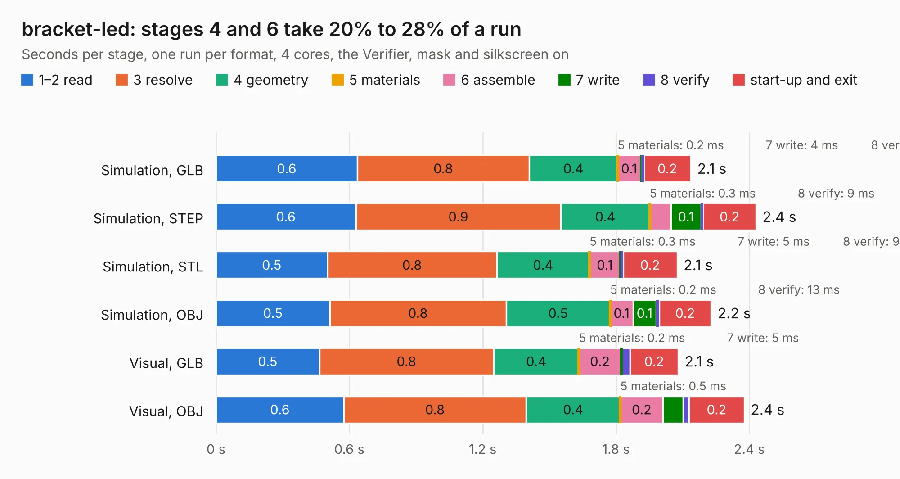

# 2051. bracket-led

Board 2,051 of the 3,101 of [Corpus Testing](../Corpus-Testing.md), on [Corpus Page 19](../CorpusTestingPages/Corpus-Testing-19.md#2051-bracket-led).

| Mode and format | 1–2 read | 3 resolve | 4 geometry | 5 materials | 6 assemble | 7 write | 8 verify | start-up and exit | Total |
|---|---:|---:|---:|---:|---:|---:|---:|---:|---:|
| Simulation, GLB | 0.6 | 0.8 | 0.4 | 0.2&nbsp;ms | 0.1 | 4&nbsp;ms | 10&nbsp;ms | 0.2 | 2.1 |
| Simulation, STEP | 0.6 | 0.9 | 0.4 | 0.3&nbsp;ms | 95&nbsp;ms | 0.1 | 9&nbsp;ms | 0.2 | 2.4 |
| Simulation, STL | 0.5 | 0.8 | 0.4 | 0.3&nbsp;ms | 0.1 | 5&nbsp;ms | 9&nbsp;ms | 0.2 | 2.1 |
| Simulation, OBJ | 0.5 | 0.8 | 0.5 | 0.2&nbsp;ms | 0.1 | 0.1 | 13&nbsp;ms | 0.2 | 2.2 |
| Visual, GLB | 0.5 | 0.8 | 0.4 | 0.2&nbsp;ms | 0.2 | 5&nbsp;ms | 37&nbsp;ms | 0.2 | 2.1 |
| Visual, OBJ | 0.6 | 0.8 | 0.4 | 0.5&nbsp;ms | 0.2 | 90&nbsp;ms | 27&nbsp;ms | 0.2 | 2.4 |

<table align="center"><tr><td valign="top">

| Board | Repo: [open-ephys/onix-fmc-host](https://github.com/open-ephys/onix-fmc-host) Board: `bracket-led.kicad_pcb` |
|---|---|
| Folder | mechanical / pcie-bracket-metal / bracket-led-pcb |
| Complexity | 268&nbsp;/&nbsp;1000 (size&nbsp;193, features&nbsp;75) |
| KESE&nbsp;features | through vias, rounded, trapezoid or chamfered pads, filled zones, stack-up, dielectric εr and tanδ |
| Tested | 9th November 2026 |
| Copper&nbsp;layers | 2 |
| File&nbsp;format | KiCad 7 (20221018) |
| Parts,&nbsp;tracks,&nbsp;vias | 120, 936, 336 |
| Triangles,&nbsp;simulation | 16,480 in 7 parts |
| Verifier | PASS in all six runs |

</td><td valign="top">

<table>
<tr><th>File type</th><th>File size</th><th>Peak memory used</th></tr>
<tr><th colspan="3" align="left">Simulation</th></tr>
<tr><td>GLB</td><td align="right">620&nbsp;kB</td><td align="right">108&nbsp;MB</td></tr>
<tr><td>STEP</td><td align="right">2.9&nbsp;MB</td><td align="right">108&nbsp;MB</td></tr>
<tr><td>STL</td><td align="right">825&nbsp;kB</td><td align="right">107&nbsp;MB</td></tr>
<tr><td>OBJ</td><td align="right">1.6&nbsp;MB</td><td align="right">108&nbsp;MB</td></tr>
<tr><th colspan="3" align="left">Visual</th></tr>
<tr><td>GLB</td><td align="right">561&nbsp;kB</td><td align="right">107&nbsp;MB</td></tr>
<tr><td>OBJ</td><td align="right">1.5&nbsp;MB</td><td align="right">107&nbsp;MB</td></tr>
</table>

</td></tr></table>

| Previous | Next |
|:---|---:|
| [2050. bracket-led](b2050b_onix-fmc-host_bracket-led-source_bracket-led.md) | [2052. fmc-host](b2052b_onix-fmc-host_fmc-host.md) |
