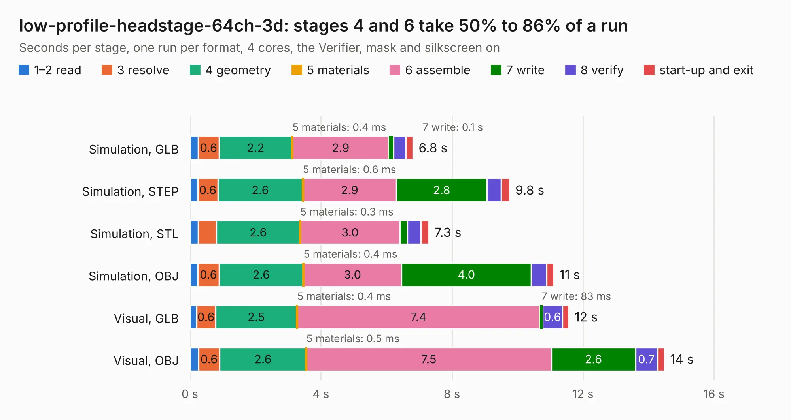

# 2052. low-profile-headstage-64ch-3d

Board 2,052 of the 3,107 of [Corpus Testing](../Corpus-Testing.md), on [Corpus Page 19](../CorpusTestingPages/Corpus-Testing-19.md#2052-low-profile-headstage-64ch-3d).

| Mode and format | 1–2 read | 3 resolve | 4 geometry | 5 materials | 6 assemble | 7 write | 8 verify | start-up and exit | Total |
|---|---:|---:|---:|---:|---:|---:|---:|---:|---:|
| Simulation, GLB | 0.3 | 0.6 | 2.2 | 0.4&nbsp;ms | 2.9 | 0.1 | 0.4 | 0.2 | 6.8 |
| Simulation, STEP | 0.2 | 0.6 | 2.6 | 0.6&nbsp;ms | 2.9 | 2.8 | 0.4 | 0.3 | 9.8 |
| Simulation, STL | 0.3 | 0.6 | 2.6 | 0.3&nbsp;ms | 3.0 | 0.2 | 0.4 | 0.2 | 7.3 |
| Simulation, OBJ | 0.2 | 0.6 | 2.6 | 0.4&nbsp;ms | 3.0 | 4.0 | 0.5 | 0.2 | 11.1 |
| Visual, GLB | 0.2 | 0.6 | 2.5 | 0.4&nbsp;ms | 7.4 | 83&nbsp;ms | 0.6 | 0.2 | 11.6 |
| Visual, OBJ | 0.3 | 0.6 | 2.6 | 0.5&nbsp;ms | 7.5 | 2.6 | 0.7 | 0.2 | 14.5 |

<table align="center"><tr><td valign="top">

| Board | Repo: [open-ephys/low-profile-headstage-64ch-3d](https://github.com/open-ephys/low-profile-headstage-64ch-3d) Board: `low-profile-headstage-64ch-3d.kicad_pcb` |
|---|---|
| Folder | pcb |
| Complexity | 333&nbsp;/&nbsp;1000 (size&nbsp;243, features&nbsp;90) |
| KESE&nbsp;features | through vias, rounded, trapezoid or chamfered pads, filled zones, curved board outline, stack-up, dielectric εr and tanδ, mask and silkscreen colours |
| Tested | 9th November 2026 |
| Copper&nbsp;layers | 4 |
| File&nbsp;format | KiCad 10 (20260206) |
| Parts,&nbsp;tracks,&nbsp;vias | 38, 671, 95 |
| Triangles,&nbsp;simulation | 802,046 in 124 parts |
| Verifier | PASS in all six runs |

</td><td valign="top">

<table>
<tr><th>File type</th><th>File size</th><th>Peak memory used</th></tr>
<tr><th colspan="3" align="left">Simulation</th></tr>
<tr><td>GLB</td><td align="right">28&nbsp;MB</td><td align="right">405&nbsp;MB</td></tr>
<tr><td>STEP</td><td align="right">155&nbsp;MB</td><td align="right">492&nbsp;MB</td></tr>
<tr><td>STL</td><td align="right">40&nbsp;MB</td><td align="right">401&nbsp;MB</td></tr>
<tr><td>OBJ</td><td align="right">85&nbsp;MB</td><td align="right">601&nbsp;MB</td></tr>
<tr><th colspan="3" align="left">Visual</th></tr>
<tr><td>GLB</td><td align="right">18&nbsp;MB</td><td align="right">524&nbsp;MB</td></tr>
<tr><td>OBJ</td><td align="right">54&nbsp;MB</td><td align="right">511&nbsp;MB</td></tr>
</table>

</td></tr></table>

| Previous | Next |
|:---|---:|
| [2051. ephys-test-board](b2051b_ephys-test-board_ephys-test-board.md) | [2053. acquisition-board](b2053b_oe-acquisition-board-gen3_acquisition-board.md) |
