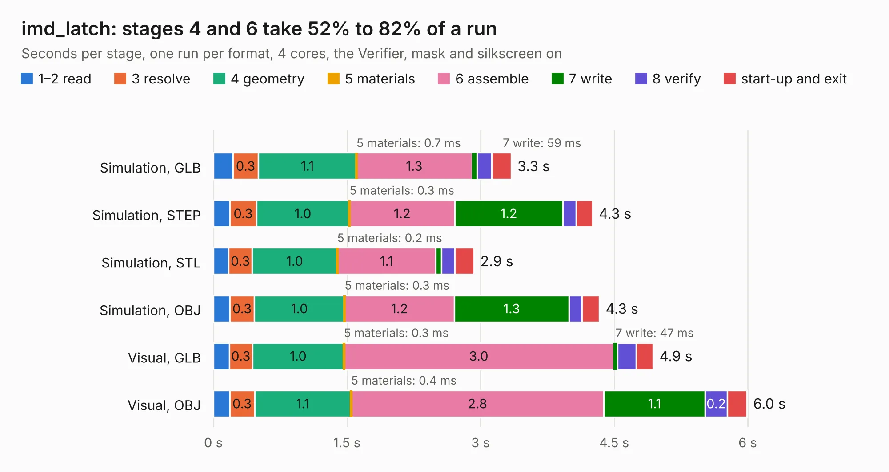

# 2052. imd_latch

Board 2,052 of the 3,117 of [Corpus Testing](../Corpus-Testing.md), on [Corpus Page 19](../CorpusTestingPages/Corpus-Testing-19.md#2052-imd_latch).

| Mode and format | 1–2 read | 3 resolve | 4 geometry | 5 materials | 6 assemble | 7 write | 8 verify | start-up and exit | Total |
|---|---:|---:|---:|---:|---:|---:|---:|---:|---:|
| Simulation, GLB | 0.2 | 0.3 | 1.1 | 0.7&nbsp;ms | 1.3 | 59&nbsp;ms | 0.2 | 0.2 | 3.3 |
| Simulation, STEP | 0.2 | 0.3 | 1.0 | 0.3&nbsp;ms | 1.2 | 1.2 | 0.1 | 0.2 | 4.3 |
| Simulation, STL | 0.2 | 0.3 | 1.0 | 0.2&nbsp;ms | 1.1 | 65&nbsp;ms | 0.1 | 0.2 | 2.9 |
| Simulation, OBJ | 0.2 | 0.3 | 1.0 | 0.3&nbsp;ms | 1.2 | 1.3 | 0.1 | 0.2 | 4.3 |
| Visual, GLB | 0.2 | 0.3 | 1.0 | 0.3&nbsp;ms | 3.0 | 47&nbsp;ms | 0.2 | 0.2 | 4.9 |
| Visual, OBJ | 0.2 | 0.3 | 1.1 | 0.4&nbsp;ms | 2.8 | 1.1 | 0.2 | 0.2 | 6.0 |

<table align="center"><tr><td valign="top">

| Board | Repo: [olin-electric-motorsports/olin-electric-motorsports](https://github.com/olin-electric-motorsports/olin-electric-motorsports) Board: `imd_latch.kicad_pcb` |
|---|---|
| Folder | vehicle / mkvi / hardware / service-section / imd_latch |
| Complexity | 227&nbsp;/&nbsp;1000 (size&nbsp;147, features&nbsp;80) |
| KESE&nbsp;features | through vias, rounded, trapezoid or chamfered pads, filled zones, stack-up, dielectric εr and tanδ, mask and silkscreen colours |
| Tested | 9th November 2026 |
| Copper&nbsp;layers | 2 |
| File&nbsp;format | KiCad 7 (20221018) |
| Parts,&nbsp;tracks,&nbsp;vias | 26, 211, 38 |
| Triangles,&nbsp;simulation | 250,446 in 99 parts |
| Verifier | PASS in all six runs |

</td><td valign="top">

<table>
<tr><th>File type</th><th>File size</th><th>Peak memory used</th></tr>
<tr><th colspan="3" align="left">Simulation</th></tr>
<tr><td>GLB</td><td align="right">9.1&nbsp;MB</td><td align="right">231&nbsp;MB</td></tr>
<tr><td>STEP</td><td align="right">46&nbsp;MB</td><td align="right">263&nbsp;MB</td></tr>
<tr><td>STL</td><td align="right">13&nbsp;MB</td><td align="right">230&nbsp;MB</td></tr>
<tr><td>OBJ</td><td align="right">26&nbsp;MB</td><td align="right">231&nbsp;MB</td></tr>
<tr><th colspan="3" align="left">Visual</th></tr>
<tr><td>GLB</td><td align="right">7.4&nbsp;MB</td><td align="right">249&nbsp;MB</td></tr>
<tr><td>OBJ</td><td align="right">21&nbsp;MB</td><td align="right">251&nbsp;MB</td></tr>
</table>

</td></tr></table>

| Previous | Next |
|:---|---:|
| [2051. AIRs](b2051b_olin-electric-motorsports_AIRs.md) | [2053. motherboard](b2053b_olin-electric-motorsports_motherboard.md) |
