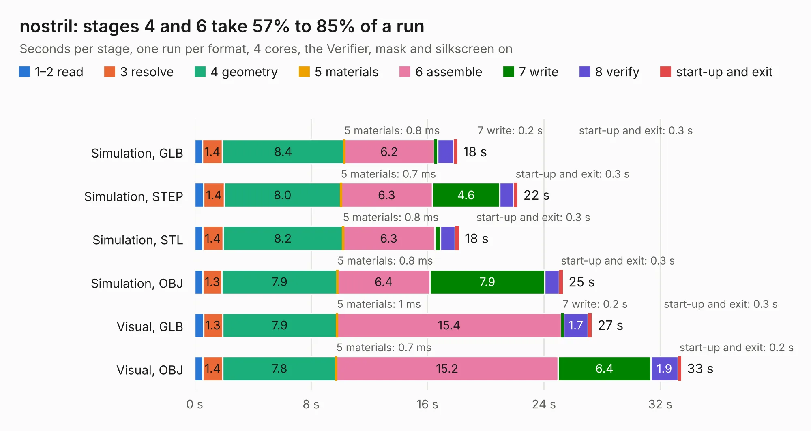

# 2052. nostril

Board 2,052 of the 3,129 of [Corpus Testing](../Corpus-Testing.md), on [Corpus Page 19](../CorpusTestingPages/Corpus-Testing-19.md#2052-nostril).

| Mode and format | 1–2 read | 3 resolve | 4 geometry | 5 materials | 6 assemble | 7 write | 8 verify | start-up and exit | Total |
|---|---:|---:|---:|---:|---:|---:|---:|---:|---:|
| Simulation, GLB | 0.5 | 1.4 | 8.4 | 0.8&nbsp;ms | 6.2 | 0.2 | 1.1 | 0.3 | 18.1 |
| Simulation, STEP | 0.6 | 1.4 | 8.0 | 0.7&nbsp;ms | 6.3 | 4.6 | 1.0 | 0.3 | 22.2 |
| Simulation, STL | 0.5 | 1.4 | 8.2 | 0.8&nbsp;ms | 6.3 | 0.4 | 1.0 | 0.3 | 18.2 |
| Simulation, OBJ | 0.6 | 1.3 | 7.9 | 0.8&nbsp;ms | 6.4 | 7.9 | 1.0 | 0.3 | 25.3 |
| Visual, GLB | 0.6 | 1.3 | 7.9 | 1&nbsp;ms | 15.4 | 0.2 | 1.7 | 0.3 | 27.3 |
| Visual, OBJ | 0.5 | 1.4 | 7.8 | 0.7&nbsp;ms | 15.2 | 6.4 | 1.9 | 0.2 | 33.4 |

<table align="center"><tr><td valign="top">

| Board | Repo: [olin-electric-motorsports/olin-electric-motorsports](https://github.com/olin-electric-motorsports/olin-electric-motorsports) Board: `nostril.kicad_pcb` |
|---|---|
| Folder | vehicle / mkvi / hardware / nostril / motherboard |
| Complexity | 308&nbsp;/&nbsp;1000 (size&nbsp;168, features&nbsp;140) |
| KESE&nbsp;features | through vias, slotted holes, custom pads, rounded, trapezoid or chamfered pads, filled zones, copper drawings, curved board outline, stack-up, dielectric εr and tanδ, copper finish, mask and silkscreen colours |
| Tested | 9th November 2026 |
| Copper&nbsp;layers | 2 |
| File&nbsp;format | KiCad 7 (20221018) |
| Parts,&nbsp;tracks,&nbsp;vias | 30, 591, 164 |
| Triangles,&nbsp;simulation | 1,288,630 in 284 parts |
| Verifier | PASS in all six runs |

</td><td valign="top">

<table>
<tr><th>File type</th><th>File size</th><th>Peak memory used</th></tr>
<tr><th colspan="3" align="left">Simulation</th></tr>
<tr><td>GLB</td><td align="right">45&nbsp;MB</td><td align="right">553&nbsp;MB</td></tr>
<tr><td>STEP</td><td align="right">229&nbsp;MB</td><td align="right">679&nbsp;MB</td></tr>
<tr><td>STL</td><td align="right">64&nbsp;MB</td><td align="right">559&nbsp;MB</td></tr>
<tr><td>OBJ</td><td align="right">134&nbsp;MB</td><td align="right">888&nbsp;MB</td></tr>
<tr><th colspan="3" align="left">Visual</th></tr>
<tr><td>GLB</td><td align="right">36&nbsp;MB</td><td align="right">711&nbsp;MB</td></tr>
<tr><td>OBJ</td><td align="right">108&nbsp;MB</td><td align="right">790&nbsp;MB</td></tr>
</table>

</td></tr></table>

| Previous | Next |
|:---|---:|
| [2051. dashboard](b2051b_olin-electric-motorsports_vehicle-mkvi-hardware-nostril-dashboard_dashboard.md) | [2053. throttle](b2053b_olin-electric-motorsports_vehicle-mkvi-hardware-nostril-throttle_throttle.md) |
